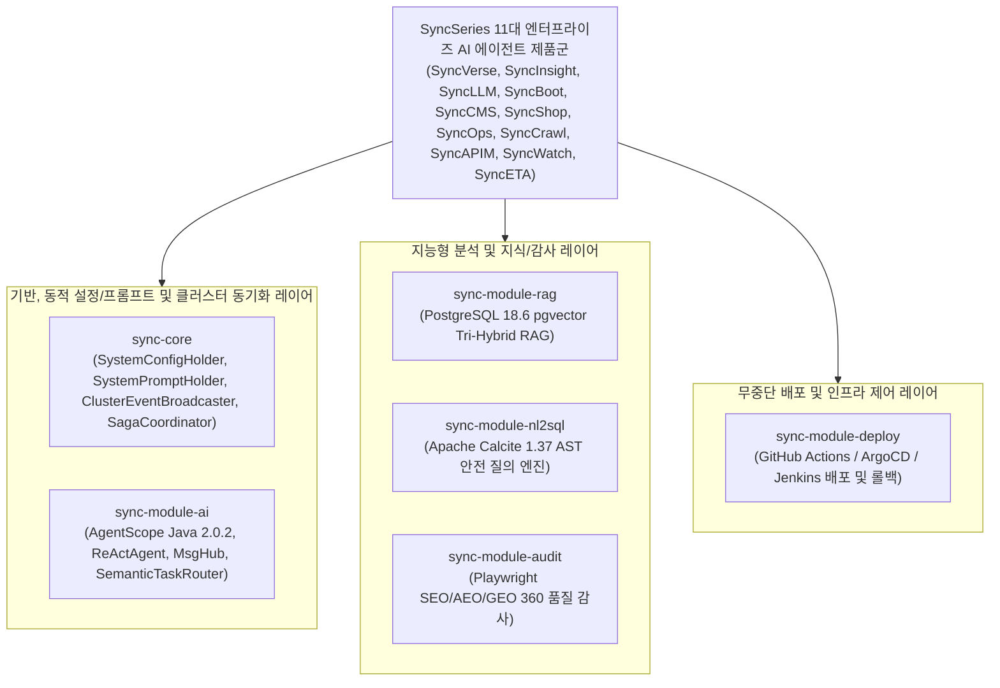
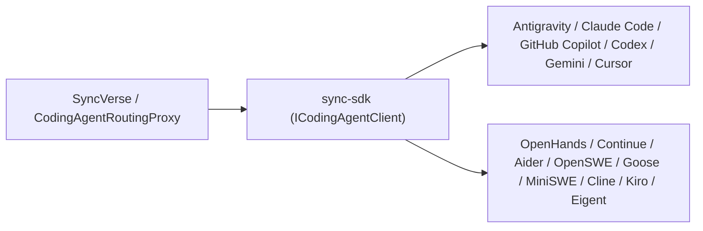

# 전사 공유 모듈 및 AI 코딩 SDK 아키텍처

SyncSeries는 루트 `pom.xml` 멀티모듈 체계 아래 개별 도메인 서비스와 에이전트 간의 중복 코드를 제거하고 전사 일관된 아키텍처 원칙(Java 25, Spring Boot 4.0, AgentScope Java 2.0.2, PostgreSQL 18.6)을 적용하기 위해 **6대 공통 기반 모듈(`sync-core`, `sync-module-*`)**과 **15대 AI 코딩 엔지니어링 SDK(`sync-sdk`)**를 표준화하여 운용합니다.

---

## 1. 전사 6대 공유 모듈 구성 체계

### 1.1 기반 및 AI 에이전트 런타임 모듈
* **`sync-core` (`com.empasy.sync:sync-core`)**:
  * 전사 도메인 엔티티 공통 규격(`BaseEntity`), 표준 API 응답 래퍼(`Result<T>`), 전역 예외 처리 및 AES-256 암호화 유틸리티 제공.
  * **DB 기반 무중단 동적 환경설정(`SystemConfigHolder`, `sys_config`) 및 동적 프롬프트(`SystemPromptHolder`, `sys_prompt_template`, `sys_prompt_history`)**: 소스코드 내 상수·프롬프트 하드코딩을 제거하고 DB에서 실시간 조회 및 버전 롤백 지원.
  * **멀티 인스턴스 클러스터 동기화(`com.empasy.sync.core.cluster.*`)**: `ClusterEventBroadcaster`, `RedisClusterStateBackingStore`, `SharedMemoryClusterStateBackingStore`, `DistributedLockExecutor`, `DistributedStateCoalescer`를 통해 다중 인스턴스 간 설정·프롬프트·서킷브레이커 상태를 실시간 동기화.
  * **Java 25** 가상 스레드(Virtual Threads) 환경에서 OS 스레드 점유(Carrier Pinning)를 방지하기 위해 `ReentrantLock` 기반 고성능 동시성 제어 제공.
* **`sync-module-ai` (`com.empasy.sync:sync-module-ai`)**:
  * 전사 유일의 표준 AI 프레임워크인 **`AgentScope Java` (`io.agentscope:agentscope-harness:2.0.2`)** 통합 (`ReActAgent`, `MsgHub`, `@Tool` 자동 디스커버리).
  * `AgentSelfRegistrationClient`: 백엔드 부팅 시 SyncVerse 중앙 관제탑(`/api/v1/verse/agent/register-manifest`)으로의 에이전트 자기 등록을 비동기로 처리.

### 1.2 지능형 분석 및 지식/감사 모듈
* **`sync-module-rag` (`com.empasy.sync:sync-module-rag`)**:
  * **Tri-Hybrid RAG 엔진**: PostgreSQL 18.6 `pgvector` HNSW Dense 벡터 검색 + `pg_trgm` 키워드 검색 + 지식 그래프 결합으로 도메인 지식 검색 정확도 극대화.
  * `ContextAwareMarkdownSplitter`: 마크다운 헤더 계층 구조와 코드 블록 맥락을 온전히 보존하는 지능형 청킹 엔진.
  * `IncidentRunbookService`: 시스템 장애 발생 시 과거 인시던트 해결 절차를 실시간 자동 매핑.
* **`sync-module-nl2sql` (`com.empasy.sync:sync-module-nl2sql`)**:
  * **Apache Calcite 1.37.0** 및 **JSqlParser 4.9** 기반 관계 대수 AST 최적화 및 다계층 SQL 보안 가드레일(`SELECT` 전용 강제, 테넌트 격리 조건 자동 주입, `LIMIT` 강제) 제공.
* **`sync-module-audit` (`com.empasy.sync:sync-module-audit`)**:
  * `AuditOrchestratorService`: Playwright 헤드리스 렌더링과 정적 AST 분석을 결합하여 SEO/AEO/GEO 3대 웹 품질을 100점 만점으로 정량 평가하고 AI 패치를 제안.

### 1.3 무중단 배포 및 인프라 제어 모듈
* **`sync-module-deploy` (`com.empasy.sync:sync-module-deploy`)**:
  * 멀티 CI/CD 파이프라인 어댑터(`JenkinsPipelineAdapter`, `GitHubActionsAdapter`, `ArgoCdPipelineAdapter`).
  * 컨테이너 및 K8s Pod 실시간 헬스체크 및 자동 롤백 오케스트레이션.

---

## 2. SyncSDK (`com.empasy.sync.sdk:sync-sdk-parent`)

`sync-sdk`는 5-Step Spec Studio 및 **15대 엔터프라이즈 코딩 에이전트(`CodingAgentType`)**와의 프로그래밍 연동을 위한 전사 표준 SDK 모듈입니다.

* **15대 멀티 코딩 엔진 핫스왑 SPI (`ICodingAgentClient` & `CodingAgentType`)**: 런타임에 `ANTIGRAVITY`, `CLAUDE_CODE`, `GITHUB_COPILOT`, `CODEX_CLI`, `GEMINI_CLI`, `CURSOR_CLI`, `OPENHANDS`, `CONTINUE`, `AIDER`, `OPENSWE`, `GOOSE`, `MINI_SWE`, `CLINE`, `KIRO`, `EIGENT` 15대 엔진을 무중단 스위칭하며, 엔진별 기본 모델은 `SystemConfigHolder.getValue("sync.sdk.agent.default-model.<code_lower>", defaultModel)`로 DB `sys_config`에서 동적 조회합니다.
* **4-Cycle 빌드 자가치유**: 코드 패치 적용 후 `mvn test-compile` 및 `vue-tsc` 검증을 수행하고, 컴파일 오류 발생 시 에러 로그를 역주입하여 자율 수정합니다.
* **Zero-Mock 프로덕션 보장**: 프로덕션 런타임 클래스 내 하드코딩된 더미 응답을 전면 배제하고 실제 Git 워크스페이스(`GitWorkspaceManager`) 및 원자적 패치 엔진(`AtomicDiffPatchEngine`)과 바인딩됩니다.
