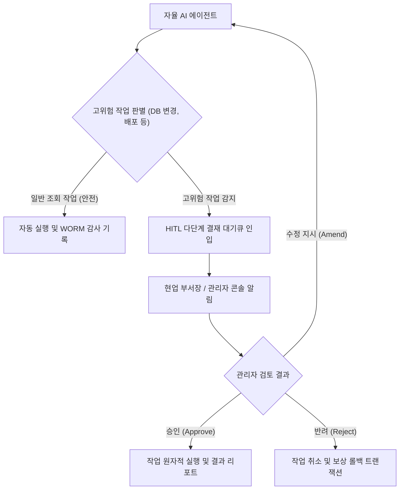

# 현업 관리자 실무 거버넌스 가이드

## 1. 개요 및 대상 독자

SyncSeries는 엔지니어링 개발자뿐만 아니라 **실제 비즈니스 부서의 관리자, 기획자, 보안 심사역**이 안전하게 AI 에이전트를 통제하고 운영할 수 있도록 웹 기반 관리 콘솔과 거버넌스 도구를 제공합니다.

본 가이드는 다음과 같은 역할을 수행하는 실무자를 위해 작성되었습니다:
- **부서장 및 승인권자**: 에이전트가 요청한 고위험 작업(대량 데이터 변경, 프로덕션 배포 등)에 대한 승인/반려 의사결정.
- **FinOps 및 재무 담당자**: 부서별/프로젝트별 월간 AI 모델 호출 비용 추적 및 예산 한도 관리.
- **컴플라이언스 및 감사 담당자**: 과거 에이전트가 수행한 작업 이력, 판단 근거, 프롬프트 로그에 대한 위변조 방지 감사.

---

## 2. 거버넌스 핵심 원칙

1. **최소 권한의 원칙 (Least Privilege)**:
   - 각 에이전트와 사용자는 부여된 역할(`sys_role`)에 매핑된 도구 및 화면 권한만 실행할 수 있습니다.
2. **다단계 인적 개입 (Multi-Party HITL)**:
   - 파괴적 행위나 일정 금액 이상의 결제 변경 건은 단일 관리자가 아닌 2인 이상의 다자간 순차 승인을 거쳐야만 최종 집행됩니다.
3. **불가역 감사 추적 (Tamper-Proof Audit)**:
   - 모든 결재 승인 내역과 에이전트의 실행 로그는 타임스탬프 암호화 해시 체인으로 봉인되어 사후 임의 수정이나 삭제가 불가능합니다.

---

## 3. 역할별 일일·주간 운영 체크리스트

| 담당 역할 | 주기 | 주요 점검 항목 | 관리 콘솔 메뉴 및 참조 매뉴얼 |
| :--- | :---: | :--- | :--- |
| **현업 부서장 / 결재권자** | 상시 | • Level 3~4 고위험 작업(가격 일괄 변경, 스키마 수정, 배포) 결재 대기열 확인 • 변경 전후 데이터 Diff 및 롤백 스냅샷 ID 생성 여부 점검 | `SyncVerse > 작업 승인 (/governance)` [HITL 승인 매뉴얼](./hitl-approval-operations) |
| **FinOps / IT 기획팀** | 주간 | • 부서·에이전트별 월간 토큰 예산 소진율(70% / 90% 임계치) 모니터링 • 시맨틱 캐시 적중률(`>= 35%`) 및 경량 모델(Tier 1~2) 자동 전환 비율 점검 | `SyncLLM > FinOps 원장` [FinOps 예산 매뉴얼](./finops-budget-operations) |
| **정보보안 / 감사팀** | 월간 | • 외부 LLM 호출 시 PII(주민번호·계좌·카드·연락처) 마스킹 적발 건수 감사 • SHA-256 해시 체인 감사 로그 무결성 및 비인가 API(`SyncAPIM`) 차단 내역 검수 | `SyncAPIM > 위협 탐지 로그` `SyncWatch > 보안 팩 배포 원장` |

---

## 4. 긴급 상황 대응 및 1-Click 롤백 표준 절차 (SOP)

에이전트의 자율 작업 반영 직후 예상치 못한 지표 이상이나 현업 클레임이 접수된 경우, 관리자는 개발팀 코드 수정 대기 없이 다음 3단계 절차로 즉시 원복할 수 있습니다.

1. **1단계 — 실행 이력 및 스냅샷 식별**:
   - `SyncVerse` 또는 해당 도메인 에이전트(`SyncShop`, `SyncCMS`, `SyncBoot`)의 **[작업 승인 > 실행 감사 이력]** 화면에서 직전 집행된 작업 ID와 자동 발급된 스냅샷 식별자(`SNP-YYYYMM-NNN`)를 확인합니다.
2. **2단계 — 1-Click 보상 롤백 트리거**:
   - 해당 이력 카드의 **[직전 스냅샷으로 즉시 복원 (Rollback)]** 버튼을 클릭하면, 백엔드 보상 트랜잭션(`revert_data_state` 또는 `ROLLBACK_PRICE`)이 실행되어 `1초` 이내에 변경 이전 데이터 상태로 복구됩니다.
3. **3단계 — 원인 분석(RCA) 및 가드레일 보정**:
   - `SyncInsight` RCA 리포트를 통해 이상 원인을 확인하고, 필요 시 해당 도구의 위험 등급을 상향하거나 제약 파라미터(예: 최소 보장 마진율, 최대 변경 건수)를 재설정합니다.

---

## 5. 세부 실무 매뉴얼 안내

- **[4단계 HITL 승인 및 스냅샷 롤백 매뉴얼](./hitl-approval-operations)**: 웹 콘솔에서의 결재 요청 수신, 상세 Diff 및 영향도 검토, 승인/반려/수정 지시 조작 및 스냅샷 롤백 절차.
- **[FinOps 예산 가드레일 및 모델 라우팅 매뉴얼](./finops-budget-operations)**: 조직 단위 월간 예산 할당, 임계치 도달 시의 알림 정책, 모델 자동 티어링 및 초과 방지 운영 방안.
