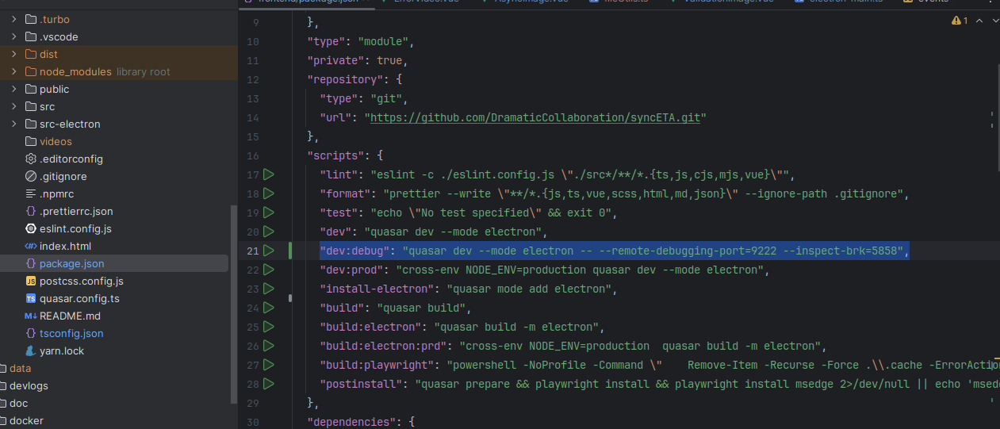
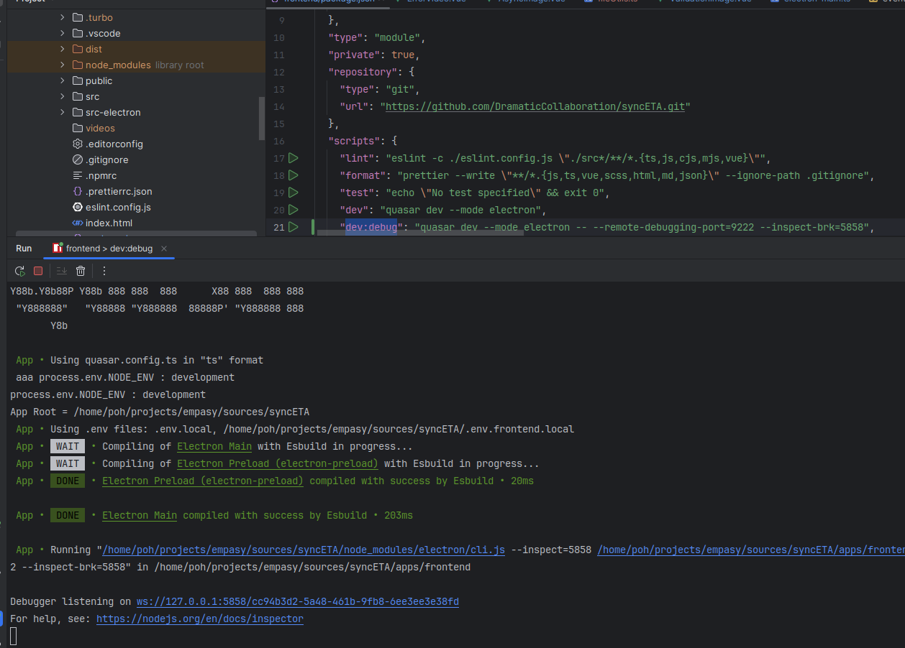
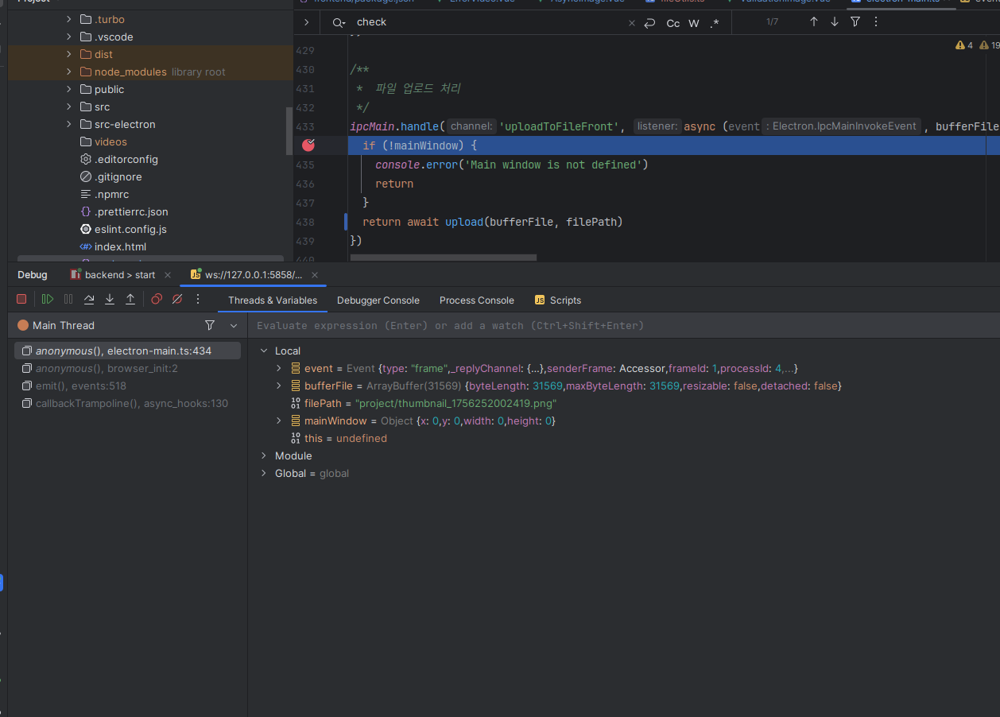

---
title: "IntelliJ IDEA 기반 Electron 메인 프로세스 원격 디버거 연결 가이드"
description: "IntelliJ IDEA에서 Electron 데스크톱 애플리케이션(SyncETA)의 메인 프로세스 V8 Inspector(ws://127.0.0.1:5858)에 원격 디버거를 연결하고 브레이크포인트를 추적하는 기술 가이드입니다."
head:
  - - meta
    - name: keywords
      content: SyncETA, Electron, IntelliJ IDEA, V8 Inspector, 원격 디버깅, 메인 프로세스, Breakpoint
  - - meta
    - property: og:title
      content: "IntelliJ IDEA 기반 Electron 메인 프로세스 원격 디버거 연결 가이드 | Empasy Docs"
  - - meta
    - property: og:description
      content: "Electron 메인 프로세스 dev:debug 실행 및 IntelliJ V8 Inspector 소켓 연결, 중단점(Breakpoint) 디버깅 절차 안내입니다."
  - - meta
    - property: og:image
      content: https://doc.empasy.com/images/favicon.png
  - - meta
    - property: og:url
      content: https://doc.empasy.com/logs/20250827_electronDebug
sort: 300
---

# IntelliJ IDEA 기반 Electron 메인 프로세스 원격 디버거 연결 가이드

SyncETA 데스크톱 애플리케이션은 **Electron 메인 프로세스(Node.js / Playwright 제어)**와 **렌더러 프로세스(Vue 3 UI)**의 멀티 프로세스 구조로 동작합니다. 본 문서는 IntelliJ IDEA에서 V8 Inspector 웹소켓(`ws://127.0.0.1:5858`)을 통해 Electron 메인 프로세스에 원격 디버거를 연결하고 중단점(Breakpoint)을 추적하는 표준 절차를 설명합니다.

---

## 1. 디버그 모드(`dev:debug`) 실행

`package.json`에 정의된 `dev:debug` 스크립트를 실행하여 Electron 메인 프로세스를 `--inspect=5858` 플래그와 함께 기동합니다.

| 실행 스크립트 | 내부 플래그 | 기본 디버그 포트 |
| :--- | :--- | :--- |
| `yarn dev:debug` | `electron --inspect=5858 .` | `127.0.0.1:5858` (V8 Inspector WebSocket) |

---

## 2. V8 Inspector 원격 디버거 소켓 연결

터미널 콘솔에 출력되는 `Debugger listening on ws://127.0.0.1:5858/...` 링크를 `Ctrl + Click` (또는 `Cmd + Click`)하여 IntelliJ 내장 JavaScript/Node.js 디버거를 즉시 부착(Attach)합니다.

---

## 3. 중단점(Breakpoint) 설정 및 런타임 상태 검사

메인 프로세스 TypeScript 소스코드(IPC 핸들러, Playwright 브라우저 컨텍스트 제어부 등)에 중단점을 설정하면, 이벤트 호출 시점에 실행이 일시 정지되며 호출 스택(Call Stack)과 로컬 변수 상태를 실시간으로 검사할 수 있습니다.

---

## 4. 프로세스별 디버깅 타깃 및 주의사항

| 프로세스 구분 | 실행 런타임 | 디버거 연결 방식 | 주요 디버깅 대상 |
| :--- | :--- | :--- | :--- |
| **Main Process** | Node.js / Electron Main | `ws://127.0.0.1:5858` V8 Inspector 소켓 연결 | `ipcMain.handle`, Playwright 브라우저 풀 제어, 로컬 파일 I/O |
| **Preload Script** | Isolated Context Bridge | Chromium DevTools (`Ctrl+Shift+I`) Sources 탭 | `contextBridge.exposeInMainWorld` API 바인딩 검증 |
| **Renderer Process** | Chromium / Vue 3 | Chromium DevTools 또는 Vite HMR 콘솔 | Vue 3 컴포넌트 상태(Pinia), 시나리오 캔버스 UI 렌더링 |

> [!TIP]
> 메인 프로세스 중단점에서 장시간 대기할 경우 렌더러 프로세스의 IPC 응답 타임아웃이 발생할 수 있으므로, 비동기 IPC 호출 디버깅 시에는 타임아웃 임계치를 일시 완화하거나 조건부 중단점(Conditional Breakpoint)을 사용하는 것을 권장합니다.
