# 엠파시 단계별 실행 항목 (45개 Action Items) 및 실무 실행 가이드 (SOP)

> **개요:** 본 가이드는 **Phase 0(사전영업) ~ Phase 5(오픈·정산)** 각 단계에서 담당자가 **무엇을(`Action Item`), 어떤 순서로 실행하고, 어떤 공식 서식(`EMP-*`)을 작성하여 어떻게 합격 판정하는지**를 규정한 전사 표준 운영 절차서(SOP)입니다.

::: tip 관련 상위 및 실무 가이드 바로가기
* **[엠파시 사업 및 프로젝트 관리 표준 문서 양식 통합 다운로드 센터 (125종)](./enterprise-document-templates.md)**: 90-8-2 전사 표준 포맷 125종 단일 마스터(Blank) + 6종 규모별 프리셋 패키지
* **[엠파시 사업 및 개발 방법론 개요 (Phase 0~5)](./enterprise-project-lifecycle.md)**: 전 주기 운영, 4대 Sign-off 및 S/M/L Tailoring 기준
* **[엠파시 사업 전 주기 표준 문서 체계 및 납품·관리 실무 가이드](./enterprise-business-documents.md)**: 공공·금융·AI 기본법 규제, AI FinOps, 외주·위기대응 표준
* **[영업 지원 및 제안 단계 실무 가이드 (Pre-sales)](./presales-ai-playbook.md)**: RFP 분석, 제안서 작성, PoC 데모 제작, 공수 산정
* **[개발 생명주기 개요 (AI-SDLC)](./ai-driven-development.md)**: 5단계 개발 프로세스 상세
* **[상황별 실전 프롬프트 모음집 (치트시트)](./ai-sdlc-prompt-recipes.md)**: 실무 단계별 즉시 복사 템플릿
:::

---

## 1. Phase 0 ~ Phase 5 전체 45개 Action Items 한눈에 보기

```mermaid
flowchart TD
    subgraph P0 ["Phase 0: 사전영업 & 제안 (7개: A0.0~A0.6)"]
        A00["A0.0 Go/No-Go 심의 및 NDA 체결"]
        A01["A0.1 RFP 요구사항 분해"]
        A02["A0.2 기술 제안서 작성"]
        A03["A0.3 PoC 데모 및 결과보고서"]
        A04["A0.4 공식 견적·3개년 TCO 산정"]
        A05["A0.5 입찰 서류 및 PT Q&A 방어"]
        A06["A0.6 기술수행 사전 승인 (Sign-off)"]
    end
    subgraph P1 ["Phase 1: 계약 체결 & 착수·분석 (8개: A1.0~A1.7)"]
        A10["A1.0 본계약·보증보험·선금·하도급·착수계"]
        A11["A1.1 PMP·보안서약·AI 거버넌스 점검"]
        A12["A1.2 요구사항 정의서(SRS)·RTM 확정"]
        A13["A1.3 업무 예외 정책 선제 발굴"]
        A14["A1.4 마스터 WBS 및 마일스톤 확정"]
        A15["A1.5 변경 관리(CR 3 M/D) 거버넌스"]
        A16["A1.6 레거시 데이터 이관 조기 실증"]
        A17["A1.7 과업 범위 확정 (Sign-off #1)"]
    end
    subgraph P2 ["Phase 2: 설계 & 규격화 (7개: A2.0~A2.6)"]
        A20["A2.0 화면설계서 스토리보드 (Sign-off #2)"]
        A21["A2.1 SAD·클라우드·방화벽 신청 확정"]
        A22["A2.2 PostgreSQL 6-File DDL·DB 9시트"]
        A23["A2.3 단일 /api/v1/ API·연계·AI프롬프트"]
        A24["A2.4 에이전트 코딩 표준(.agents/AGENTS.md)"]
        A25["A2.5 외부 연계 Mock Server 선행 구축"]
        A26["A2.6 설계 단계 완료 보고 및 승인"]
    end
    subgraph P3 ["Phase 3: 협업 구현 & 공정관리 (7개: A3.1~A3.7)"]
        A31["A3.1 수정 파일 범위(focusFiles) 격리"]
        A32["A3.2 백엔드·AgentScope Zero-Mock 구현"]
        A33["A3.3 프론트 Vben 표준·모달 분리 구현"]
        A34["A3.4 주간·월간 진척 보고 (S-Curve)"]
        A35["A3.5 이슈·위험·일일 결함관리대장 운영"]
        A36["A3.6 과업 변경 요청서(CR)·공기연장(EOT)"]
        A37["A3.7 중간 보고서 및 기성 검수(40%)"]
    end
    subgraph P4 ["Phase 4: 검증, 보안 & 감리 (6개: A4.1~A4.6)"]
        A41["A4.1 4-Cycle Zero-Mock 회귀 검증"]
        A42["A4.2 빌드 오류 자가 치유(autoRepair)"]
        A43["A4.3 행안부·KISA 보안 49개·OSS 검증"]
        A44["A4.4 성능 부하 시험 및 AI 골든셋 평가"]
        A45["A4.5 사용자 인수테스트 UAT (Sign-off #3)"]
        A46["A4.6 3자 감리 지적사항 조치 완료"]
    end
    subgraph P5 ["Phase 5: 오픈, 검수 & 정산 (10개: A5.1~A5.10)"]
        A51["A5.1 배포·롤백 런북 및 무중단 컷오버"]
        A52["A5.2 런타임 설정 반영·실시간 모니터링"]
        A53["A5.3 사용자·관리자 매뉴얼 및 파일럿"]
        A54["A5.4 고객사 교육 및 계정·권한 인계"]
        A55["A5.5 운영 런북 및 원클릭 온보딩"]
        A56["A5.6 완료보고 및 최종검수 (Sign-off #4)"]
        A57["A5.7 준공 잔금(30%) 청구 및 수금"]
        A58["A5.8 하자보수보증증권 및 하자계획서"]
        A59["A5.9 유지관리 SLA·월간 FinOps 정산"]
        A510["A5.10 프로젝트 종료 회고·P&L 정산"]
    end

    P0 --> P1 --> P2 --> P3 --> P4 --> P5
```

---

## 2. 단계별 Action Item 실무 실행 상세 가이드

---

### [Phase 0] 사전영업 및 제안 지원 (Pre-sales & Proposal — 7개)

#### Action Item A0.0: 입찰 참여 타당성 심의 (Go / No-Go) 및 비밀유지협약서(NDA) 체결
* **목적**: 부실·적자 입찰을 사전 차단하고 고객사 원천 자료 수령 전 법적 보안 및 외부 AI 학습 금지를 확립.
* **담당자**: 사업 본부장, 영업대표, 제안 기술 PM, 법무 담당자
* **실행 절차**:
  1. 고객사 RFP 상세 자료나 데이터 수령 전 상호 비밀유지협약서(NDA)를 체결합니다.
  2. 기술 적합도(30점), 수익성(25점), 납기 현실성(20점), 자산 재사용률(15점), 계약·보안 리스크(10점)를 정량 채점합니다.
  3. 총점 **70점 이상** 시 입찰 참여(Go)를 승인하고, 미달 시 불참(No-Go)을 결정합니다.
* **표준 산출물**: [EMP-P0-01 상호비밀유지협약서(NDA)](./enterprise-document-templates.md#emp-p0-01), [EMP-P0-02 입찰타당성 Go/No-Go 심의표](./enterprise-document-templates.md#emp-p0-02)
* **합격 판정 기준**: NDA 날인이 완료되고 Go/No-Go 총점 70점 이상으로 공식 참여 승인이 났는가?

#### Action Item A0.1: RFP 요구사항 분해 및 사전 질의
* **목적**: 수백 페이지 RFP에서 기능(SFR)·데이터(DAR)·연계(SIR)·비기능(NFR) 요구사항을 누락 없이 추출.
* **담당자**: 프리세일즈 엔지니어, 제안 기술 PM
* **실행 절차**:
  1. RFP 요구사항을 고유 ID·분류·난이도(상/중/하)로 구조화합니다.
  2. 불명확한 제약사항과 레거시 연계 범위는 사전 고객 질의서로 정리해 발주처 확인을 받습니다.
* **표준 산출물**: [EMP-P0-03 사전영업 고객질의서](./enterprise-document-templates.md#emp-p0-03), [EMP-P0-08 사전기술 제안방향서](./enterprise-document-templates.md#emp-p0-08)
* **합격 판정 기준**: RFP 원문의 모든 요구사항 항목이 누락 없이 분류되고 핵심 쟁점이 식별되었는가?

#### Action Item A0.2: 사업 기술 제안서 작성
* **목적**: 목표 시스템 4계층 아키텍처, 보안·품질 보증 및 수행 방법론의 차별화를 입증.
* **담당자**: 솔루션 아키텍트, 제안 PM
* **실행 절차**:
  1. 제안 작업 세부계획서에 따라 목차별 담당자와 리뷰 일정을 배정합니다.
  2. 아키텍처 구성도, Spec-First 방법론, 4-Cycle Zero-Mock 품질 검증 및 AI 거버넌스 전략을 기술합니다.
* **표준 산출물**: [EMP-P0-07 제안작업 세부계획서](./enterprise-document-templates.md#emp-p0-07), [EMP-P0-09 사업기술제안서 표준템플릿](./enterprise-document-templates.md#emp-p0-09)
* **합격 판정 기준**: 고객사 필수 제약 조건과 평가 배점 항목을 모두 충족하는가?

#### Action Item A0.3: 영업 시연용 PoC 데모 제작 및 기술검증 결과보고서
* **목적**: 제안 발표(PT) 시 실제 동작하는 핵심 화면 1~2개를 시연해 기술 평가 우위 확보.
* **담당자**: 프로토타입 개발자, 프론트엔드·AI 엔지니어
* **실행 절차**:
  1. 고객 핵심 관심 화면 1~2개를 선정해 사내 표준 컴포넌트(`Vben BasicModal` 등)로 실동작 프로토타입을 빌드합니다.
  2. 정확도·응답속도 등 실증 결과를 정리해 영업대표에게 전달합니다.
* **표준 산출물**: 실동작 데모 URL, [EMP-P0-08 사전기술 제안방향서](./enterprise-document-templates.md#emp-p0-08)
* **합격 판정 기준**: 시연 환경에서 클릭·조회·AI 분석이 오류 없이 정상 동작하는가?

#### Action Item A0.4: 공식 견적서, 3개년 TCO 원가계산서 및 실행예산서 산정
* **목적**: 인건비·클라우드/GPU·상용 LLM 토큰·외주비를 통합 산정해 목표 마진 확보.
* **담당자**: 제안 PM, 영업대표, 개발 리드
* **실행 절차**:
  1. 기능 난이도 기준 투입 공수(M/M)와 인프라·LLM 토큰 3개년 TCO를 산출합니다.
  2. 내부 원가 대비 영업이익률을 반영해 공식 견적서와 실행예산서를 확정합니다.
* **표준 산출물**: [EMP-P0-04 3개년 TCO 원가계산서](./enterprise-document-templates.md#emp-p0-04), [EMP-P0-05 수주 실행예산서](./enterprise-document-templates.md#emp-p0-05), [EMP-P0-06 SW개발 표준견적서](./enterprise-document-templates.md#emp-p0-06)
* **합격 판정 기준**: 가용 인력과 기간 내 수행 가능하며 목표 마진율을 충족하는가?

#### Action Item A0.5: 입찰 참가 서류 준비 및 제안 PT Q&A 방어 시뮬레이션
* **목적**: 입찰 자격 결격 방지 및 심사위원 공격 질문 10선 논리 방어.
* **담당자**: 경영지원팀, 프리세일즈, 제안 발표자
* **실행 절차**:
  1. 법인인감, 국세/지방세 완납증명서, 신용평가등급서, 실적증명원, 입찰보증보험증권을 완비합니다.
  2. 심사위원 단골 질문 10선에 대한 [원칙 -> 기술 해결책 -> 검증 실적] 3단 방어 스크립트를 리허설합니다.
* **표준 산출물**: 입찰 자격 서류 일체, [EMP-P0-10 제안발표 PT 심사슬라이드](./enterprise-document-templates.md#emp-p0-10)
* **합격 판정 기준**: 행정 서류 유효기간·직인 누락이 없고 10선 Q&A 방어가 준비되었는가?

#### Action Item A0.6: 기술적 수행 가능성 사전 합의 (Technical Sign-off)
* **목적**: 개발 조직 검증 없는 무리한 저가·단기 투찰을 사전 차단.
* **담당자**: 개발 리드(Tech Lead), 사업 본부장
* **실행 절차**:
  1. 투찰 전 개발 리드가 공수, 납기, 기술 스펙과 AI SLA 달성 가능성을 최종 검토합니다.
  2. 실현 가능성을 확인한 후 사전 승인서에 서명합니다.
* **표준 산출물**: [EMP-P0-11 기술수행타당성 사전승인서](./enterprise-document-templates.md#emp-p0-11)
* **합격 판정 기준**: 개발 리드의 공식 서면 승인이 확보되었는가?

---

### [Phase 1] 계약 체결, 착수 및 요구사항 분석 (Inception & SRS — 8개)

#### Action Item A1.0: 본계약 체결, 보증보험, 선금·하도급 승인 및 착수계 제출
* **목적**: 법적 권리·의무 확정, 선금(30~50%) 조기 확보 및 공식 착수 신고.
* **담당자**: 사업대표, 영업/법무, PM, 경영지원팀
* **실행 절차**:
  1. 대금 지급(30/40/30), 지체상금(0.075%), 지재권, 하자보수(1년)가 명시된 표준계약서를 체결합니다.
  2. 계약이행보증보험증권 발행 및 착수계·선금 신청서(선금보증보험 포함)를 접수합니다.
  3. 외주 협력사 투입 시 SW진흥법 제51조에 따라 하도급 사전승인 신청서(50% 이내·재하도급 금지)를 제출합니다.
* **표준 산출물**: [EMP-P1-01 SW용역 표준계약서](./enterprise-document-templates.md#emp-p1-01), [EMP-P1-02 착수계 및 PMP](./enterprise-document-templates.md#emp-p1-02), [EMP-P1-06 선금신청서](./enterprise-document-templates.md#emp-p1-06), [EMP-P1-07 하도급사전승인서](./enterprise-document-templates.md#emp-p1-07)
* **합격 판정 기준**: 양사 계약 날인, 보증증권 발행, 착수계 및 선금 신청이 완료되었는가?

#### Action Item A1.1: 사업수행계획서(PMP) 확정, 보안서약 및 AI 기본법 거버넌스 점검
* **목적**: 착수보고회 승인, 투입 인력 보안 준수 및 2026 AI 기본법 요건 선제 점검.
* **담당자**: 총괄 PM, 보안 담당자, AI 리드
* **실행 절차**:
  1. 착수보고회 및 킥오프 워크샵을 통해 수행 조직, 연락망, 정례회의 체계 및 표준 폴더 구조를 확정합니다.
  2. 참여 인력 전원 보안서약서·개인정보처리위탁계약서를 제출하고, AI 포함 사업은 AI 기본법 고영향 여부·외부 학습 배제·PII 마스킹 18개 항목을 점검합니다.
* **표준 산출물**: [EMP-G0-01 표준폴더구조](./enterprise-document-templates.md#emp-g0-01), [EMP-P1-04 착수보고회 발표자료](./enterprise-document-templates.md#emp-p1-04), [EMP-P1-08 보안서약·위탁계약서](./enterprise-document-templates.md#emp-p1-08), [EMP-P1-09 연락망·회의체계](./enterprise-document-templates.md#emp-p1-09), [EMP-P1-22 AI 거버넌스 점검표](./enterprise-document-templates.md#emp-p1-22)
* **합격 판정 기준**: 착수보고회 승인, 전원 보안서약서 제출 및 AI 거버넌스 1차 점검이 완료되었는가?

#### Action Item A1.2: 요구사항 정의서(SRS) 및 추적 매트릭스(RTM) 확정
* **목적**: 제안 약속과 실제 구현 범위를 고유 ID 기반으로 1:1 매핑.
* **담당자**: PM, BA/기획자, 고객사 현업 PM
* **실행 절차**:
  1. 현업 인터뷰, 환경분석, 벤치마킹 및 AS-IS 프로세스 진단을 수행합니다.
  2. 기능·데이터·연계·보안 요구사항을 SRS로 확정하고 양방향 RTM 및 기간계 연계규격협의서를 합의합니다.
* **표준 산출물**: [EMP-P1-13 요구사항정의서(SRS)](./enterprise-document-templates.md#emp-p1-13), [EMP-P1-14 요구사항추적표(RTM)](./enterprise-document-templates.md#emp-p1-14), [EMP-P1-16 환경분석서](./enterprise-document-templates.md#emp-p1-16), [EMP-P1-18 AS-IS 정의서](./enterprise-document-templates.md#emp-p1-18), [EMP-P1-19 연계규격협의서](./enterprise-document-templates.md#emp-p1-19)
* **합격 판정 기준**: 모든 요구사항에 고유 ID·수용 기준이 부여되고 고객 실무 확인을 마쳤는가?

#### Action Item A1.3: 업무 예외 정책 선제 발굴 및 현업 인터뷰
* **목적**: 개발 도중 빈번한 정책 변경과 재작업을 사전 차단.
* **담당자**: 서비스 기획자, BA
* **실행 절차**:
  1. 취소, 환불, 만료, 동시 요청, 권한 경계 등 엣지 케이스 질의서를 작성해 현업 인터뷰를 진행합니다.
  2. 고객사로부터 인도받을 텍스트·이미지·마스터 데이터 수급 일정을 확정합니다.
* **표준 산출물**: [EMP-P1-15 요구사항질의서 및 콘텐츠수급목록](./enterprise-document-templates.md#emp-p1-15), [EMP-P2-03 운영정책정의서](./enterprise-document-templates.md#emp-p2-03)
* **합격 판정 기준**: 정상 흐름 외 주요 예외 처리 정책과 콘텐츠 수급 일정이 서면 합의되었는가?

#### Action Item A1.4: 마스터 WBS 및 마일스톤 베이스라인 확정
* **목적**: 전 주기 작업 분할, 가중치 공정률 기준 및 스프린트 계획 수립.
* **담당자**: 총괄 PM, 테크 리드
* **실행 절차**:
  1. RTM 기반으로 Phase 0~5 세부 Task, 가중치(합계 100%), 공휴일 기준을 반영한 WBS를 확정합니다.
  2. 규모별 Tailoring 산출물 목록과 핵심 마일스톤을 발주처와 합의합니다.
* **표준 산출물**: [EMP-P1-10 WBS 마스터](./enterprise-document-templates.md#emp-p1-10), [EMP-P1-11 마일스톤 요약](./enterprise-document-templates.md#emp-p1-11), [EMP-P1-12 수행범위 및 산출물목록](./enterprise-document-templates.md#emp-p1-12)
* **합격 판정 기준**: 가중치 합계 100% 검증 및 전체 일정 베이스라인 합의가 완료되었는가?

#### Action Item A1.5: 과업 변경 관리(CR 3 M/D 기준) 거버넌스 수립
* **목적**: 구두 요구 및 무분별한 범위 확장(Scope Creep)으로 인한 적자 방지.
* **담당자**: 총괄 PM, 고객사 PM
* **실행 절차**:
  1. 구두 요청 불인정 및 공식 CR Form 서면 접수 절차를 합의합니다.
  2. 영향도 분석 결과 **3 M/D 초과** 변경(대형 계약 특약 시 5 M/D)은 기능 상계(Swap), 납기 순연 또는 추가 계약 연동 원칙을 명문화합니다.
* **표준 산출물**: [EMP-P3-10 과업변경요청서(CR Form)](./enterprise-document-templates.md#emp-p3-10), [EMP-P3-11 변경관리 누적대장](./enterprise-document-templates.md#emp-p3-11)
* **합격 판정 기준**: 변경 통제 기준과 승인 절차가 고객사와 서면 합의되었는가?

#### Action Item A1.6: 레거시 데이터 마이그레이션 조기 실증
* **목적**: 오픈 직전 데이터 결측·포맷 불일치로 인한 오픈 지연 차단.
* **담당자**: 데이터 엔지니어, DBA
* **실행 절차**:
  1. 착수 2~3주 차에 레거시 DB 샘플을 조기 추출해 신규 스키마 변환을 실증합니다.
  2. 발견된 결측치·코드 오류 목록을 고객 전산실에 공식 통보해 사전 정제를 유도합니다.
* **표준 산출물**: [EMP-P1-19 대내외 연계규격협의서](./enterprise-document-templates.md#emp-p1-19), [EMP-P5-04 데이터이관 정합성 대사표(초안)](./enterprise-document-templates.md#emp-p5-04)
* **합격 판정 기준**: 샘플 변환 테스트를 완료하고 정제 대상 오류 데이터가 조기 식별되었는가?

#### Action Item A1.7: 과업 범위 확정 합의서 서명 (Sign-off #1 — Scope Freeze)
* **목적**: Phase 1을 공식 종결하고 개발 대상 범위를 법적으로 동결.
* **담당자**: 총괄 PM, 발주사 현업·IT 책임자
* **실행 절차**:
  1. 확정된 SRS(`EMP-P1-13`), RTM(`EMP-P1-14`), 연계규격협의서(`EMP-P1-19`)를 첨부해 범위 동결을 품의합니다.
  2. 양사 책임자의 공식 직인/서명을 확보하고 Phase 2 진입을 승인받습니다.
* **표준 산출물**: [EMP-P1-20 과업범위확정 Scope Freeze 합의서](./enterprise-document-templates.md#emp-p1-20)
* **합격 판정 기준**: 양사 총괄 책임자 서명본 원본이 확보되었는가?

---

### [Phase 2] 명세 우선 아키텍처 및 상세 설계 (Design & Spec — 7개)

#### Action Item A2.0: 화면 설계서(UI/UX 스토리보드) 작성 및 고객 승인 (Sign-off #2)
* **목적**: 현업이 직접 검토 가능한 UI/UX 스펙을 코딩 전에 서면 동결해 재작업 차단.
* **담당자**: UI/UX 기획자, 디자이너, 고객사 현업
* **실행 절차**:
  1. 정보구조도(IA), 단위기능정의서, TO-BE 프로세스, 디자인 전략서 및 화면 스토리보드를 작성합니다.
  2. 현업 리뷰회를 거쳐 화면 수·레이아웃·인터랙션에 대한 공식 승인을 획득합니다.
* **표준 산출물**: [EMP-P2-01 정보구조도(IA)](./enterprise-document-templates.md#emp-p2-01), [EMP-P2-02 단위기능정의서](./enterprise-document-templates.md#emp-p2-02), [EMP-P2-06 화면설계서 스토리보드](./enterprise-document-templates.md#emp-p2-06), [EMP-P2-07 디자인전략서](./enterprise-document-templates.md#emp-p2-07), [EMP-P2-10 화면설계 승인확인서](./enterprise-document-templates.md#emp-p2-10)
* **합격 판정 기준**: 모든 메뉴 화면 설계가 완료되고 고객사 공식 승인 서명(Sign-off #2)을 받았는가?

#### Action Item A2.1: 시스템 아키텍처 설계서(SAD) 및 클라우드·방화벽 신청 확정
* **목적**: 서버 사양, 망분리 구간 및 방화벽 포트 정책을 조기 확정해 인프라 병목 해소.
* **담당자**: 인프라 아키텍트(AA), 고객사 전산팀
* **실행 절차**:
  1. DEV/STG/PRD 3계층 구성도, 컨테이너(EKS/Docker), HA/백업 및 보안 아키텍처를 설계합니다.
  2. 출발지·목적지 IP·포트 방화벽 오픈 신청서를 고객사 보안팀에 조기 접수합니다.
* **표준 산출물**: [EMP-P2-11 시스템아키텍처정의서(SAD)](./enterprise-document-templates.md#emp-p2-11), [EMP-P2-12 아키텍처구성도](./enterprise-document-templates.md#emp-p2-12), [EMP-P2-13 클라우드·방화벽 신청서](./enterprise-document-templates.md#emp-p2-13)
* **합격 판정 기준**: 서버·네트워크·방화벽 규격이 인프라·보안팀과 합의되었는가?

#### Action Item A2.2: 데이터 표준화, 6-File PostgreSQL DDL 및 DB 9시트 명세 확정
* **목적**: 감리 필수 데이터 표준화 산출물 완비 및 SQL 충돌 오류 원천 차단.
* **담당자**: 데이터아키텍트(DA), DBA
* **실행 절차**:
  1. 표준용어·공통코드·논리/물리 모델·DB 9시트 명세서 및 CRUD Matrix를 작성합니다.
  2. `<SubProject>/db/`에 `00_extensions.sql` ~ `05_sample_dev.sql` 6단계 순수 SQL(`ON CONFLICT` 금지)을 작성하고 클린 1회 실행을 검증합니다.
* **표준 산출물**: [EMP-P2-17 표준용어정의서](./enterprise-document-templates.md#emp-p2-17), [EMP-P2-18 공통코드정의서](./enterprise-document-templates.md#emp-p2-18), [EMP-P2-19 논리·물리 데이터모델](./enterprise-document-templates.md#emp-p2-19), [EMP-P2-20 DB명세서 9시트](./enterprise-document-templates.md#emp-p2-20), [EMP-P2-21 CRUD Matrix](./enterprise-document-templates.md#emp-p2-21)
* **합격 판정 기준**: 로컬 PostgreSQL 18.6에서 6단계 SQL이 1회에 오류 없이 초기화되는가?

#### Action Item A2.3: 단일 Canonical REST API, 배치 및 AI 프롬프트 설계 확정
* **목적**: 백엔드·프론트엔드·AI 병렬 개발을 위한 인터페이스 계약 동결.
* **담당자**: 백엔드 리드, 프론트엔드 리드, AI 엔지니어
* **실행 절차**:
  1. 모든 API를 단일 `/api/v1/{product}/{resource}` 표준 경로와 OpenAPI 3.0 스펙으로 확정합니다.
  2. 정기 배치 스케줄러(선후행·재처리) 및 AI 추론 파이프라인·JSON 출력 스키마를 설계합니다.
* **표준 산출물**: [EMP-P2-22 인터페이스·API 명세서](./enterprise-document-templates.md#emp-p2-22), [EMP-P2-23 배치프로그램설계서](./enterprise-document-templates.md#emp-p2-23), [EMP-P2-24 AI추론·프롬프트설계서](./enterprise-document-templates.md#emp-p2-24)
* **합격 판정 기준**: 단일 URL 표준 준수 및 프론트·백엔드·AI 간 계약 리뷰가 완료되었는가?

#### Action Item A2.4: 전사 개발표준 정의 및 에이전트 공통 규칙(`.agents/AGENTS.md`) 배포
* **목적**: 전 팀원과 코딩 에이전트가 동일한 2026 표준을 일관되게 준수하도록 강제.
* **담당자**: 아키텍트, 테크 리드
* **실행 절차**:
  1. Java 25, Spring Boot 4.0, AgentScope Java, Lombok, Vue 3 Vben 표준 및 Zero-Mock 규칙을 정의합니다.
  2. 저장소 루트 `.agents/AGENTS.md` 및 IDE 규칙 파일에 커밋해 전 개발 환경에 배포합니다.
* **표준 산출물**: [EMP-P2-15 개발표준 및 개발환경정의서](./enterprise-document-templates.md#emp-p2-15), 저장소 `.agents/AGENTS.md`
* **합격 판정 기준**: 코딩 에이전트 및 CI 검증 스크립트가 전사 표준 규칙을 자동 강제하는가?

#### Action Item A2.5: 외부 연계 시스템 가상화(Mock Server) 선행 구축
* **목적**: 대외 기관·기간계 망 개방 지연으로 인한 내부 개발 대기 병목 제거.
* **담당자**: 백엔드 연계 PL
* **실행 절차**:
  1. 인터페이스 설계서(`EMP-P2-22`) 기반으로 정상·타임아웃·오류 응답을 모사하는 Mock Server를 기동합니다.
  2. 실망 개방 시 환경변수 엔드포인트 전환만으로 즉시 실연동 전환되도록 어댑터를 분리합니다.
* **표준 산출물**: Mock Server 구성 파일, [EMP-P2-16 소프트웨어 컴포넌트설계서](./enterprise-document-templates.md#emp-p2-16)
* **합격 판정 기준**: 외부 망 미개방 상태에서도 로컬/개발계 E2E 시나리오가 독립 구동되는가?

#### Action Item A2.6: 설계 단계 완료 보고 및 개발 진입 승인
* **목적**: Phase 2 전체 설계 산출물을 동결하고 모듈별 개발 일정 확정.
* **담당자**: 총괄 PM, 고객사 PM
* **실행 절차**:
  1. 화면·SAD·DB·API·AI 설계 산출물을 일괄 검토하고 모듈별 상세 개발 일정계획서를 확정합니다.
  2. 설계 완료 승인을 거쳐 Phase 3 구현 단계에 진입합니다.
* **표준 산출물**: [EMP-P2-10 화면설계 승인확인서](./enterprise-document-templates.md#emp-p2-10), [EMP-P2-25 모듈별 개발일정계획서](./enterprise-document-templates.md#emp-p2-25)
* **합격 판정 기준**: 주요 설계 산출물 승인이 완료되고 개발 스프린트 백로그가 배정되었는가?

---

### [Phase 3] AI 협업 구현 및 공정·변경 통제 (Implementation & Control — 7개)

#### Action Item A3.1: 수정 대상 파일 범위(`focusFiles`) 한정 작업
* **목적**: 단위 작업 외 타 모듈·설정 파일의 의도치 않은 사이드이펙트 차단.
* **담당자**: 개발자 전원
* **실행 절차**:
  1. 기능 티켓 착수 전 수정 대상 파일 목록(`Controller`, `Service`, `Modal.vue` 등)을 명시적으로 격리합니다.
  2. 작업 완료 후 `git status` 및 `git diff`로 범위 외 변경이 없는지 확인합니다.
* **표준 산출물**: 티켓별 `focusFiles` 목록 및 격리 PR 브랜치
* **합격 판정 기준**: 지정된 작업 파일 외 불필요한 변경이 0건인가?

#### Action Item A3.2: 백엔드·AgentScope Java 표준 구현 (Zero-Mock 준수)
* **목적**: 더미 데이터·가짜 폴백 없이 실제 PostgreSQL 18.6 및 AI 파이프라인과 100% 실연동.
* **담당자**: 백엔드 개발자, AI 엔지니어
* **실행 절차**:
  1. Lombok(`@RequiredArgsConstructor`, `@Slf4j`), 단일 `/api/v1/` URL, `@Transactional` 외부 LLM 호출 분리를 준수합니다.
  2. AI 비즈니스 규칙 사전, 프롬프트 명세 및 기간계 DB 연계 어댑터를 실연동 구현합니다.
* **표준 산출물**: 표준 준수 백엔드 소스코드, [EMP-P3-14 REST API 매뉴얼](./enterprise-document-templates.md#emp-p3-14), [EMP-P3-15 AI 규칙사전](./enterprise-document-templates.md#emp-p3-15), [EMP-P3-16 AI 프롬프트명세서](./enterprise-document-templates.md#emp-p3-16), [EMP-P3-17 레거시DB 연계명세서](./enterprise-document-templates.md#emp-p3-17)
* **합격 판정 기준**: Mock/Stub 및 가짜 예외 폴백이 0건이고 실제 DB·AI가 정상 동작하는가?

#### Action Item A3.3: 프론트엔드 Vben 표준 및 모달 컴포넌트 독립 분리 구현
* **목적**: 화면 일관성, 유지보수성 및 DB 기반 동적 권한 제어 확보.
* **담당자**: 프론트엔드 개발자
* **실행 절차**:
  1. `BasicTable`, `BasicForm`, `BasicModal` 등 Vben 표준 컴포넌트를 사용하고 모달을 `components/<Name>Modal.vue`로 분리합니다.
  2. 정적 라우트 하드코딩을 금지하고 `04_seed_domain.sql`의 `sys_permission`과 1:1 매핑합니다.
* **표준 산출물**: 독립 분리된 Vue 3 컴포넌트 및 동적 메뉴 시드
* **합격 판정 기준**: 원시 인라인 모달·정적 메뉴 하드코딩이 0건이고 실 API와 정상 통신하는가?

#### Action Item A3.4: 주간·월간 진척 보고 및 공수·비용 통제
* **목적**: 계획 대비 실적 공정률(S-Curve) 및 예산 소진율을 정례 추적해 지연 조기 만회.
* **담당자**: 총괄 PM, PMO
* **실행 절차**:
  1. 매주 주간업무보고서와 공식 회의록을 작성하고, 매월 월간진척보고서·투입공수·비용집행 대장을 보고합니다.
  2. 계획 대비 실적 편차가 `-5%p` 이하일 경우 즉시 만회 대책을 수립합니다.
* **표준 산출물**: [EMP-P3-01 주간업무보고서](./enterprise-document-templates.md#emp-p3-01), [EMP-P3-02 월간진척보고서](./enterprise-document-templates.md#emp-p3-02), [EMP-P3-04 표준회의록 3종](./enterprise-document-templates.md#emp-p3-04), [EMP-P3-06 월별투입공수](./enterprise-document-templates.md#emp-p3-06), [EMP-P3-07 비용관리대장](./enterprise-document-templates.md#emp-p3-07)
* **합격 판정 기준**: 주간·월간 정례 보고가 누락 없이 접수되고 공정 편차가 통제 범위 내인가?

#### Action Item A3.5: 이슈·위험 관리대장 및 일일 결함관리대장 운영
* **목적**: 외부 연계 지연, 데이터 결측, 구현 결함을 등급별로 추적해 조기 해소.
* **담당자**: PM, 테크 리드, QA
* **실행 절차**:
  1. 모든 이슈·위험을 `High/Medium/Low`로 분류해 담당자·목표 해결일·대응책을 관리합니다.
  2. 개발계 화면·기능 일일 점검(Daily Check) 결함을 즉시 등록·수정·재시험합니다.
* **표준 산출물**: [EMP-P3-08 이슈 및 위험관리대장](./enterprise-document-templates.md#emp-p3-08), [EMP-P3-09 일일 결함관리대장](./enterprise-document-templates.md#emp-p3-09)
* **합격 판정 기준**: 기한 초과 High 등급 이슈와 미조치 치명 결함이 0건인가?

#### Action Item A3.6: 과업 변경 요청서(CR Form) 처리 및 공기연장(EOT) 증빙
* **목적**: 추가 요구 공수 연동 및 발주처 귀책 지연 시 지체상금 법적 면책 확보.
* **담당자**: 총괄 PM, 영업/법무
* **실행 절차**:
  1. 변경 요청 접수 시 정량 영향도(DB/API/UI/M/D)를 분석해 3 M/D 초과 건은 상계(Swap)·일정·계약 조정을 서면 합의합니다.
  2. 발주처 방화벽·자료 지연 시 3영업일 내 협조 공문을 발송하고 국가계약법 제74조 기준 EOT를 신청합니다.
* **표준 산출물**: [EMP-P3-10 과업변경요청서(CR Form)](./enterprise-document-templates.md#emp-p3-10), [EMP-P3-11 변경관리 누적대장](./enterprise-document-templates.md#emp-p3-11), [EMP-P3-13 공기연장·면책입증서(EOT)](./enterprise-document-templates.md#emp-p3-13)
* **합격 판정 기준**: 모든 변경 작업이 양사 서명 완료 후 착수되고 지연 증빙이 공식 누적되었는가?

#### Action Item A3.7: 중간 보고서 시연 및 기성 검수(중도금 40%) 신청
* **목적**: 중간 마일스톤 실동작 시연으로 현업 피드백을 조기 반영하고 중도금 회수.
* **담당자**: 총괄 PM, 영업/경영지원팀
* **실행 절차**:
  1. 설계 완료 산출물과 핵심 구현 모듈 실동작 시연을 포함한 중간 보고회를 실시합니다.
  2. 기성 검수 신청서를 제출해 기성 확인서를 획득하고 중도금을 청구합니다.
* **표준 산출물**: [EMP-P3-03 중간보고서 발표자료](./enterprise-document-templates.md#emp-p3-03), [EMP-P3-12 기성검수신청서](./enterprise-document-templates.md#emp-p3-12)
* **합격 판정 기준**: 중간보고회 승인 및 기성 검수 확인서가 수령되었는가?

---

### [Phase 4] 품질 검증, 보안 및 감리 (Verification, Security & Audit — 6개)

#### Action Item A4.1: 4-Cycle Zero-Mock 무인 회귀 검증 및 독립 QA 교차 감사
* **목적**: 정적 결함, 인터페이스 불일치, 비즈니스 결함 및 Mock 잔재를 릴리스 전 100% 차단.
* **담당자**: QA 엔지니어, 개발자, 독립 QA 감사자
* **실행 절차**:
  1. Cycle 1: Zero-Mock·하드코딩 스멜 검사 + `mvn compile test-compile`.
  2. Cycle 2: 프론트-백엔드 `/api/v1/` API 계약 1:1 대조 + 시크릿 유출 검사.
  3. Cycle 3: JUnit 5 / Vitest 격리 단위테스트 + E2E 통합테스트 + `pnpm build`.
  4. Cycle 4: 클린 패키징 + 독립 QA 교차 감사(Traceability Matrix 대조).
* **표준 산출물**: [EMP-P4-01 단위테스트계획서](./enterprise-document-templates.md#emp-p4-01), [EMP-P4-02 단위테스트케이스](./enterprise-document-templates.md#emp-p4-02), [EMP-P4-03 통합테스트계획서](./enterprise-document-templates.md#emp-p4-03), [EMP-P4-04 통합테스트시나리오·결과서](./enterprise-document-templates.md#emp-p4-04)
* **합격 판정 기준**: 4-Cycle 검증 위반 0건, 단위/통합 테스트 100% 통과 및 독립 QA 승인을 받았는가?

#### Action Item A4.2: 빌드 오류 발생 시 `autoRepairCode` 자가 치유
* **목적**: 컴파일·테스트 오류를 에러 로그 기반으로 신속 복구하되 비즈니스 정책 훼손 방지.
* **담당자**: 개발자, 코딩 에이전트
* **실행 절차**:
  1. 빌드 실패 로그를 분석해 핵심 비즈니스 검증문을 삭제하지 않는 패치를 생성하고 재검증합니다(최대 3회).
  2. 3회 초과 실패 시 작업을 중단하고 담당 시니어 개발자에게 에스컬레이션합니다.
* **표준 산출물**: 자동 수정 패치 커밋 및 재검증 빌드 로그
* **합격 판정 기준**: 수정 후 전체 4-Cycle 빌드가 성공하고 기존 비즈니스 검증 정책이 보존되었는가?

#### Action Item A4.3: 행안부·KISA SW 개발보안 49개 점검 및 OSS 라이선스 검증
* **목적**: 보안 취약점 및 오픈소스 라이선스 오염(GPL 등)으로 인한 오픈 보류 예방.
* **담당자**: 보안 담당자, 테크 리드
* **실행 절차**:
  1. **행정안전부·한국인터넷진흥원(KISA) SW 개발보안 가이드 49개 보안약점**을 진단하고 조치합니다.
  2. SBOM을 추출해 오픈소스 라이선스 적합성을 검증하고 배포용 고지문(NOTICE)을 생성합니다.
* **표준 산출물**: [EMP-P4-06 SW개발보안 49개 점검표](./enterprise-document-templates.md#emp-p4-06), [EMP-P4-07 오픈소스 라이선스 검증서](./enterprise-document-templates.md#emp-p4-07)
* **합격 판정 기준**: Critical/High 보안약점 0건 및 GPL 계열 라이선스 충돌 0건인가?

#### Action Item A4.4: 성능 부하 시험 및 AI 골든셋(Golden-Set) 정량 품질 평가
* **목적**: 목표 동시접속·응답시간 SLA와 AI 판정 정확도를 객관적 수치로 입증.
* **담당자**: 인프라/QA 리드, AI 엔지니어
* **실행 절차**:
  1. JMeter/k6로 목표 동시사용자(VU)·TPS 부하를 인가해 평균·P95 응답시간 및 DB 락을 검증합니다.
  2. AI 포함 사업은 **50문항 도메인 표준 골든셋**과 1:1 대조해 정밀도(Precision)·재현율(Recall) 목표 달성 여부를 판정합니다.
* **표준 산출물**: [EMP-P4-08 성능부하시험 결과보고서](./enterprise-document-templates.md#emp-p4-08), [EMP-P4-09 AI골든셋 품질평가보고서](./enterprise-document-templates.md#emp-p4-09)
* **합격 판정 기준**: 응답시간 SLA 충족 및 AI 골든셋 목표 정밀도를 달성하였는가?

#### Action Item A4.5: 사용자 인수 테스트(UAT) 시연 및 합격 확인서 서명 (Sign-off #3)
* **목적**: 고객 현업이 직접 업무 시나리오를 수행·검증해 상용 오픈 적합성을 공인.
* **담당자**: PO/QA 리드, 고객사 현업 담당자
* **실행 절차**:
  1. 검증계(STG) 환경에서 현업 테스터가 Given-When-Then 시나리오를 직접 수행합니다.
  2. 치명·주요 결함 0건 조치 후 UAT 완료 확인서에 양사 책임자 서명을 확보합니다.
* **표준 산출물**: [EMP-P4-05 시스템설치계획서](./enterprise-document-templates.md#emp-p4-05), [EMP-P4-11 사용자인수테스트 UAT 확인서](./enterprise-document-templates.md#emp-p4-11)
* **합격 판정 기준**: UAT 시나리오 통과 및 고객사 책임자 합격 서명(Sign-off #3)이 완료되었는가?

#### Action Item A4.6: 3자 감리 지적사항 조치 및 적격 판정 획득 (해당 시)
* **목적**: 전자정부법 제57조 등 공공·대형 사업 전문 감리단의 최종 적격 판정 확보.
* **담당자**: 총괄 PM, 테크 리드
* **실행 절차**:
  1. 감리단의 응용·DB·보안 지적사항 전 항목에 대해 조치 전/후 증빙을 작성합니다.
  2. 감리단 재검토를 통해 최종 '조치 완료(적격)' 확인을 수령합니다.
* **표준 산출물**: [EMP-P4-10 3자감리 지적사항 조치결과서](./enterprise-document-templates.md#emp-p4-10)
* **합격 판정 기준**: 감리단으로부터 조치 완료 적격 판정을 수령하였는가?

---

### [Phase 5] 오픈, 최종 검수, 정산 및 유지관리 (Release & Settlement — 10개)

#### Action Item A5.1: 시스템 이행 계획, 배포·롤백 런북 및 데이터 이관 대사
* **목적**: D-Day 무중단 컷오버 실행 및 데이터 이관 건수·금액 오차 0원 검증.
* **담당자**: DevOps 엔지니어, DBA, PM
* **실행 절차**:
  1. 오픈 D-7/D-Day/D+1 체크리스트와 비상 롤백 런북에 따라 상용 배포를 실행합니다.
  2. 원천 DB vs 신규 DB 전체 건수 및 누적 금액 100% 교차 대사표를 작성해 고객사 전산팀과 확인 서명합니다.
* **표준 산출물**: [EMP-P5-01 시스템이행계획서](./enterprise-document-templates.md#emp-p5-01), [EMP-P5-02 이행체크리스트](./enterprise-document-templates.md#emp-p5-02), [EMP-P5-03 배포·롤백런북](./enterprise-document-templates.md#emp-p5-03), [EMP-P5-04 데이터이관 정합성 대사표](./enterprise-document-templates.md#emp-p5-04)
* **합격 판정 기준**: 다단계 승인 후 무중단 배포 완료 및 데이터 이관 오차 0건이 확인되었는가?

#### Action Item A5.2: 런타임 설정 반영 및 오픈 직후 집중 안정성 모니터링
* **목적**: 오픈 직후 장애·지연 징후 실시간 탐지 및 5xx 에러율 임계치 관리.
* **담당자**: 시스템 운영자, DevOps
* **실행 절차**:
  1. 설정 변경 건은 무중단 런타임 갱신으로 반영하고 APM·로그 모니터링을 집중 가동합니다.
  2. P1/P2 장애 발생 시 30분 내 전파 -> 2시간 내 우회 복구 -> 24시간 내 Post-Mortem 보고 절차를 가동합니다.
* **표준 산출물**: [EMP-P5-15 장애발생보고서(Post-Mortem)](./enterprise-document-templates.md#emp-p5-15), [EMP-P5-16 월간 정기점검 운영보고서](./enterprise-document-templates.md#emp-p5-16)
* **합격 판정 기준**: 5xx 에러율 0.1% 미만 및 가용성 99.9% 이상이 유지되는가?

#### Action Item A5.3: 파일럿 시범운영 및 사용자·관리자 매뉴얼 납품
* **목적**: 2주 파일럿 안정화 검증 및 현업·운영자 독립 운영 매뉴얼 이관.
* **담당자**: 테크라이터, PM, 현업 리드
* **실행 절차**:
  1. 전사 오픈 전 파일럿 그룹 시범운영 실적·만족도를 평가해 그랜드 오픈 전환을 판정합니다.
  2. 현업 일반 사용자 매뉴얼과 전산팀 시스템 관리자 매뉴얼(Word 및 교육용 PPT)을 분리 납품합니다.
* **표준 산출물**: [EMP-P5-05 파일럿 시범운영결과보고서](./enterprise-document-templates.md#emp-p5-05), [EMP-P5-06 통합 매뉴얼(Word)](./enterprise-document-templates.md#emp-p5-06), [EMP-P5-07 사용자매뉴얼 교재](./enterprise-document-templates.md#emp-p5-07), [EMP-P5-08 운영자매뉴얼 교재](./enterprise-document-templates.md#emp-p5-08)
* **합격 판정 기준**: 파일럿 전환 기준 합격 및 모든 주요 기능 매뉴얼이 납품되었는가?

#### Action Item A5.4: 고객사 직무별 교육 실시 및 시스템 계정·권한 공식 인계
* **목적**: 운영 권한 공식 이양 및 교육 증빙 확보.
* **담당자**: PM, 교육 담당자, 고객사 운영팀
* **실행 절차**:
  1. 현업 사용자·전산 관리자 교육을 실시하고 참석자 서명부와 만족도 결과를 정리합니다.
  2. 최고 관리자 계정, SSL 인증서, API 키, 산출물 일체를 인수인계 계획서에 따라 안전하게 이관합니다.
* **표준 산출물**: [EMP-P5-09 교육훈련 계획·결과보고서](./enterprise-document-templates.md#emp-p5-09), [EMP-P5-10 운영팀 인수인계계획서](./enterprise-document-templates.md#emp-p5-10)
* **합격 판정 기준**: 교육 참석자 서명부와 계정·자산 수령 확인 서명이 확보되었는가?

#### Action Item A5.5: 운영 런북 최신화 및 원클릭 개발 온보딩 패키징
* **목적**: 사후 유지보수 투입 인력이 당일 내 로컬 환경 구동 및 장애 조치 가능하도록 표준화.
* **담당자**: 테크 리드
* **실행 절차**:
  1. 장애 조치, 백업 주기, 배치 재처리 절차가 담긴 운영 런북과 `docker-compose-local.yml`을 최신화합니다.
  2. 신규 인력이 가이드만으로 로컬 빌드·실행을 재현할 수 있는지 검증합니다.
* **표준 산출물**: [EMP-P5-03 시스템배포 및 롤백런북](./enterprise-document-templates.md#emp-p5-03), 최신 `docker-compose-local.yml` 및 `ONBOARDING.md`
* **합격 판정 기준**: 신규 엔지니어가 문서만으로 당일 로컬 빌드 및 점검을 수행할 수 있는가?

#### Action Item A5.6: 사업 완료 보고 및 최종 검수 완료 확인서 서명 (Sign-off #4)
* **목적**: 계약 이행을 최종 공인받아 잔금 수금의 법적 청구권과 매출 인식일 확정.
* **담당자**: 총괄 PM, 사업 본부장, 발주사 대표·검수책임자
* **실행 절차**:
  1. 최종 추진 실적, 품질 지표, 산출물 완비 목록을 정리해 준공 완료 보고회를 진행합니다.
  2. 고객사 법인 직인이 날인된 최종 검수 완료 확인서 및 시스템 인수증 원본을 수령합니다.
* **표준 산출물**: [EMP-P5-11 사업완료보고서(준공보고)](./enterprise-document-templates.md#emp-p5-11), [EMP-P5-12 최종검수완료확인서 및 인수증](./enterprise-document-templates.md#emp-p5-12)
* **합격 판정 기준**: 고객사 공식 직인이 날인된 최종 검수 확인서 원본이 확보되었는가?

#### Action Item A5.7: 준공 잔금(30%) 청구 공문 제출 및 수금 완료
* **목적**: 회계팀 검토 서류 누락 없이 잔금 전액을 약정 기일 내 법인 계좌로 회수.
* **담당자**: 경영지원/회계팀, 영업대표
* **실행 절차**:
  1. 검수 완료일 기준으로 전자세금계산서를 발행합니다.
  2. 대금 청구 공문과 7대 필수 증빙(검수확인서, 세금계산서, 하자보증증권, 국세/지방세/4대보험 완납증명, 통장사본)을 일괄 제출하고 입금을 확인합니다.
* **표준 산출물**: [EMP-P5-13 준공대금청구공문](./enterprise-document-templates.md#emp-p5-13), 전자세금계산서 및 입금 확인증
* **합격 판정 기준**: 잔금 전액이 약정 기일 내 오차 없이 법인 계좌에 입금되었는가?

#### Action Item A5.8: 하자보수 이행보증보험증권 발급 및 무상 하자보수 개시
* **목적**: 1년 무상 하자담보책임 이행 보증 및 접수 창구 공식화.
* **담당자**: 경영지원팀, 유지보수팀
* **실행 절차**:
  1. 계약금액의 5~10% 하자보수 이행보증보험증권을 발급해 고객사에 제출합니다.
  2. 무상 하자 접수 및 처리내역대장과 작업요청서 운영 절차를 고객사 운영팀에 안내합니다.
* **표준 산출물**: 하자보수보증보험증권, [EMP-P5-17 유지보수 작업요청서](./enterprise-document-templates.md#emp-p5-17), [EMP-P5-18 하자보수 처리내역대장](./enterprise-document-templates.md#emp-p5-18)
* **합격 판정 기준**: 보증증권 제출 및 무상 하자 접수 창구 합의가 완료되었는가?

#### Action Item A5.9: 유지관리 SLA 협약 제안 및 월간 AI FinOps 정산 정례화
* **목적**: 무상 하자보수(결함)와 유상 유지보수(기능추가·프롬프트 튜닝) 경계 확정 및 AI 운영비 투명 정산.
* **담당자**: 영업대표, 유지보수팀, AI 운영 담당
* **실행 절차**:
  1. 장애 등급별(P1~P4) SLA와 유상 전환 조건이 명시된 하자보수·유지관리 SLA 협약서를 체결합니다.
  2. AI 도입 사업은 매월 모델별 호출·토큰·캐시 절감액·부서별 차지백을 정리한 AI FinOps 보고서를 제출합니다.
* **표준 산출물**: [EMP-P5-14 하자보수 및 유지관리 SLA협약서](./enterprise-document-templates.md#emp-p5-14), [EMP-P5-19 월간 AI FinOps 토큰정산보고서](./enterprise-document-templates.md#emp-p5-19)
* **합격 판정 기준**: 무상/유상 경계 명문화 및 월간 운영·FinOps 보고 체계가 가동되었는가?

#### Action Item A5.10: 프로젝트 종료 회고, 사후 원가 정산(P&L) 및 5년 아카이빙
* **목적**: 목표 마진 대비 실제 손익 결산, 조직 지식 자산화 및 법정 5년 문서 보존 완료.
* **담당자**: 총괄 PM, 개발 리드, 경영지원팀
* **실행 절차**:
  1. 실행예산(`EMP-P0-05`) 및 비용대장(`EMP-P3-07`)을 마감해 최종 사업 손익(P&L)을 경영진에 보고합니다.
  2. 계약·검수·보안·AI 평가 증빙 일체를 사내 저장소에 5년 영구 아카이빙하고 회고록을 등록합니다.
* **표준 산출물**: [EMP-G0-03 프로젝트통합관리 마스터(마감본)](./enterprise-document-templates.md#emp-g0-03), [EMP-P3-07 비용관리대장(결산본)](./enterprise-document-templates.md#emp-p3-07), 프로젝트 회고록
* **합격 판정 기준**: 최종 손익 보고, 회고 등록 및 5년 아카이빙이 완료되었는가?
