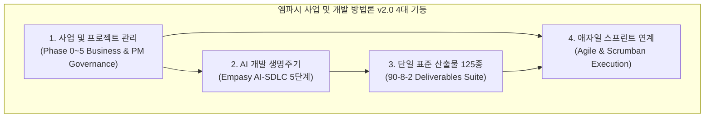
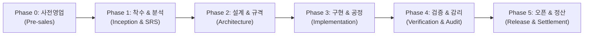

# 엠파시 사업 및 개발 방법론 종합 포털

**엠파시 사업 및 개발 방법론 v2.0 (Empasy Business & Development Methodology)**은 소프트웨어 사업의 출발점인 **제안요청서(RFP) 분석 및 사전영업(Phase 0)**부터 **계약 체결, 착수, 명세 우선 아키텍처 설계, AI 협업 구현, 4-Cycle Zero-Mock 품질 검증 및 감리, 상용 오픈, 최종 검수 서명, 잔금 회수 및 1년 무상 하자보수(Phase 5)**에 이르는 전 생애주기를 체계화한 전사 표준 방법론입니다.

본 포털은 경영진, 영업대표, 총괄PM, 아키텍트, 개발·AI 엔지니어, QA·보안 담당자, 경영지원·법무팀, 그리고 고객사(발주처) 의사결정권자까지 프로젝트 참여자 전원이 일관된 **Phase 0 ~ Phase 5 단일 단계 체계**와 **125종 단일 표준 서식**으로 협업할 수 있도록 구성된 종합 실무 허브입니다.

---

## 1. 방법론 4대 핵심 체계

1. **사업 및 프로젝트 관리 (Business & PM Governance)**:
   - 부실 수주 차단(Go/No-Go 70점), 선금 30~50% 확보, 4대 공식 서명(Sign-off), 3 M/D 변경 통제(CR), 2026 AI 기본법 거버넌스, 지체상금·외주 위장도급 차단, 100% 잔금 회수 행정 체계.
2. **AI 개발 생명주기 (Empasy AI-SDLC)**:
   - 기획부터 배포까지 5단계(요구사항 구체화 -> 명세 우선 아키텍처 -> AgentScope 협업 구현 -> 4-Cycle Zero-Mock 검증 -> HITL 다단계 승인 무인 배포) 엔지니어링 표준.
3. **단일 표준 산출물 125종 스위트 (90-8-2 Deliverables Suite)**:
   - 전사 단일 코드 체계(`EMP-G0`, `EMP-P0~P5`, `EMP-C0`)와 90-8-2 절제형 컨설팅 디자인 표준이 적용된 125종 Clean Blank Master 빈 양식, 121종 `SyncFlow AI` 실전 작성 예시(행별 나란히 다운로드 및 프리셋 동시 수록), 동기화 마크다운 14종, 규모별 Tailoring 프리셋 패키지 6종.
4. **애자일 스프린트 연계 (Agile & Scrumban Execution)**:
   - 거시적 마일스톤(WBS)을 일상적인 1~2주 스프린트로 세분화하고, Git Flow 및 이슈 트래킹 기반으로 매일 가시적으로 구동되는 실행 문화.

---

## 2. 8대 핵심 역할별 원클릭 퀵 점프 매트릭스

| 역할 | 담당 직무 | 필수 확인 가이드 | 핵심 표준 서식 (125종 카탈로그) |
| :--- | :--- | :--- | :--- |
| **영업 / 사업대표** | 수주 타당성 검토, RFP 분석, TCO·견적, 계약 체결, 잔금 회수 | [사전영업 플레이북](./presales-ai-playbook.md) [라이프사이클 총괄](./enterprise-project-lifecycle.md) | [NDA](./enterprise-document-templates.md#emp-p0-01), [Go/No-Go](./enterprise-document-templates.md#emp-p0-02), [TCO 원가](./enterprise-document-templates.md#emp-p0-04), [표준계약서](./enterprise-document-templates.md#emp-p1-01), [준공대금청구](./enterprise-document-templates.md#emp-p5-13) |
| **총괄 PM / PO** | 일정 통제(WBS), 4대 서명 확보, 변경 통제(3 M/D), 감리 대응 | [45개 실행 가이드(SOP)](./enterprise-action-items-guide.md) [표준 문서·거버넌스 가이드](./enterprise-business-documents.md) | [착수계·PMP](./enterprise-document-templates.md#emp-p1-02), [WBS 마스터](./enterprise-document-templates.md#emp-p1-10), [Scope Freeze](./enterprise-document-templates.md#emp-p1-20), [월간/중간보고](./enterprise-document-templates.md#emp-p3-02), [CR Form](./enterprise-document-templates.md#emp-p3-10), [최종검수](./enterprise-document-templates.md#emp-p5-12) |
| **시스템 아키텍트** | 시스템 구조 설계, 망분리·방화벽, 6-File DDL/API 규격 확정 | [명세 우선 아키텍처 가이드](./ai-sdlc-02-architecture.md) [AI-SDLC 총괄](./ai-driven-development.md) | [SAD](./enterprise-document-templates.md#emp-p2-11), [방화벽 신청서](./enterprise-document-templates.md#emp-p2-13), [개발표준·환경정의서](./enterprise-document-templates.md#emp-p2-15), [DB 명세서 9시트](./enterprise-document-templates.md#emp-p2-20) |
| **백엔드 / 프론트 / AI** | AgentScope 협업 코딩, 인터페이스 구현, 프롬프트·단위 테스트 | [AI 협업 구현 가이드](./ai-sdlc-03-implementation.md) [실전 프롬프트 치트시트](./ai-sdlc-prompt-recipes.md) | [API 명세서](./enterprise-document-templates.md#emp-p2-22), [AI 추론·프롬프트 설계서](./enterprise-document-templates.md#emp-p2-24), [AI 규칙사전](./enterprise-document-templates.md#emp-p3-15), [프롬프트 명세서](./enterprise-document-templates.md#emp-p3-16) |
| **QA / 보안 엔지니어** | 4-Cycle Zero-Mock 검증, 보안 49개, OSS, AI 골든셋, UAT | [테스트 자동화 가이드](./ai-sdlc-04-testing.md) [기획 및 요구사항 가이드](./ai-sdlc-01-requirements.md) | [통합테스트](./enterprise-document-templates.md#emp-p4-04), [행안부·KISA 49개 점검표](./enterprise-document-templates.md#emp-p4-06), [OSS 검증서](./enterprise-document-templates.md#emp-p4-07), [AI 골든셋](./enterprise-document-templates.md#emp-p4-09), [UAT 확인서](./enterprise-document-templates.md#emp-p4-11) |
| **DevOps / 운영 관리** | 인프라 구성, CI/CD 무인 배포, 롤백 런북, 장애·FinOps 관제 | [코드 검토 및 배포 가이드](./ai-sdlc-05-review-deploy.md) [표준 문서·거버넌스 가이드](./enterprise-business-documents.md) | [배포·롤백 런북](./enterprise-document-templates.md#emp-p5-03), [이행 체크리스트](./enterprise-document-templates.md#emp-p5-02), [장애보고서](./enterprise-document-templates.md#emp-p5-15), [AI FinOps 정산](./enterprise-document-templates.md#emp-p5-19) |
| **경영지원 / 법무** | 입찰 서류, 보증보험, 선금·하도급 승인, 외주/프리랜서·AI 기본법 | [표준 문서·거버넌스 가이드](./enterprise-business-documents.md) [서식 다운로드 센터](./enterprise-document-templates.md) | [선금신청서](./enterprise-document-templates.md#emp-p1-06), [하도급승인](./enterprise-document-templates.md#emp-p1-07), [AI 거버넌스 점검표](./enterprise-document-templates.md#emp-p1-22), [외주 도급](./enterprise-document-templates.md#emp-c0-08), [프리랜서 계약](./enterprise-document-templates.md#emp-c0-09) |
| **발주처 / 고객사 현업** | 요구사항 확정, 화면 승인, 중간 점검, UAT 인수, 최종 준공 검사 | [라이프사이클 총괄](./enterprise-project-lifecycle.md) [표준 문서·거버넌스 가이드](./enterprise-business-documents.md) | [Scope Freeze](./enterprise-document-templates.md#emp-p1-20), [화면설계 승인서](./enterprise-document-templates.md#emp-p2-10), [UAT 확인서](./enterprise-document-templates.md#emp-p4-11), [최종 검수확인서](./enterprise-document-templates.md#emp-p5-12) |

---

## 3. 사업 전 주기 6단계(Phase 0~5) · AI-SDLC · 애자일 3축 통합 매핑

사업 관리의 6개 단계(`Phase 0 ~ Phase 5`), 개발 공학의 5단계(`AI-SDLC`), 그리고 일상 실행 단위(`Agile/Scrumban`)는 아래 단일 체계로 1:1 매핑됩니다.

| 사업 관리 단계 (PM) | 핵심 목표 및 필수 게이트 | 대응 AI-SDLC 단계 | 애자일·스프린트 연계 | 산출물 코드 대역 |
| :--- | :--- | :--- | :--- | :---: |
| **Phase 0. 사전영업·제안** | Go/No-Go(70점), NDA, 3개년 TCO, PoC, Technical Sign-off | [사전영업 플레이북](./presales-ai-playbook.md) | 프로토타입 스파이크(Spike) | `EMP-P0-01~11` |
| **Phase 1. 착수·분석** | 본계약·선금(30~50%), WBS, 조기 데이터실증, AI 기본법 점검, **Sign-off #1 (Scope Freeze)** | [01단계: 기획·요구사항](./ai-sdlc-01-requirements.md) | 제품 백로그 정제 · Story Point | `EMP-P1-01~22` |
| **Phase 2. 설계·규격화** | 화면 스토리보드(**Sign-off #2**), SAD·방화벽, 6-File DDL, 단일 `/api/v1/` API, AI 프롬프트 설계 | [02단계: 명세 우선 아키텍처](./ai-sdlc-02-architecture.md) | DoR(준비 완료 정의) 확정 | `EMP-P2-01~25` |
| **Phase 3. 구현·공정통제** | AgentScope·Zero-Mock 실연동, 주간/월간/중간보고, CR 통제(3 M/D), 기성검수(40%) | [03단계: AI 협업 코딩](./ai-sdlc-03-implementation.md) | 1~2주 스크럼반 · Git Flow | `EMP-P3-01~17` |
| **Phase 4. 검증·감리·UAT** | 4-Cycle Zero-Mock 검증, **행안부·KISA 개발보안 49개**, OSS, AI 골든셋, 3자 감리, **Sign-off #3 (UAT)** | [04단계: 테스트·자동수정](./ai-sdlc-04-testing.md) | DoD 충족 · 회귀·결함 트리아지 | `EMP-P4-01~11` |
| **Phase 5. 오픈·정산·운영** | 컷오버·롤백, 데이터 대사(오차 0원), 매뉴얼·교육, **Sign-off #4 (최종검수)**, 잔금(30%), SLA·FinOps | [05단계: 코드검토·무인배포](./ai-sdlc-05-review-deploy.md) | 릴리스 회고 · 운영 이관 · P&L | `EMP-P5-01~19` |

---

## 4. 공식 산출물 및 서식 다운로드 센터 (125종 양식 + 121종 작성 예시)

중복 파일과 레거시 포맷을 모두 정비하고, **90-8-2 전사 단일 디자인 표준**으로 통합한 **125종 고유 빈 양식(Clean Blank Master)**과 **121종 실전 작성 예시(`SyncFlow AI` Sample)**를 개별 행과 규모별 프리셋 압축팩(6종) 모두에서 함께 제공합니다.

::: tip 125종 통합 다운로드 센터 및 규모별 Tailoring 프리셋 (양식 + 예시 동시 수록)
* **[표준 문서 양식 통합 다운로드 센터 바로가기](./enterprise-document-templates.md)**
* **제공 패키지 옵션 (6종)**:
  1. **전사 표준 통합 마스터팩 (`Empasy_Master_Full_Pack.zip`, 양식 125종 + 예시 121종 + MD 14종)**: 공공·금융·대기업 감리 대응 전체 올인원 세트
  2. **소형 / MVP 필수팩 (`Empasy_Preset_Small_MVP.zip`, 양식 29종 + 예시 27종)**: 1억 미만·2~3개월 단기 프로젝트 핵심 세트
  3. **표준 엔터프라이즈팩 (`Empasy_Preset_Standard_Enterprise.zip`, 양식 88종 + 예시 85종)**: 일반 민간·중형 SI 표준 납품 세트
  4. **AI / LLM 프로젝트 특화팩 (`Empasy_Preset_AI_Addon.zip`, 양식 10종 + 예시 8종)**: AI 기본법 점검표, 프롬프트·규칙사전, 골든셋, AI FinOps
  5. **법무·계약·외주·위기관리팩 (`Empasy_Preset_Legal_Subcontract.zip`, 양식 18종 + 예시 18종)**: 계약·선금·하도급·외주 5종·EOT·유출신고·중도타절
  6. **작성 예시 참고팩 (`Empasy_SyncFlow_AI_Sample_Pack.zip`, 예시 121종 단독)**: 가상 프로젝트(`한빛글로벌 / SyncFlow AI`) 전체 실전 작성 예시본
:::

---

## 5. 단계별 실행 항목 가이드 (45개 Action Items SOP)

프로젝트 실무자가 각 단계(`Phase 0 ~ Phase 5`)에서 무엇을, 어떤 순서로 실행하고 어떤 표준 산출물(`EMP-*`)로 합격 판정을 받는지 규정한 표준 운영 절차서입니다.

* **[단계별 실행 항목 및 실무 실행 가이드 (45개 Action Items SOP) 전문 보기](./enterprise-action-items-guide.md)**
  - Phase 0 (사전영업·제안): `A0.0 ~ A0.6` (7개 실행 항목)
  - Phase 1 (착수·분석): `A1.0 ~ A1.7` (8개 실행 항목)
  - Phase 2 (설계·규격화): `A2.0 ~ A2.6` (7개 실행 항목)
  - Phase 3 (구현·공정통제): `A3.1 ~ A3.7` (7개 실행 항목)
  - Phase 4 (검증·감리·UAT): `A4.1 ~ A4.6` (6개 실행 항목)
  - Phase 5 (오픈·정산·운영): `A5.1 ~ A5.10` (10개 실행 항목)

---

## 6. 애자일 프로세스 및 공학 워크플로우와의 연계

본 사업 방법론의 거시적 마일스톤(WBS)을 개발팀 단위에서 매주 실행하기 위한 스프린트 운영 및 엔지니어링 문화는 독립된 **[애자일 프로세스](/agile/)** 포털과 연동됩니다.

* **[애자일 & 스크럼반 운영](/agile/scrumban)**: 스크럼반 하이브리드 보드 운영, WIP 제한, 데일리 스크럼, 스토리 포인트 산정
* **[개발 공학 워크플로우](/agile/gitFlow)**: Git Flow 브랜치 모델, Git 커밋 로그 컨벤션, 이슈 작성 규칙
* **[방법론 비교 및 용어사전](/agile/xp_scrum_kanban)**: XP, 스크럼, 칸반 비교 및 애자일 표준 용어집
