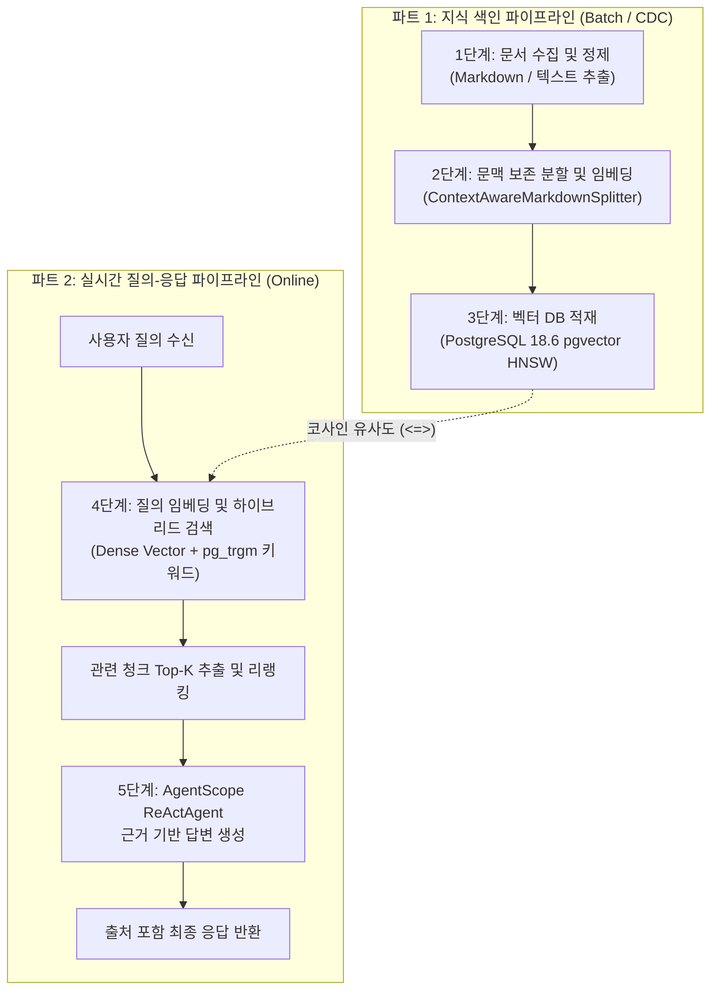

# RAG(검색 증강 생성) 아키텍처 및 파이프라인 구축 가이드

## 목차

1. [RAG란 무엇인가? (개념 및 비유)](#1-rag란-무엇인가-개념-및-비유)
2. [RAG의 필요성 및 도입 효과](#2-rag의-필요성-및-도입-효과)
3. [RAG 시스템 핵심 구성 요소](#3-rag-시스템-핵심-구성-요소)
4. [RAG 구축 5단계 파이프라인](#4-rag-구축-5단계-파이프라인)
5. [AgentScope Java & PostgreSQL 18.6 pgvector 기반 구현](#5-agentscope-java--postgresql-186-pgvector-기반-구현)
6. [향후 발전 방향](#6-향후-발전-방향)

---

## 1. RAG란 무엇인가? (개념 및 비유)

**RAG(Retrieval-Augmented Generation)** 는 **"정보 검색(Retrieval) + 답변 생성(Generation)"** 을 결합한 아키텍처로, 대형 언어 모델(LLM)이 검증된 외부 지식 저장소를 실시간 참조하여 사실에 기반한 답변을 생성하도록 돕는 기술입니다.

- **`R` (Retrieval - 검색)**: 방대한 사내 문서 및 데이터베이스에서 **질문과 의미적으로 가장 연관성 높은 근거 문서를 찾아오는** 단계입니다.
- **`AG` (Augmented Generation - 증강 생성)**: 검색된 근거 문서를 프롬프트 컨텍스트로 주입하여 **LLM이 환각 없이 정확한 답변을 생성하는** 단계입니다.

### 비유로 이해하는 일반 LLM vs RAG 기반 에이전트

- **일반 LLM (기억에만 의존하는 자문역)**: 사전 학습된 방대한 지식을 보유하고 있으나, **학습 시점 이후의 최신 정보나 사내 비공개 규정**을 알지 못하며 근거 없이 그럴듯한 문장을 지어내는 환각(Hallucination) 현상이 발생할 수 있습니다.
- **RAG 기반 에이전트 (검증된 자료실을 갖춘 전문 비서)**: 질문을 받으면 먼저 **사내 전용 자료실(Vector DB)** 에서 최신 규정집과 보고서를 검색(Retrieval)한 뒤, 해당 원문 조항을 근거로 제시하며 정확하게 답변(Augmented Generation)합니다.

---

## 2. RAG의 필요성 및 도입 효과

엔터프라이즈 환경에서 RAG 아키텍처는 상용 LLM의 구조적 한계를 다음과 같이 해결합니다.

| 평가 항목 | 일반 LLM 단독 사용 | 엔터프라이즈 RAG 적용 (`sync-module-rag`) |
| :--- | :--- | :--- |
| **최신 정보 반영** | 사전 학습 시점(Cut-off) 이후 데이터 반영 불가 | 문서 적재 즉시 재학습 없이 실시간 최신 정보 반영 |
| **환각(Hallucination) 통제** | 미확인 사실에 대해 확률적 추측 답변 생성 위험 | 검색된 근거 문서 범위 내에서만 사실 기반 답변 강제 |
| **사내 비공개 지식 활용** | 사내 매뉴얼, 계약서, 운영 DB 참조 불가 | RBAC/ABAC 권한이 검증된 사내 문서 및 지식 그래프 연동 |
| **투명성 및 감사 추적** | 답변의 출처 및 근거 조항 확인 불가 | 참조한 원본 문서 ID, 섹션 헤더, 코사인 유사도 점수 명시 |

---

## 3. RAG 시스템 핵심 구성 요소

1. **원천 지식 저장소 (Knowledge Source)**: PDF, Word, Markdown 기술 문서, 위키, 웹 수집 데이터(`SyncCrawl`) 및 운영 DB 메타데이터
2. **문맥 보존 청킹 및 임베딩 엔진 (Chunking & Embedding)**: 문서를 의미 단위로 분할(`ContextAwareMarkdownSplitter`)하고 고차원 실수 벡터(`vector(1536)`)로 변환하는 임베딩 모델
3. **벡터 데이터베이스 (`PostgreSQL 18.6 pgvector`)**: 벡터 임베딩과 메타데이터(`JSONB`), 전문 검색 토큰(`pg_trgm`)을 단일 ACID 트랜잭션 내에 저장하고 HNSW 인덱스로 고속 검색하는 저장소
4. **에이전트 런타임 (`AgentScope Java`)**: 검색된 컨텍스트를 조합하고 도메인 가드레일을 적용하여 최종 응답을 합성하는 `ReActAgent` 오케스트레이터

---

## 4. RAG 구축 5단계 파이프라인

전체 파이프라인은 **지식 색인(Indexing) 배치 파이프라인**과 **실시간 질의-응답(Retrieval & Generation) 파이프라인**으로 구분됩니다.



### 파트 1: 지식 색인 파이프라인
- **1단계 (문서 수집 및 정제)**: 문서에서 불필요한 노이즈 태그를 제거하고 제목 계층(`H1`~`H3`)과 표 구조를 보존한 마크다운으로 정규화합니다.
- **2단계 (문맥 보존 분할 및 임베딩)**: 단순 글자 수 절단이 아닌 헤더 계층과 코드 블록 경계를 유지하며 청크(Chunk)를 분할한 뒤 임베딩 벡터를 산출합니다.
- **3단계 (벡터 데이터베이스 저장)**: `PostgreSQL 18.6 pgvector` 테이블에 원본 청크 텍스트, 출처 메타데이터(`JSONB`), 임베딩 벡터를 함께 저장합니다.

### 파트 2: 실시간 질의-응답 파이프라인
- **4단계 (질의 벡터 변환 및 유사도 검색)**: 사용자 질의를 동일한 임베딩 모델로 벡터화한 후, `pgvector` HNSW 코사인 거리 연산자(`<=>`)와 `pg_trgm` 키워드 필터를 결합하여 상위 `Top-K` 문서를 조회합니다.
- **5단계 (프롬프트 증강 및 답변 생성)**: 검색된 문서를 시스템 프롬프트의 `[참고 문서]` 블록에 주입하여 `AgentScope Java` 에이전트가 출처와 함께 답변을 생성합니다.

---

## 5. AgentScope Java & PostgreSQL 18.6 pgvector 기반 구현

SyncSeries 전사 표준 스택인 **Spring Boot 4.0**, **AgentScope Java (`io.agentscope:agentscope-harness:2.0.2`)**, **Lombok (`@RequiredArgsConstructor`, `@Slf4j`)**, **PostgreSQL 18.6 (`pgvector`)** 기반의 실전 구현 예시입니다.

### 5.1 Maven 의존성 설정 (`pom.xml`)

```xml
<dependencies>
    <!-- 전사 표준 AI 에이전트 프레임워크 -->
    <dependency>
        <groupId>io.agentscope</groupId>
        <artifactId>agentscope-harness</artifactId>
        <version>2.0.2</version>
    </dependency>

    <!-- 전사 Tri-Hybrid RAG 공통 모듈 -->
    <dependency>
        <groupId>com.empasy.sync</groupId>
        <artifactId>sync-module-rag</artifactId>
        <version>2026.10.0</version>
    </dependency>

    <!-- PostgreSQL 18.6 & pgvector 드라이버 -->
    <dependency>
        <groupId>org.postgresql</groupId>
        <artifactId>postgresql</artifactId>
        <scope>runtime</scope>
    </dependency>
</dependencies>
```

### 5.2 PostgreSQL 18.6 `pgvector` 스키마 (`db/00_extensions.sql` & `02_schema_domain.sql`)

```sql
-- db/00_extensions.sql
CREATE EXTENSION IF NOT EXISTS "vector";
CREATE EXTENSION IF NOT EXISTS "uuid-ossp";
CREATE EXTENSION IF NOT EXISTS "pg_trgm";

-- db/02_schema_domain.sql
CREATE TABLE rag_knowledge_chunk (
    chunk_id VARCHAR(64) PRIMARY KEY,
    doc_title VARCHAR(255) NOT NULL,
    section_path VARCHAR(500) NOT NULL,
    content TEXT NOT NULL,
    embedding vector(1536) NOT NULL,
    created_at TIMESTAMPTZ NOT NULL DEFAULT CURRENT_TIMESTAMP
);

CREATE INDEX idx_rag_chunk_embedding_hnsw
    ON rag_knowledge_chunk USING hnsw (embedding vector_cosine_ops)
    WITH (m = 16, ef_construction = 64);
```

### 5.3 문맥 보존 청킹 및 PostgreSQL 18.6 벡터 검색 리포지토리

인메모리 컬렉션(`HashMap` 등) 대신 실제 `JdbcTemplate` / MyBatis와 `PostgreSQL 18.6 pgvector` 코사인 거리 연산자(`<=>`)를 사용하여 영속성과 확장성을 보장합니다.

```java
package com.empasy.sync.rag.repository;

import lombok.Builder;
import lombok.Getter;
import lombok.RequiredArgsConstructor;
import lombok.extern.slf4j.Slf4j;
import org.springframework.jdbc.core.JdbcTemplate;
import org.springframework.stereotype.Repository;

import java.util.List;

@Slf4j
@Repository
@RequiredArgsConstructor
public class PgVectorKnowledgeRepository {

    private final JdbcTemplate jdbcTemplate;

    @Getter
    @Builder
    public static class MatchedChunk {
        private final String chunkId;
        private final String docTitle;
        private final String sectionPath;
        private final String content;
        private final double similarity;
    }

    public List<MatchedChunk> searchTopK(String vectorLiteral, int topK, double minSimilarity) {
        String sql = """
            SELECT chunk_id,
                   doc_title,
                   section_path,
                   content,
                   1 - (embedding <=> ?::vector) AS similarity
              FROM rag_knowledge_chunk
             WHERE 1 - (embedding <=> ?::vector) >= ?
             ORDER BY embedding <=> ?::vector ASC
             LIMIT ?
            """;

        return jdbcTemplate.query(
                sql,
                (rs, rowNum) -> MatchedChunk.builder()
                        .chunkId(rs.getString("chunk_id"))
                        .docTitle(rs.getString("doc_title"))
                        .sectionPath(rs.getString("section_path"))
                        .content(rs.getString("content"))
                        .similarity(rs.getDouble("similarity"))
                        .build(),
                vectorLiteral, vectorLiteral, minSimilarity, vectorLiteral, topK
        );
    }
}
```

### 5.4 AgentScope Java 기반 RAG 질의 서비스 및 컨트롤러

```java
package com.empasy.sync.rag.service;

import com.empasy.sync.rag.repository.PgVectorKnowledgeRepository;
import com.empasy.sync.rag.repository.PgVectorKnowledgeRepository.MatchedChunk;
import io.agentscope.core.agent.ReActAgent;
import io.agentscope.core.message.Msg;
import lombok.RequiredArgsConstructor;
import lombok.extern.slf4j.Slf4j;
import org.springframework.stereotype.Service;

import java.util.List;
import java.util.stream.Collectors;

@Slf4j
@Service
@RequiredArgsConstructor
public class EnterpriseRagQueryService {

    private final PgVectorKnowledgeRepository knowledgeRepository;
    private final EmbeddingVectorClient embeddingVectorClient;
    private final ReActAgent ragAnswerAgent;

    public String answerWithEvidence(String question) {
        String queryVector = embeddingVectorClient.encodeAsVectorLiteral(question);
        List<MatchedChunk> chunks = knowledgeRepository.searchTopK(queryVector, 5, 0.78);

        if (chunks.isEmpty()) {
            throw new IllegalStateException("질의와 일치하는 사내 근거 문서를 찾을 수 없습니다: " + question);
        }

        String contextBlock = chunks.stream()
                .map(c -> String.format("[%s > %s (유사도: %.3f)]\n%s",
                        c.getDocTitle(), c.getSectionPath(), c.getSimilarity(), c.getContent()))
                .collect(Collectors.joining("\n\n---\n\n"));

        String augmentedPrompt = String.format("""
                다음 [사내 근거 문서]만을 기반으로 질문에 정확히 답변하고 출처를 명시하십시오.
                
                [사내 근거 문서]
                %s
                
                [사용자 질문]
                %s
                """, contextBlock, question);

        Msg reply = ragAnswerAgent.reply(Msg.ofUser("User", augmentedPrompt));
        return reply.getText();
    }
}
```

### 5.5 `application.yml` 표준 설정 (`SyncLLM` 게이트웨이 연동)

```yaml
spring:
  profiles:
    active: ${SPRING_PROFILES_ACTIVE:local}
  datasource:
    driver-class-name: org.postgresql.Driver
    url: jdbc:postgresql://localhost:45432/sync_db
    username: ${DB_USERNAME:postgres}
    password: ${DB_PASSWORD:postgres}

sync:
  ai:
    gateway-url: ${SYNC_LLM_GATEWAY_URL:http://localhost:18085/api/v1/llm}
    chat-model: claude-3-5-sonnet
    embedding-model: text-embedding-3-large
    min-similarity: 0.78
```

---

## 6. 향후 발전 방향

1. **Tri-Hybrid RAG 아키텍처 고도화**: Dense 벡터 검색(`pgvector` HNSW) + Sparse 키워드 검색(`pg_trgm` / BM25) + 도메인 지식 그래프(Knowledge Graph) 3중 결합 및 Cross-Encoder 리랭킹(`sync-module-rag`)으로 복합 도메인 질의 정확도를 극대화합니다.
2. **시맨틱 캐싱 및 FinOps 연계**: `SyncLLM` 시맨틱 캐시(유사도 \(\ge 0.95\))와 연동하여 반복되는 사내 규정·매뉴얼 질의의 LLM 추론 비용과 응답 지연시간을 절감합니다.
3. **실시간 CDC 및 적응형 웹 지식 동기화**: `SyncCrawl` 적응형 수집 파이프라인과 연동하여 외부 법령·시장 동향 변경 시 벡터 인덱스를 무중단 증분 갱신합니다.
4. **ABAC 문서 보안 및 PII 가드레일**: 질의자의 역할(Role)과 부서 속성에 따라 접근 가능한 청크만 벡터 검색 조건에 자동 필터링하고 민감 개인정보를 실시간 마스킹합니다.
