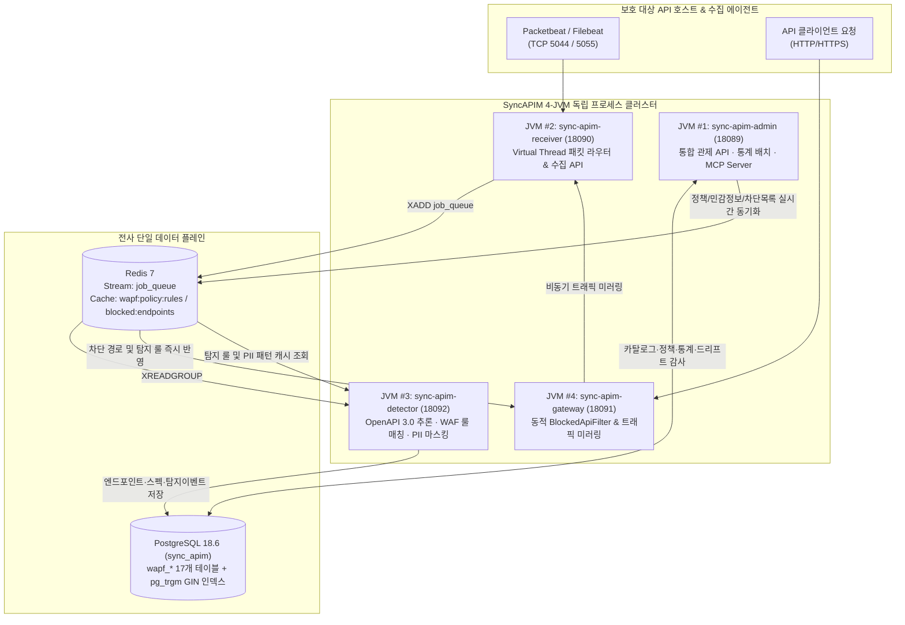

# SyncAPIM 4-JVM 시스템 아키텍처 및 데이터베이스 설계

`SyncAPIM`은 **Java 25 (Virtual Threads)**, **Spring Boot 3.5.16**, **AgentScope Java (`io.agentscope:agentscope-harness`)**, **PostgreSQL 18.6 (`JSONB` + `pg_trgm`)**, **Redis 7 Stream**, **Vue 3 + Vben Admin (`@empasy/sync-apim-admin`)** 표준 기술 스택 위에 구축된 고성능 API 모니터링 및 보안 에이전트 플랫폼입니다.

---

## 1. 성능 격리형 4-JVM 프로세스 아키텍처

대규모 API 트래픽 환경에서 패킷 수집(I/O 집약)과 정규식·JWT 위협 탐지(CPU 집약) 부하가 관리자 콘솔이나 인라인 게이트웨이 응답 지연에 영향을 주지 않도록 **4개의 독립된 JVM 프로세스**로 분리하여 기동합니다.

### 1.1 JVM별 역할 및 포트 규격

| JVM 모듈명 | 호스트 포트 (컨테이너) | 핵심 클래스 | 주요 역할 및 성능 격리 목적 |
| :--- | :---: | :--- | :--- |
| **`sync-apim-admin`** | `18089` (`8080`) | `WapfApiEndPointController`, `WapfPolicyController`, `ApimTrafficAggregationService`, `SyncApimAgent`, `ApimMcpController` | 11개 관제 화면 REST API(`/api/v1/apim/...`), 5분 주기 트래픽·위협 통계 집계 배치, `SyncVerse` 연동 6대 MCP 도구 서빙 |
| **`sync-apim-receiver`** | `18090` (`8081`) TCP `5044`/`5055` | `PacketReceiver`, `LumberjackRouter`, `RedisStreamProducerService`, `ApimReceiverController` | Java 25 Virtual Threads 기반 비차단 TCP 소켓 서버 및 HTTP 수집 엔드포인트(`/api/v1/apim/receiver/ingest`) 운영, Redis Stream `job_queue` 적재 |
| **`sync-apim-detector`** | `18092` (`8090`) | `RedisStreamConsumer`, `DetectionRuleServiceImpl`, `WapfDetectRuleServiceImpl` | Redis Stream 워커 스레드 풀에서 실시간 패킷 파싱, 엔드포인트 자동 등록, OpenAPI 3.0.1 명세 합성, 6대 WAF 정규식/JWT 위협 탐지 및 8대 PII 마스킹 후 PostgreSQL `wapf_detect_event` 저장 |
| **`sync-apim-gateway`** | `18091` (`8083`) | `BlockedApiFilter`, `BlockedApiRegistryService`, `ApimGatewayController` | DB(`wapf_api_endpoint.block_status='1'`) 및 Redis(`wapf:blocked:endpoints`)와 동기화되어 차단된 섀도우/고위험 API 호출을 `403 Forbidden`으로 즉시 차단하고 정상 트래픽을 `receiver`로 미러링 |

---

## 2. 멀티모듈 디렉터리 및 Maven 좌표 구조

`sync-apim/Server/` 하위 모든 모듈은 전사 표준에 따라 `artifactId`와 물리 디렉터리명이 `1:1`로 일치합니다.

- **최상위 부모 POM**: `com.empasy.sync.apim:sync-apim-parent:1.0.0-SNAPSHOT` (`sync-apim/pom.xml`)
- **백엔드 부모 POM**: `com.empasy.sync.apim:sync-apim-server-parent:1.0.0-SNAPSHOT` (`sync-apim/Server/pom.xml`)
- **공통 및 코어 모듈**:
  - `Server/sync-apim-common`: 17개 도메인 엔티티(`WapfApiEndPoint`, `WapfDetectEvent` 등), MyBatis-Plus Mapper, 공통 Service (`WapfOpenApiSpecServiceImpl` 드리프트 감사 엔진 포함)
  - `Server/sync-apim-base-core`: `MybatisPlusConfig`, `RedisConfig`, `AuthInterceptor`, `GlobalExceptionHandler`
  - `Server/sync-apim-module-system`: 시스템 인증·인가 및 DB 동적 메뉴 공급(`/api/v1/apim/sys/permission/getUserPermissionByToken`)

---

## 3. PostgreSQL 18.6 도메인 데이터베이스 설계 (`db/02_schema_domain.sql`)

기존 MariaDB/MySQL + OpenSearch 이중 스토리지를 단일 **PostgreSQL 18.6 (`sync_apim` 데이터베이스)**으로 통합하여 운영 복잡도와 메모리 점유율을 낮추었습니다.

| 분류 | 물리 테이블명 | 주요 컬럼 및 설계 특징 |
| :--- | :--- | :--- |
| **에이전트 & 호스트** | `wapf_agent`, `wapf_agent_host`, `wapf_host` | 수집 에이전트 마스터(SHA-256 `auth_key`), 보호 대상 API 호스트(`host`, `status`) 및 `N:M` 매핑 |
| **API 카탈로그** | `wapf_api_endpoint`, `wapf_api_endpoint_detail`, `wapf_api_endpoint_history` | 자동 발견된 `host` + `path` + `method` 고유 엔드포인트, 위험도 점수(`risk_score`), 차단 상태(`block_status`), 경로 병합 이력 |
| **데이터 필드 & 명세** | `wapf_data_field`, `wapf_open_api_spec` | 요청/응답 섹션별(`REQ_QUERY`, `REQ_BODY`, `RES_BODY`) JSONPath 필드, 민감정보 매핑(`sensitivity_uuid`), OpenAPI 3.0.1 JSON 명세 및 드리프트 상태(`contract_status`, `drift_summary`) |
| **WAF 정책 & 탐지 룰** | `wapf_policy`, `wapf_policy_api_endpoint`, `wapf_policy_rule`, `wapf_rule` | 7대 보안 정책 마스터(`basic` 기본 정책 여부), 정책별 엔드포인트 적용 매핑, 6대 위협 탐지 정규식(`pattern`) 및 JWT 검증 옵션(`jwt_option`) |
| **민감정보 & 경보** | `wapf_sensitivity`, `wapf_email` | 8대 개인·금융 민감정보 탐지 정규식 마스터, 고위험 위협 발생 시 보안 담당자 경보 메일 발송 이력 |
| **시계열 통계** | `wapf_endpoint_average`, `wapf_rule_average` | 엔드포인트별 호출량 및 위협 탐지 룰별·심각도별 시계열 집계 테이블 |
| **실시간 탐지 이벤트** | `wapf_detect_event` | 패킷 요청/응답 헤더·파라미터·본문(`JSONB` 및 마스킹 텍스트), 위협 코드 배열(`threat_codes`), 위험도 점수, `pg_trgm` GIN 인덱스 기반 초고속 전문 검색 |
