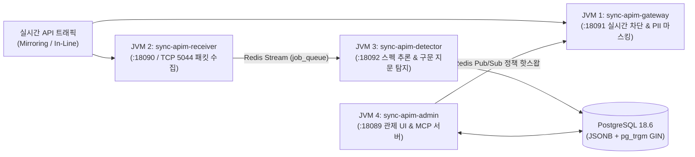

# SyncAPIM 엔터프라이즈 도입 FAQ

엔터프라이즈 API 보안 관제 및 OpenAPI 3.0.1 명세 거버넌스 플랫폼인 `SyncAPIM`을 도입할 때 보안 아키텍트, 인프라 운영팀, 개발 조직에서 자주 묻는 핵심 질문과 기술적 답변입니다.

---

## 1. 4-JVM 성능 격리 및 단일 스토리지 아키텍처



### Q1. 왜 단일 서버가 아닌 4개의 개별 JVM(`admin`, `receiver`, `detector`, `gateway`)으로 분리되어 있나요?
- **답변**: API 보안 관제 솔루션은 초당 수천~수만 건 이상의 네트워크 패킷을 수신(`receiver`)하고, 다중 인코딩 해제·구문 토큰 지문 분석(`SqlXssLexicalTokenizer`) 및 OpenAPI 3.0.1 JSON 스키마 추론(`detector`)을 상시 수행해야 합니다. 만약 패킷 수신·탐지 엔진과 관리자 UI 백엔드(`admin`) 또는 인라인 게이트웨이(`gateway`)가 동일한 JVM 힙과 CPU 스레드 풀을 공유하면, 대량 DDoS/공격 트래픽 유입 시 관리 콘솔 응답이 멈추거나 게이트웨이 지연이 발생할 수 있습니다.
- 따라서 `SyncAPIM`은 **공통 도메인 모듈(`sync-apim-common`)은 공유하되 런타임 프로세스는 4개 JVM으로 완전 격리**하여 각 구간의 레이턴시를 독립 보장하고 트래픽 특성에 따라 특정 JVM만 개별 스케일아웃(Scale-Out)할 수 있도록 설계되었습니다.

| JVM 프로세스 | 기본 포트 | 주요 역할 | 권장 스케일링 기준 |
| :--- | :---: | :--- | :--- |
| **`sync-apim-gateway`** | `18091` (`8083`) | 인라인 리버스 프록시, 실시간 위협 차단(`BlockedApiFilter`), 커널 eBPF 연동 | 인바운드 API RPS 증가 시 수평 확장 |
| **`sync-apim-receiver`** | `18090` / TCP `5044` | Java 25 Virtual Threads 기반 비침투 미러링 패킷 고속 수신 및 큐 적재 | 수집 에이전트 호스트 수 증가 시 확장 |
| **`sync-apim-detector`** | `18092` (`8090`) | 섀도우 API 스키마 추론, Contract Drift 감사, WAF 구문 분석 및 PII 마스킹 | Redis Stream 큐 대기 길이 기반 오토스케일 |
| **`sync-apim-admin`** | `18089` (`8080`) | 관제 대시보드 REST API(`/api/v1/apim/*`), 시계열 집계 배치 및 MCP 서버 | 관리자 동시 접속 및 A2A 관제 트래픽 기준 |

### Q2. 별도의 무거운 OpenSearch/Elasticsearch 클러스터 없이 대용량 패킷 로그 포렌식 검색이 가능한가요?
- **답변**: 네, 가능합니다. 기존 레거시 보안 관제 환경에서는 패킷 이벤트 검색을 위해 별도의 OpenSearch/Elasticsearch 클러스터(최소 3노드, 수십 GB JVM 힙 메모리)를 중복 운영해야 했으나, `SyncAPIM`은 **PostgreSQL 18.6의 `JSONB` 컬럼과 `pg_trgm` 트라이그램 GIN 인덱스**를 결합한 `wapf_detect_event` 단일 스토리지 아키텍처를 채택했습니다.
- 이를 통해 공격 페이로드 부분 문자열 검색(`ILIKE '%union select%'`), 구문 지문 필터링, 엔드포인트별 시계열 통계 집계를 단일 RDBMS 위에서 밀리초 단위로 처리하면서도 인프라 구축 비용과 운영 복잡도를 획기적으로 절감합니다.

---

## 2. 무중단 도입, 제로데이 가상 패치 및 섀도우 API 탐지

### Q3. 운영 중인 기존 레거시 WAS나 마이크로서비스를 수정하지 않고도 적용할 수 있나요?
- **답변**: 네, 서비스 특성에 따라 두 가지 무중단 배포 모드를 선택하거나 혼합할 수 있습니다:
  1. **비침투 미러링 모드 (Out-of-Band Mirroring)**: 보호 대상 서버나 앞단 L4/L7 스위치·Ingress에서 `sync-apim-receiver`로 트래픽 사본을 미러링합니다. 운영 서비스에 **지연 영향(Latency Impact `0ms`) 및 단일 장애점(SPOF) 위험이 전혀 없이** 미등록 섀도우 API 카탈로그화와 위협 탐지를 즉시 시작할 수 있습니다.
  2. **인라인 차단 게이트웨이 모드 (In-Line Protection)**: 고위험 외부 노출 API에 대해 실시간 공격 차단(`403 Forbidden`)과 응답 본문 민감정보(PII) 동적 마스킹이 필요한 경우 `sync-apim-gateway`를 앞단에 배치하여 원클릭으로 차단 정책을 즉시 집행합니다.

### Q4. 신규 제로데이 취약점이 발표되었을 때 애플리케이션 재배포 없이 어떻게 방어하나요?
- **답변**: 전사 보안 관측소인 **[`SyncWatch`](/syncwatch/)** 와 실시간 연동하여 **무중단 핀셋 가상 패치(Virtual Patching)** 를 수행합니다.
  1. `SyncWatch`가 8대 글로벌 위협 피드(OSV.dev, GitHub GHSA, NVD CVE, CISA KEV, Nuclei, OWASP CRS, MITRE ATT&CK, KISA)에서 신규 취약점을 수집하고 샌드박스 검증(TP 100%, FP 0%)을 마친 **`ApimDefensePack`** 을 `POST /api/v1/apim/waf/defense-pack/apply`로 배포합니다.
  2. `SyncAPIM`은 수신 즉시 어휘 토큰 분석기(`SqlXssLexicalTokenizer`)와 격리된 SpEL 평가기(`SandboxedDefenseEvaluator`)에 방어 규칙을 핫스왑 적재합니다.
  3. 개발팀이 백엔드 소스코드를 패치하고 재배포하기 전이라도, 취약한 특정 엔드포인트(`targetPath`)로 유입되는 공격 페이로드만 정밀하게 차단하여 방어 공백(Window of Exposure)을 `0분`으로 단축합니다.

```json
{
  "eventId": "evt-20261118-99412",
  "detectedAt": "2026-11-18T14:22:09Z",
  "clientIp": "203.0.113.45",
  "httpMethod": "POST",
  "requestUri": "/api/v1/shop/orders/search",
  "attackCategory": "SQLI",
  "grammarFingerprint": "sUE|s&1",
  "matchedRuleId": "arule-sqli-union-001",
  "actionTaken": "BLOCKED_403_AND_EBPF_DROP",
  "evaluationLatencyMs": 0.09,
  "maskedPiiFields": ["card_number", "phone_number"]
}
```

---

## 3. 폐쇄망(Air-Gapped) 운영 및 컴플라이언스

### Q5. 외부 인터넷이 완전히 차단된 폐쇄망(Air-Gapped) 환경에서도 AI 보안 분석과 PII 마스킹이 동작하나요?
- **답변**: 네, 체계적으로 동작합니다. `SyncAPIM`의 패킷 수집, OpenAPI 3.0.1 스키마 자동 추론, Contract Drift 비교 감사, 구문 토큰 지문 기반 WAF 위협 탐지(`SqlXssLexicalTokenizer`), 그리고 8대 개인·금융 민감정보(주민등록번호, 카드번호, 계좌번호, 이메일, 전화번호, 비밀번호, 이름, IP) 마스킹 엔진은 외부 LLM 연결 없이도 **결정론적(Deterministic) 알고리즘으로 100% 자체 동작**합니다.
- 또한 보안 관제 담당자를 위한 공격 패킷 포렌식 해설 및 대응 가이드 생성은 사내 폐쇄망에 구축된 `SyncLLM`(온프레미스 vLLM/Ollama 연동)을 통해 외부 데이터 반출 없이 안전하게 수행됩니다.
