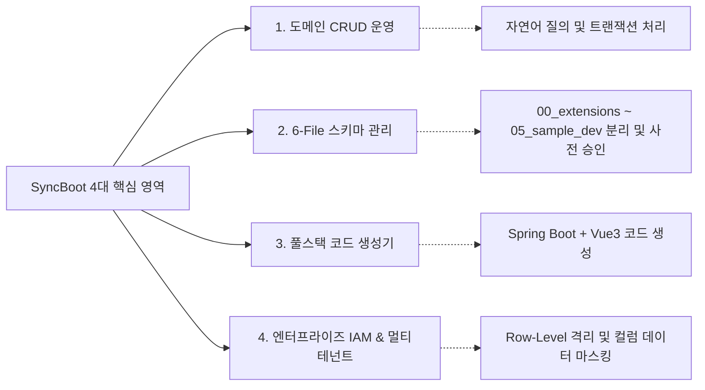
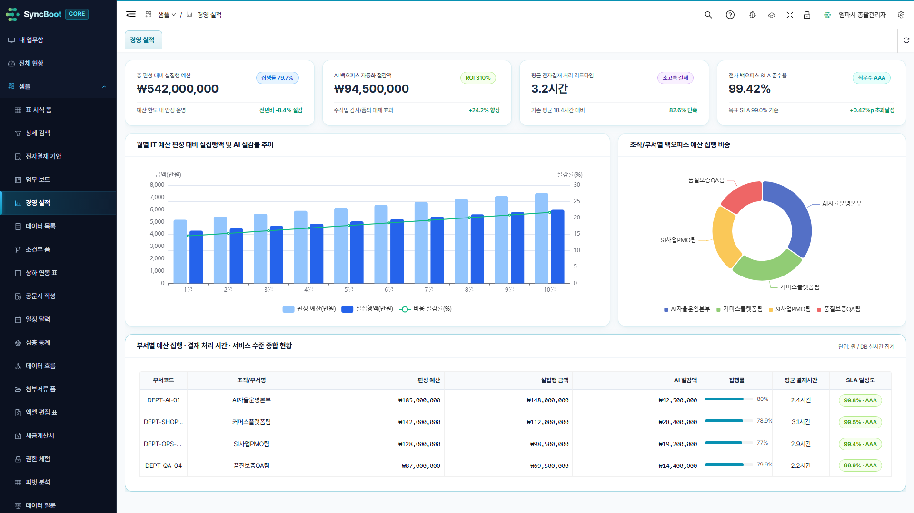
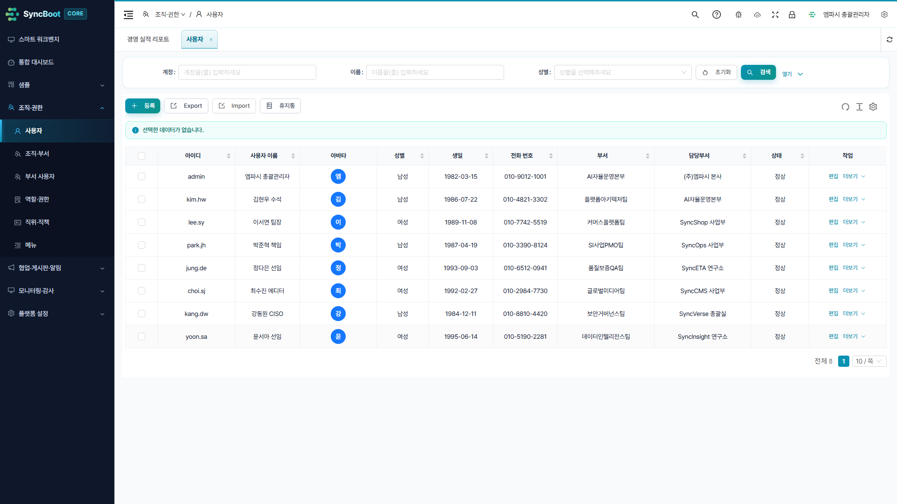
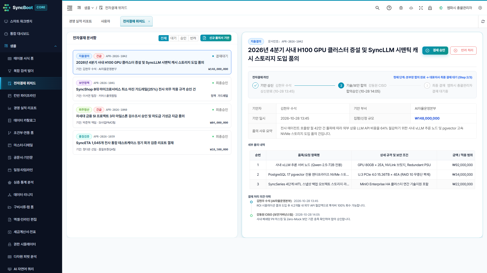
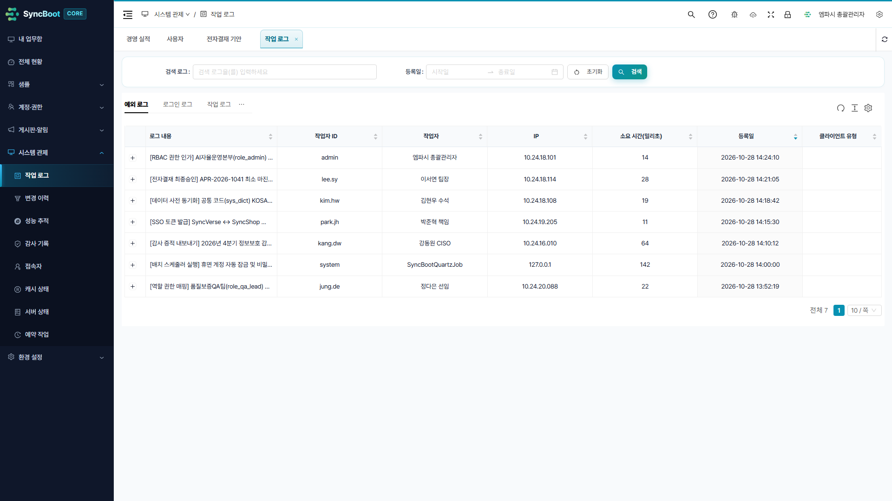

# SyncBoot: 디지털 백엔드 프레임워크 개요

> **비개발자 · 도입 검토 안내**: 쉬운 제품 소개는 [SyncBoot 제품 홈페이지(empasy.io)](https://empasy.io/ko/solutions/sync-boot.html){target="_blank" rel="noopener"}에서, 설치 없는 화면 체험은 [통합 데모 포털](https://demo.empasy.io/products/sync-boot#demo){target="_blank" rel="noopener"}에서 이용하실 수 있으며, 소개서·제안서 PDF는 [제안서 자료실](/proposals/)에서 내려받으실 수 있습니다.

SyncBoot는 비즈니스 도메인 맥락을 인지하여 데이터베이스 운영과 API 개발을 지원하는 Java 기반 엔터프라이즈 백엔드 플랫폼입니다.

Spring Boot 4.0, AgentScope Java (`io.agentscope:agentscope-harness`), Model Context Protocol (MCP) 표준을 기반으로 설계되었으며, 데이터 CRUD, 스키마 관리, 풀스택 코드 생성, 분산 로그 진단 기능을 제공합니다.

---

## 4대 핵심 기능 영역

1. **도메인 CRUD 운영 및 쿼리 실행 (Domain Operations)**:
   - 자연어 질의 및 표준 MCP 도구를 통해 도메인 데이터를 조회하고 조작할 수 있도록 지원합니다.
   - 인가된 트랜잭션 경계 내에서 데이터를 안전하게 처리합니다.

2. **스키마 설계 및 6-File SQL 표준 (Schema Governance)**:
   - 요구사항에 맞춰 6-File SQL(`db/00_extensions.sql ~ 05_sample_dev.sql`) 구조를 구성합니다.
   - 스키마 변경 시 영향도를 사전에 분석하고 관리자의 사전 승인(Human-in-the-Loop)을 거쳐 데이터베이스에 반영합니다.

3. **로우코드 풀스택 API & UI 생성기 (Low-Code Fullstack)**:
   - 데이터베이스 엔티티 메타데이터를 기반으로 Controller, Service, Mapper, DTO 및 Vben Admin 표준 컴포넌트(`BasicTable`, `BasicModal`, `BasicForm`) 기반 Vue 3 화면 코드를 생성합니다.

4. **멀티테넌트 및 RBAC 보안 (Enterprise Security)**:
   - 테넌트 데이터 격리(독립 DB 및 공유 DB 방식 지원), 컬럼 단위 동적 데이터 마스킹, 행 단위(Row-Level) 권한 필터링을 지원합니다.

---

## 5대 백엔드 워커 역할 체계

SyncBoot는 도메인 관리, 보안, 배치, 프로토콜 연동 역할을 모듈별로 나누어 운영합니다.

| 역할 명칭 | 주요 담당 업무 | 실행 방식 |
| :--- | :--- | :--- |
| **Domain Operator** | 도메인 데이터 모델 기반 CRUD 및 비즈니스 쿼리 처리 | 자율 처리 |
| **Schema Architect** | 6-File 표준 DDL 설계, ERD 다이어그램 생성 및 변경 영향도 분석 | 제안 후 개발자 승인 |
| **Security IAM** | RBAC 역할/메뉴 매핑, 행 단위 데이터 필터링, 민감정보 마스킹 감시 | 상시 정책 적용 |
| **MCP Dispatcher** | 외부 시스템 및 오케스트레이터와의 A2A 통신을 위한 표준 Tool/Resource 제공 | HTTP SSE 프로토콜 |
| **Batch Orchestrator**| 대용량 데이터 처리 및 주기적 Quartz/Spring Batch 작업 분산 스케줄링 | 스케줄러 기반 실행 |

---

## 도입 시 기대 효과

- **백엔드 개발 공수 절감**: 반복적인 CRUD API 작성과 관리자 UI 화면 구현 시간을 단축합니다.
- **안정적인 DB 마이그레이션**: 변경 영향도 사전 분석과 승인 콘솔을 통해 스키마 변경 시의 오류 위험을 낮춥니다.
- **로그 수집 및 분석 시간 단축**: 분산 서버의 최근 에러 로그를 수집하여 원인 파악을 돕습니다.
- **표준 프레임워크 준수**: Spring Boot 4.0, AgentScope Java (`io.agentscope:agentscope-harness`), OpenAPI 3.0, Model Context Protocol(MCP) 사양을 준수합니다.

---

## 실제 구동 화면 및 핵심 워크플로우

### 1. 백오피스 경영 실적 및 예산·결재 리드타임 통합 대시보드
편성 대비 실집행 예산, AI 백오피스 자동화 절감액, 평균 전자결재 처리 리드타임, 전사 백오피스 SLA 준수율 및 부서별 집행 현황을 한 화면에서 모니터링합니다.

### 2. 조직·부서 연동 사용자 계정 및 역할 기반 권한 관리
조직·부서 트리와 연동된 사용자 계정 원장, 직무 역할(RBAC) 매핑, 메뉴·버튼 단위 접근 권한을 데이터베이스 단일 원천 기반으로 즉시 제어합니다.

### 3. 한국형 전자결재 문서함 및 다단계 결재선 승인 위저드
지출결의·보안정책·외주정산·품질검증 등 한국형 전자결재 문서함과 기안 상신 -> 기술/보안 합의 -> 최종 결재로 이어지는 다단계 결재선 및 세부 품의 내역 워크플로우를 기본 내장하고 있습니다.

### 4. 실시간 권한 인가 · 전자결재 · 배치 스케줄러 작업 감사 로그
권한 인가, 전자결재 최종승인, 공통 코드 동기화, SSO 토큰 발급, 정기 배치 스케줄러 실행 등 전사 백오피스 작업 이력과 수행자 IP·소요시간을 중앙에서 추적합니다.

---

## 문서 목차

- [5분 퀵스타트 가이드](./quickstart) - Docker Compose를 이용한 로컬 환경 실행
- [시스템 아키텍처 및 모듈 구성](./architecture) - 4계층 아키텍처 및 워커 체계
- [지능형 스키마 스튜디오](./schema-studio) - 6-File SQL 표준 및 DDL 승인 절차
- [로우코드 풀스택 생성기](./lowcode-generator) - 백엔드 API 및 Vue 3 UI 코드 생성
- [멀티테넌트 및 RBAC 보안](./enterprise-security) - Row-level 보안 및 데이터 마스킹
- [배치 및 작업 스케줄러](./batch-and-scheduler) - Spring Batch 및 Quartz 작업 관리
- [AgentScope Java 및 MCP 연동](./mcp-and-ai) - Model Context Protocol 도구 사양
- [프로덕션 배포 및 벤치마크](./production-guide) - 컨테이너 배포 및 성능 지표
- [PostgreSQL 18.6 로컬 컨테이너 환경](./h2) - Zero-Mock 기반 로컬 개발 및 테스트 DB 구성
