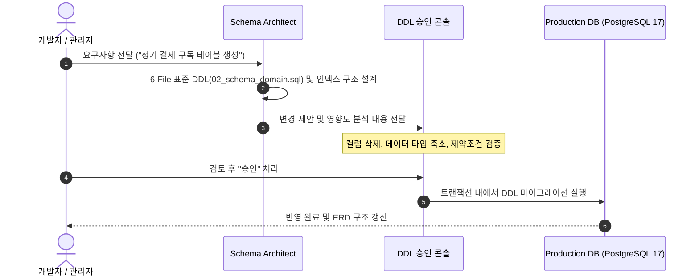

# 지능형 스키마 스튜디오 & 6-File DB 표준

SyncBoot는 데이터베이스 스키마 설계의 일관성과 안정성을 확보하기 위해 전사 **6-File DB 스크립트 표준(`db/00_extensions.sql ~ 05_sample_dev.sql`)**과 **사전 승인(HITL) 체계**를 적용합니다.

---

## 6-File DB 스크립트 표준 구조

SyncBoot를 포함한 모든 서비스 모듈의 데이터베이스 스크립트는 서브프로젝트 루트 `db/` 디렉터리 아래 6단계 파일과 `migrations/` 폴더로 구분하여 관리합니다.

```
db/
├── 00_extensions.sql     # 0. PostgreSQL 17 필수 확장 모듈 선언 (vector, uuid-ossp, pg_trgm 등)
├── 01_schema_system.sql  # 1. 플랫폼 공통 시스템 테이블 DDL (sys_user, sys_role, sys_permission 등)
├── 02_schema_domain.sql  # 2. 해당 도메인 전용 비즈니스 테이블 DDL, 인덱스 및 제약조건
├── 03_seed_system.sql    # 3. 시스템 필수 기초 데이터 (초기 최고관리자, 기본 역할, 공통 사전 코드)
├── 04_seed_domain.sql    # 4. 도메인 업무 메뉴(sys_permission), 역할 권한 매핑 및 마스터 데이터
├── 05_sample_dev.sql     # 5. [DEV/TEST ONLY] 개발 및 시연 전용 샘플 데이터
└── migrations/           # 점진적 스키마 형상 변경 추적 폴더 (Flyway V{MAJOR}_{MINOR}_{PATCH}__*.sql)
```

| 파일명 | 포함 내용 | 관리 주체 및 원칙 |
| :--- | :--- | :--- |
| **`00_extensions.sql`** | `vector`, `uuid-ossp`, `pg_trgm` 등 PostgreSQL 17 확장 모듈 | 플랫폼 인프라 표준 |
| **`01_schema_system.sql`** | `sys_user`, `sys_role`, `sys_permission`, `sys_tenant` 등 시스템 기본 테이블 DDL | 플랫폼 공통 표준 |
| **`02_schema_domain.sql`** | 비즈니스 도메인 테이블 DDL 및 인덱스 | **Schema Architect** 제안 후 개발자 승인 |
| **`03_seed_system.sql`** | 최고관리자 계정, 기본 역할, 시스템 코드 시드 데이터 | 무중복 순수 `INSERT INTO` 강제 |
| **`04_seed_domain.sql`** | 도메인 동적 라우팅 메뉴(`sys_permission`) 및 권한 매핑(`sys_role_permission`) | DB 단일 원천(Single Source of Truth) |
| **`05_sample_dev.sql`** | 개발 및 QA 테스트 환경용 기초 샘플 데이터 | 운영 환경 자동 실행 제외 |

---

## DDL 사전 승인 절차 (Human-in-the-Loop)

프로덕션 데이터베이스 스키마 변경 시 발생할 수 있는 오류를 줄이기 위해 단계별 검토 및 승인 절차를 거칩니다.



### 영향도 분석 및 변경 감지
- `DROP TABLE`, `DROP COLUMN`, 컬럼 길이 축소 등 기존 데이터에 영향을 미칠 수 있는 쿼리를 사전에 분류하여 알림을 제공합니다.
- 변경 취소가 필요한 경우를 대비해 롤백용 스크립트 생성을 함께 지원합니다.

---

## DDL 정의 예시

```sql
-- ===================================================
-- db/02_schema_domain.sql (도메인 특화 테이블 정의 예시)
-- ===================================================

CREATE TABLE tb_subscription (
    id BIGSERIAL PRIMARY KEY,
    tenant_id VARCHAR(64) NOT NULL DEFAULT 'default',
    user_id BIGINT NOT NULL,
    plan_code VARCHAR(32) NOT NULL,
    status VARCHAR(20) NOT NULL DEFAULT 'ACTIVE',
    started_at TIMESTAMPTZ NOT NULL,
    next_billing_at TIMESTAMPTZ NULL,
    created_by VARCHAR(64) NOT NULL,
    created_at TIMESTAMPTZ NOT NULL DEFAULT CURRENT_TIMESTAMP,
    updated_at TIMESTAMPTZ NOT NULL DEFAULT CURRENT_TIMESTAMP
);

CREATE INDEX idx_sub_tenant_user ON tb_subscription (tenant_id, user_id);
CREATE INDEX idx_sub_billing ON tb_subscription (status, next_billing_at);
```
