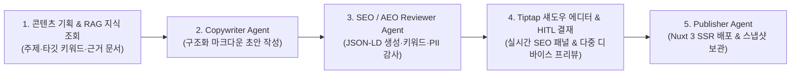

# SyncCMS AI 콘텐츠 라이프사이클 및 저작도구

`SyncCMS`는 단순한 정적 웹 문서 저장소를 넘어, 사내 지식베이스(`sync-module-rag`)와 비즈니스 이벤트를 바탕으로 마케팅 아티클, 기술 릴리스 노트, 다국어 랜딩 페이지를 자율 생성·검수·발행하는 **3단계 멀티 에이전트 스웜(`CmsSwarmWorkflowService`)** 과 **엔터프라이즈 저작 스튜디오**를 제공합니다.

---

## 1. Copywriter-SEO-Publisher 3단계 에이전트 스웜 & 4단계 라이프사이클

`SyncCMS`의 콘텐츠 생산 파이프라인은 **`AgentScope Java` (`io.agentscope:agentscope-harness:2.0.2`)** 기반의 3대 전문 에이전트(`Copywriter Agent` -> `SEO/AEO Reviewer Agent` -> `Publisher Agent`)와 인간 편집자의 **HITL(Human-in-the-Loop) 승인 게이트**가 유기적으로 결합되어 동작합니다.



### 1.1 에이전트별 역할 및 산출물 명세

| 스웜 단계 | 담당 에이전트 (`CmsSwarmWorkflowService`) | 주요 입력 데이터 | 자동 생성 산출물 및 검증 기준 |
| :---: | :--- | :--- | :--- |
| **Stage 1** | **`Copywriter Agent`**<br>(초안 저작 에이전트) | 주제 프롬프트, 타깃 독자, `PostgreSQL 18.6 pgvector` 참조 지식 청크 | • `H1` -> 요약문(TL;DR) -> `H2/H3` 본문 -> FAQ 구조의 마크다운 초안<br>• 생성형 AI(GEO) 인용에 최적화된 두괄식 단락 및 표 구조화 |
| **Stage 2** | **`SEO & Safety Reviewer Agent`**<br>(품질·보안 검수 에이전트) | Stage 1 초안, 타깃 검색 키워드, 금칙어·PII 규칙 | • HTML Head 메타(`title`, `description`, `og:*`, `canonical`) 자동 합성<br>• `Schema.org` (`Article`, `FAQPage`, `Product`) JSON-LD 스크립트 생성<br>• 개인정보(PII) 및 미검증 수치 포함 여부 정적 감사 (85점 미만 시 재작성 지시) |
| **Stage 3** | **`HITL Editor & Approval`**<br>(편집자 검토 및 승인 게이트) | 초안 + 메타데이터 + AEO/GEO 감사 리포트 | • Tiptap 에디터 내 인라인 교정 및 다중 뷰포트(Desktop/Tablet/Mobile) 확인<br>• 변경 전후 스냅샷 Diff 확인 후 최종 발행 승인 |
| **Stage 4** | **`Publisher Agent`**<br>(배포 및 캐시 동기화 에이전트) | 승인된 콘텐츠 엔티티(`cms_article`) | • Nuxt 3 SSR 프론트엔드(`cms.empasy.io`) 및 Live SDK 캐시 즉시 무효화<br>• 이전 버전 롤백 스냅샷(`cms_content_snapshot`) 영구 보관 |

---

## 2. 엔터프라이즈 저작도구 및 실시간 진단 컴포넌트

### 2.1 Tiptap 섀도우 에디터 (`TiptapShadowEditor.vue`)
- **다중 디바이스 뷰포트 프리뷰**: 저작 화면 상단 토글을 통해 데스크톱(`1440px`), 태블릿(`768px`), 모바일(`375px`) 반응형 렌더링 결과를 배포 전에 즉시 시뮬레이션합니다.
- **양방향 마크다운 & 리치 블록 동기화**: 슬래시 커맨드(`/`) 기반 콜아웃, 코드 블록, 비교 테이블, Lottie 애니메이션 블록 삽입과 표준 마크다운 소스를 무손실로 양방향 변환합니다.

### 2.2 실시간 인라인 SEO / AEO / GEO 분석 패널 (`SeoAnalysisPanel.vue`)
에디터 우측 패널에서 작성 중인 본문을 실시간 파싱하여 검색엔진(SEO)과 AI 답변엔진(AEO/GEO) 최적화 점수를 100점 만점으로 정량 평가합니다.

| 진단 카테고리 | 세부 평가 항목 | 권장 기준치 (Pass Threshold) |
| :--- | :--- | :--- |
| **HTML Head 메타 거버넌스** | 메타 타이틀 길이, 메타 디스크립션 길이, Canonical URL, OG 이미지 | Title `30~60자`, Description `70~155자`, 필수 OG 태그 100% 완비 |
| **시맨틱 문서 계층 (SEO)** | 단일 `H1` 존재 여부, `H2` -> `H3` 순서 무결성, 문단당 평균 단어 수 | 계층 역전 `0건`, 이미지 `alt` 속성 누락 `0건` |
| **AI 답변 인용 최적화 (AEO/GEO)** | 상단 핵심 요약(Summary) 블록, 구조화 비교표(`<table>`), Q&A 섹션, JSON-LD | `Article` 또는 `FAQPage` JSON-LD 스키마 유효성 100% 통과 |
| **컴플라이언스 & 보안** | 본문 내 전화번호·이메일·계좌번호 등 PII 노출 및 깨진 링크(Dead Link) | 비인가 PII 노출 `0건`, 내부·외부 깨진 링크 `0건` |

### 2.3 반응형 인터랙션 컴포넌트 라이브러리
- **`CommentSection.vue`**: 독자 댓글·대댓글 스레드, 스팸 필터링 및 관리자 검수 대기(`[검수 대기]`) -> 승인 상태 전이를 지원합니다.
- **`CommandPaletteModal.vue`**: `Ctrl + K` (또는 `Cmd + K`) 단축키로 전체 아티클, 미디어 자산, 메타 정책을 즉시 검색하고 이동하는 커맨드 팔레트입니다.

---

## 3. 스웜 워크플로우 실행 REST API 및 JSON-LD 출력 예시

### 3.1 AI 콘텐츠 스웜 생성 요청 (`POST /api/v1/cms/swarm/generate`)

```json
{
  "topic": "엔터프라이즈 API 보안에서 구문 토큰 지문 분석과 런타임 가상 패치의 중요성",
  "categoryCode": "TECH_WHITEPAPER",
  "targetKeywords": ["API 보안", "가상 패치", "섀도우 API", "SyncAPIM"],
  "targetLocale": "ko-KR",
  "includeFaqSchema": true,
  "autoPublish": false
}
```

### 3.2 스웜 실행 결과 및 자동 생성된 JSON-LD 응답 예시

```json
{
  "code": 200,
  "success": true,
  "result": {
    "articleId": "art-20261118-305",
    "workflowStatus": "PENDING_HITL_APPROVAL",
    "aeoGeoAuditScore": 94,
    "headMeta": {
      "title": "엔터프라이즈 API 보안: 구문 토큰 지문 분석과 실시간 가상 패치 가이드 | SyncCMS",
      "description": "미등록 섀도우 API 탐지부터 SqlXssLexicalTokenizer 구문 분석 및 무중단 가상 패치까지의 API 보안 아키텍처를 해설합니다.",
      "canonicalUrl": "https://cms.empasy.io/insights/enterprise-api-security-virtual-patching"
    },
    "generatedJsonLd": {
      "@context": "https://schema.org",
      "@type": "TechArticle",
      "headline": "엔터프라이즈 API 보안: 구문 토큰 지문 분석과 실시간 가상 패치 가이드",
      "author": {
        "@type": "Organization",
        "name": "Empasy Enterprise Security Team"
      },
      "datePublished": "2026-11-18"
    }
  }
}
```
