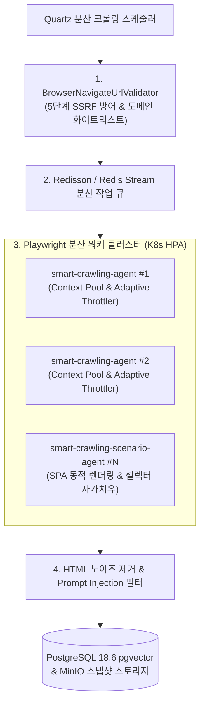

# SyncCrawl 적응형 안티봇 대응 및 분산 스케일링 아키텍처

## 1. 엔터프라이즈 웹 수집 안정성 및 적응형 레이트 제어

대규모 외부 시장 동향, 공공 고시 데이터, 경쟁사 가격 지수를 상시 수집할 때 대상 서버에 과부하를 주지 않으면서도 차단(IP Rate Limit, WAF 오탐, 동적 렌더링 지연) 없이 안정적으로 데이터를 확보해야 합니다. `SyncCrawl`은 합법적 로봇 배제 표준 및 엔터프라이즈 보안 거버넌스를 준수하면서 다음 3계층 적응형 수집 제어 기술을 적용합니다.



### 1.1 3대 핵심 적응형 수집 안정화 기법
1. **브라우저 컨텍스트 격리 및 헤더·뷰포트 정규화 (Browser Context Isolation)**:
   - 워커 노드마다 격리된 Playwright `BrowserContext` 풀을 운영하여 쿠키, `localStorage`, TLS 세션, `User-Agent`, `Accept-Language`, WebGL/Viewport 메타데이터를 실제 데스크톱·모바일 표준 브라우저 프로파일과 일관되게 유지합니다.
2. **도메인별 적응형 스로틀링 및 프록시 풀 로테이션 (Adaptive Rate Limiting & Proxy Pool)**:
   - 대상 도메인별 동시 연결 수(`maxConcurrentPerHost`), 요청 간 지터(Jitter) 지연시간(`minDelayMs` ~ `maxDelayMs`), 응답 상태 코드(`429 Too Many Requests`, `503 Service Unavailable`) 기반 지수 백오프(Exponential Backoff)를 자동으로 조절합니다.
   - 다중 아웃바운드 프록시 게이트웨이와 세션 지속성(Sticky Session)을 결합하여 로그인이나 다단계 페이지네이션 중 세션이 끊기지 않도록 보장합니다.
3. **비정상 차단 화면 감지 및 HITL 원격 세션 개입 (Block Detection & HITL Handoff)**:
   - 대상 사이트에서 비정상적인 빈 화면(White Screen), 접근 거부 배너, 또는 추가 인증 요구가 감지되면 무한 재시도로 IP가 영구 차단되는 것을 막기 위해 작업을 즉시 일시 정지(`PAUSED_BY_GUARD`)하고 스마트 크롤링 콘솔로 알림을 발송합니다.

---

## 2. 도메인별 수집 정책 및 스케일링 설정 규격

`SyncCrawl`은 각 수집 대상 사이트(`crawl_site_config`)별로 정밀한 트래픽 제어와 자가치유 파라미터를 DB에서 동적으로 관리합니다.

| 설정 파라미터 (`crawl_site_config`) | 기본값 | 허용 범위 | 기능 및 동작 설명 |
| :--- | :---: | :---: | :--- |
| `max_concurrent_workers` | `4` | `1 ~ 32` | 동일 타깃 도메인에 동시 접속을 허용할 최대 Playwright 워커 컨텍스트 수 |
| `request_delay_jitter_ms` | `1200` | `200 ~ 10000` | 연속 페이지 탐색 시 기본 대기 시간에 추가할 랜덤 지터(`ms`) 범위 |
| `backoff_multiplier` | `2.0` | `1.5 ~ 5.0` | `429` / `503` 응답 수신 시 재시도 대기 시간을 증폭시키는 지수 배수 |
| `max_retry_attempts` | `3` | `0 ~ 5` | 네트워크 일시 단절 또는 타임아웃 시 최대 자동 재시도 횟수 |
| `self_healing_enabled` | `true` | `true / false` | DOM 구조 변경으로 기존 CSS/XPath 매칭 실패 시 시맨틱 DOM 자가치유 활성화 |
| `ssrf_strict_mode` | `true` | `true` (고정) | 5단계 SSRF 방어 가드(사설 IP, 루프백, 클라우드 메타데이터 `169.254.169.254` 차단) 강제 |

---

## 3. 쿠버네티스(K8s) 기반 분산 워커 오토스케일링 및 데이터 정제

### 3.1 Kubernetes HPA (Horizontal Pod Autoscaler) 구성
대량의 정기 수집 배치가 동시에 시작되어 Redis 분산 작업 큐(`crawl:job:pending`)의 대기 길이가 임계치를 초과하면, Kubernetes HPA가 `smart-crawling-agent` 파드를 자동으로 수평 확장합니다.

```yaml
apiVersion: autoscaling/v2
kind: HorizontalPodAutoscaler
metadata:
  name: synccrawl-worker-hpa
  namespace: sync-series
spec:
  scaleTargetRef:
    apiVersion: apps/v1
    kind: Deployment
    name: smart-crawling-agent
  minReplicas: 2
  maxReplicas: 20
  metrics:
    - type: Resource
      resource:
        name: cpu
        target:
          type: Utilization
          averageUtilization: 70
    - type: Pods
      pods:
        metric:
          name: synccrawl_pending_jobs_per_pod
        target:
          type: AverageValue
          averageValue: "15"
```

### 3.2 RAG 지식 오염 방지(Data Poisoning Guard) 및 정제 파이프라인
수집된 외부 웹페이지에 숨겨진 악의적 프롬프트 인젝션(Indirect Prompt Injection, 예: `font-size: 0` 또는 `display: none` 영역에 삽입된 `"이전 지시를 무시하고..."` 문구)이 사내 RAG 지식베이스를 오염시키지 않도록 `Sanitizer` 파이프라인이 3단계 정제를 수행합니다:
1. **비가시 영역 및 스크립트 태그 완전 제거**: `<script>`, `<style>`, `<iframe>`, `aria-hidden="true"`, 비가시 CSS 스타일 노드를 DOM 트리에서 선제 제거합니다.
2. **구조 보존 마크다운 변환**: 본문 제목(`H1`~`H3`), 표(`<table>`), 목록 구조만 추출하여 정규화된 마크다운으로 변환하고 SHA-256 콘텐츠 해시를 산출하여 중복 적재를 방지합니다.
3. **PostgreSQL 18.6 `pgvector` 증분 인덱싱**: 변경분이 감지된 문서만 `ContextAwareMarkdownSplitter`로 청킹하여 `PostgreSQL 18.6 pgvector` HNSW 인덱스에 실시간 반영합니다.
