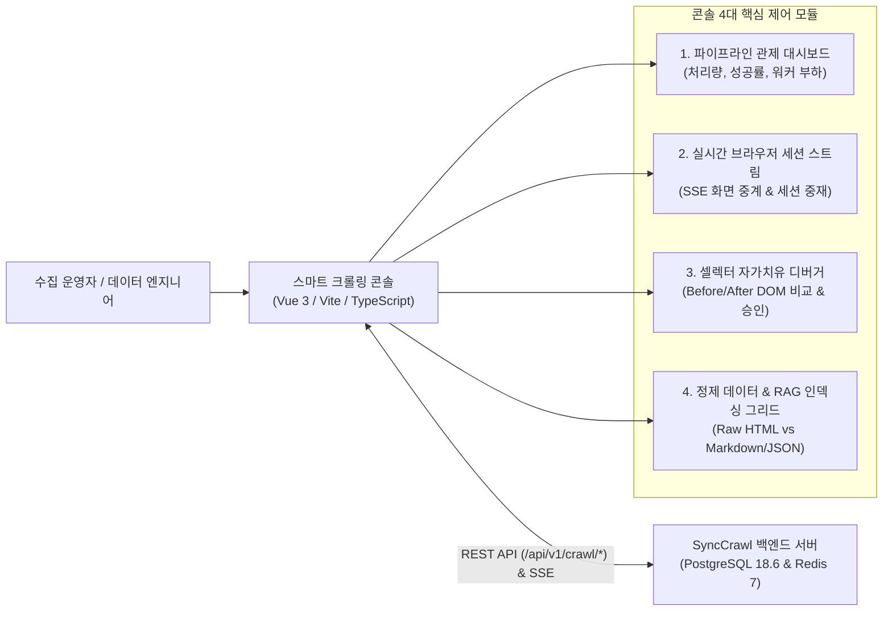

# 스마트 크롤링 콘솔 아키텍처 및 실시간 관제 가이드

## 1. 개요 및 콘솔 설계 목적

대규모 엔터프라이즈 웹 데이터 수집 환경에서는 수십~수백 개의 크롤링 시나리오와 분산 브라우저 워커가 비동기적으로 실행되므로, 전체 수집 파이프라인의 처리량과 오류 징후를 실시간으로 파악하고 제어할 수 있는 통합 관제 도구가 필수적입니다.

`SyncCrawl`의 **스마트 크롤링 콘솔(Smart Crawling Console)** 은 Vue 3, Vite, TypeScript 기반으로 구축된 운영자 전용 웹 콘솔로, 자연어 기반 수집 시나리오 설계부터 실시간 Playwright 브라우저 세션 스트리밍, 시맨틱 DOM 셀렉터 자가치유(Self-Healing) 승인, 수집 데이터 정합성 검증 및 Tri-Hybrid RAG 인덱싱 현황까지 단일 화면에서 관제합니다.



---

## 2. 콘솔 4대 핵심 기능 상세

### 2.1 파이프라인 통합 관제 대시보드
- **실시간 워커 클러스터 텔레메트리**: 가동 중인 `smart-crawling-agent` 및 `smart-crawling-scenario-agent` 노드의 활성 브라우저 컨텍스트 수, 초당 페이지 처리량(Pages/sec), 평균 렌더링 소요 시간을 실시간 시각화합니다.
- **오류 유형별 분류 집계**: 네트워크 타임아웃, DOM 구조 변경(Selector Drift), SSRF 가드 차단, 스키마 유효성 실패 건수를 유형별로 집계하여 병목 지점을 즉시 식별합니다.

### 2.2 실시간 수집 세션 관제 (Live Session Stream & Arbitration)
- 현재 실행 중인 워커 에이전트의 브라우저 탐색 단계(URL 접속 -> 동적 렌더링 대기 -> 요소 클릭 -> 텍스트 추출)를 Server-Sent Events(SSE) 스트림으로 실시간 중계합니다.
- 다수의 시나리오가 동일한 타깃 사이트의 제한된 로그인 계정을 공유할 때 발생하는 세션 충돌을 방지하기 위해, 콘솔에서 Redisson 분산 세션 락 점유 현황과 대기 큐를 실시간으로 확인하고 강제 잠금 해제(Lock Release)를 제어할 수 있습니다.

### 2.3 시맨틱 DOM 셀렉터 디버거 (Self-Healing Selector Studio)
- 대상 웹사이트 개편으로 기존 CSS/XPath 셀렉터가 깨졌을 때, `SyncCrawl` 자가치유 엔진이 DOM 계층 구조와 시맨틱 속성, 주변 텍스트 앵커를 분석하여 후보 셀렉터를 자동 제안합니다.
- 관리자는 콘솔의 분할 비교 뷰(Diff View)에서 **변경 전 DOM 스냅샷과 변경 후 매칭된 추출 결과**를 시각적으로 대조한 뒤 원클릭으로 시나리오 템플릿 DB에 반영할 수 있습니다.

| 자가치유 진단 항목 | 콘솔 표시 정보 | 운영자 액션 |
| :--- | :--- | :--- |
| **기존 셀렉터 (`brokenSelector`)** | `div.board-list > ul > li:nth-child(1) > a.title` | 매칭 실패 원인(`0 Elements Matched`) 확인 |
| **복구 제안 셀렉터 (`healedSelector`)** | `article[data-role='notice-item'] h3.post-heading > a` | 추출 샘플 텍스트 및 시맨틱 유사도(`0.96`) 검토 |
| **반영 방식 (`applyMode`)** | 자동 반영(`>= 0.95`) 또는 관리자 승인 대기(`0.80 ~ 0.94`) | **[영구 반영]** 또는 **[수동 셀렉터 편집]** 클릭 |

### 2.4 수집 데이터 정합성 검증 및 RAG 인덱싱 그리드
- 수집된 원시 HTML(`MinIO / S3` 보관본), 노이즈가 제거된 정규화 마크다운, 그리고 JSON 스키마 추출 결과를 3단 분할 뷰로 나란히 대조합니다.
- 필수 필드(예: `title`, `published_at`, `body_markdown`)의 누락 여부를 JSON Schema 규칙으로 자동 검증하고, 검증 통과 문서를 `PostgreSQL 18.6 pgvector` 지식베이스로 즉시 색인 트리거합니다.

---

## 3. 콘솔 연동 표준 REST API 및 SSE 이벤트 규격

스마트 크롤링 콘솔은 백엔드 서버와 `/api/v1/crawl/*` 표준 Canonical URL로 통신합니다.

| 화면 모듈 | HTTP Method & Canonical URL | 설명 |
| :--- | :--- | :--- |
| **대시보드 통계** | `GET /api/v1/crawl/dashboard/metrics` | 워커 가동률, 일간 수집 건수, 자가치유 성공률, 큐 대기열 조회 |
| **사이트 & 시나리오** | `GET /api/v1/crawl/sites/list`<br>`POST /api/v1/crawl/scenarios/execute` | 수집 대상 도메인 목록 조회 및 자연어/시나리오 즉시 실행 트리거 |
| **실시간 세션 스트림** | `GET /api/v1/crawl/sessions/{jobId}/stream` | 브라우저 실행 단계 로그 및 캡처 프레임 SSE 실시간 구독 |
| **셀렉터 자가치유 승인** | `POST /api/v1/crawl/healing/{healingId}/approve` | AI가 복구한 신규 DOM 셀렉터를 운영 템플릿에 확정 반영 |
| **수집 데이터 & RAG** | `GET /api/v1/crawl/documents/list`<br>`POST /api/v1/crawl/documents/{docId}/index-rag` | 정제 마크다운 결과 조회 및 `PostgreSQL 18.6 pgvector` 즉시 임베딩 |

```json
{
  "jobId": "crawl-job-20261118-019",
  "siteCode": "KR_GOV_POLICY_PORTAL",
  "status": "HEALED_AND_COMPLETED",
  "extractedRecords": 25,
  "selfHealingEvent": {
    "field": "attachment_download_url",
    "previousSelector": "div.file-box > a.btn-down",
    "healedSelector": "section.attach-area a[href*='/download/']",
    "confidenceScore": 0.97,
    "autoApplied": true
  },
  "ragIndexing": {
    "vectorTable": "crawl_rag_chunk",
    "chunksCreated": 118,
    "embeddingModel": "text-embedding-3-large"
  }
}
```

---

## 4. 프론트엔드 아키텍처 및 빌드 최적화

- **DB 단일 원천 동적 라우팅**: 메뉴 트리와 버튼 권한을 `sys_permission` 테이블(`/api/v1/crawl/sys/permission/getUserPermissionByToken`)에서 동적으로 수신하여 역할별 접근을 통제합니다.
- **반응형 상태 동기화 및 지연 로딩**: Pinia 상태 저장소와 SSE 이벤트 버스를 결합하여 페이지 새로고침 없이 수집 진행률을 실시간 갱신하며, Vite 코드 스플리팅(Code-splitting)으로 초기 로딩 시간을 최소화합니다.
