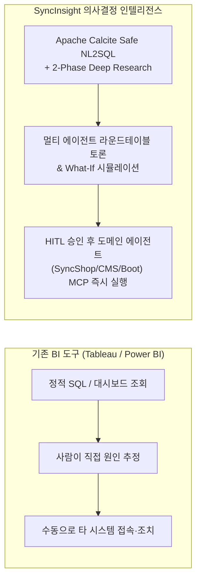

# SyncInsight 엔터프라이즈 도입 FAQ

SyncInsight를 전사 의사결정 인텔리전스 및 데이터 관제 플랫폼으로 도입할 때 아키텍트, 데이터 엔지니어, 보안 담당자가 자주 묻는 핵심 질문과 기술적 답변입니다.

---

## 1. 기존 BI 도구 대비 차별점 및 아키텍처



### Q1. 태블로(Tableau)나 파워BI(Power BI)가 이미 있는데 SyncInsight가 왜 필요한가요?
- **답변**: 기존 BI 도구는 이미 발생한 과거의 데이터를 차트로 시각화(Descriptive Analytics)하는 데 머무르며, 지표 하락의 원인 분석이나 해결책 도출, 타 시스템 반영은 여전히 사람이 수동으로 수행해야 합니다.
- 반면 SyncInsight는 **내부 DB 지표와 외부 웹 시장 지식(`SyncCrawl`)을 결합하는 2-Phase Deep Research**, **상반된 관점(성장·리스크·고객경험)의 멀티 에이전트 라운드테이블 토론**, **What-If 사전 손익 시뮬레이션**, 그리고 관리자 승인(HITL) 직후 **Model Context Protocol(MCP)을 통해 도메인 시스템(`SyncShop`, `SyncCMS`, `SyncBoot`, `SyncOps`)에 실행 전략을 자동 반영하고 스냅샷 롤백을 보장**하는 엔드투엔드 의사결정 인텔리전스 플랫폼입니다.

### Q2. 분석 대상 데이터소스로 어떤 데이터베이스와 스토리지를 연결할 수 있나요?
- **답변**: 전사 표준인 **PostgreSQL 18.6 (`pgvector`)** 뿐만 아니라 사내 운영 중인 이기종 RDBMS 및 데이터 웨어하우스를 읽기 전용 커넥터로 연결할 수 있습니다.

| 데이터소스 구분 | 지원 엔진 및 프로토콜 | 주요 연동 방식 및 보안 정책 |
| :--- | :--- | :--- |
| **전사 코어 RDBMS** | PostgreSQL 18.6 (`pgvector`, `pg_trgm`) | Read Replica JDBC 연결, HNSW 벡터 검색 및 시맨틱 사전 자동 동기화 |
| **기간계 엔터프라이즈 DB** | Oracle,Tibero, MySQL, MariaDB, MS SQL Server | 읽기 전용 계정(`SELECT`-Only), Apache Calcite 관계대수 AST 방화벽 적용 |
| **외부 시장·비정형 지식** | `SyncCrawl` 웹 수집 파이프라인, S3 / MinIO 문서 | 마크다운 청킹 후 `sync-module-rag` Tri-Hybrid RAG 지식베이스 통합 조회 |
| **실시간 스트림 & 메트릭** | Redis Stream, Prometheus, `SyncAPIM` 트래픽 통계 | 이상 징후(Anomaly Detection) 실시간 감지 및 RCA 자동 트리거 |

---

## 2. 데이터 거버넌스 및 Safe NL2SQL 보안 가드레일

### Q3. AI가 자연어 질의를 SQL로 변환할 때 사내 데이터베이스를 임의로 수정하거나 과부하 장애를 유발할 위험은 없나요?
- **답변**: `sync-module-nl2sql` 모듈의 **Apache Calcite 1.37.0 및 JSqlParser 4.9 기반 4중 보안 방화벽**이 모든 자연어 생성 SQL을 실행 전에 검증합니다.
  1. **Strict Read-Only AST 검증**: 쿼리 문자열을 추상 구문 트리(AST)로 파싱하여 `SELECT` 단일 문장만 허용하며, `INSERT`, `UPDATE`, `DELETE`, `DROP`, `ALTER`, `TRUNCATE`, `GRANT`, 다중 세미콜론(`;`) 체이닝을 파서 레벨에서 100% 차단합니다.
  2. **테넌트 및 RBAC 행/열 격리 자동 주입**: 질의자의 역할(`sys_role`)과 소속 테넌트(`tenant_id`) 조건을 AST `WHERE` 절에 강제 주입하고, 급여·주민등록번호 등 비인가 민감 컬럼 참조 시 즉시 실행을 거부합니다.
  3. **쿼리 비용 및 타임아웃 가드레일**: 카티션 곱(Cartesian Product) 조인이나 인덱스 없는 대용량 풀스캔을 사전 차단하며, 최대 실행 타임아웃(`10초`) 및 기본 결과 행 제한(`LIMIT 1000`)을 자동 부여합니다.

```json
{
  "requestQuestion": "최근 30일간 카테고리별 반품률이 가장 높은 상위 5개 상품과 주요 반품 사유를 조회해줘",
  "validatedAst": {
    "statementType": "SELECT",
    "readOnlyVerified": true,
    "injectedTenantFilter": "tenant_id = 'empasy_prod'",
    "enforcedLimit": 1000,
    "timeoutMs": 10000
  },
  "generatedSql": "SELECT p.category_name, p.product_name, COUNT(r.return_id) AS return_cnt, ROUND(COUNT(r.return_id) * 100.0 / NULLIF(COUNT(o.order_id), 0), 2) AS return_rate FROM oms_order o JOIN pms_product p ON o.product_id = p.product_id LEFT JOIN oms_order_return r ON o.order_id = r.order_id WHERE o.tenant_id = 'empasy_prod' AND o.created_at >= CURRENT_TIMESTAMP - INTERVAL '30 days' GROUP BY p.category_name, p.product_name ORDER BY return_rate DESC LIMIT 5"
}
```

### Q4. 도출된 비즈니스 액션이 실제 운영 시스템에 반영된 후 예상과 다른 결과가 나오면 어떻게 되돌릴 수 있나요?
- **답변**: SyncInsight가 제안하는 모든 도메인 변경 액션(`Action Proposal`)은 **HITL(Human-in-the-Loop) 관리자 사전 승인** 없이는 절대 자동 집행되지 않습니다.
- 또한 승인되어 대상 에이전트(`SyncShop`, `SyncCMS`, `SyncBoot`)의 MCP 도구가 호출되는 순간, 변경 직전 상태의 **원자적 데이터 스냅샷(`snapshotId`)** 과 보상 트랜잭션(`rollback_command`)이 자동 생성됩니다. 관리자는 액션 승인 센터에서 **1-Click 롤백** 버튼을 눌러 1초 이내에 직전 운영 상태로 무손실 복구할 수 있습니다.

---

## 3. 온프레미스 폐쇄망 배포 및 FinOps 비용 통제

### Q5. 금융·공공기관처럼 외부 인터넷이 완전히 차단된 폐쇄망(Air-Gapped) 환경에서도 딥 리서치와 NL2SQL이 동작하나요?
- **답변**: 네, 완벽히 동작합니다. SyncInsight는 외부 클라우드 SaaS 의존성 없이 사내 쿠버네티스 또는 온프레미스 서버에 컨테이너로 배포되며, 사내 GPU 서버에 구축된 **온프레미스 LLM(`vLLM` / `Ollama` 기반 Llama-3.3-70B, Qwen-2.5-72B 등)** 및 **`SyncLLM` 게이트웨이**와 연동하여 사내망 내부에서만 안전하게 추론을 수행합니다.

### Q6. 전사 임직원이 자연어 데이터 탐색과 딥 리서치를 많이 사용할 경우 LLM 토큰 비용이 급증하지 않나요?
- **답변**: 모든 LLM 호출은 `SyncLLM` FinOps 게이트웨이를 경유하며 다음 3단계 비용 최적화 정책이 기본 적용됩니다:
  1. **시맨틱 캐싱(Semantic Cache)**: 유사도 \(\ge 0.95\) 이상의 반복 지표 질의나 일일 브리핑 요청은 LLM 재추론 없이 캐시된 SQL 템플릿 및 분석 요약 구조를 재활용하여 토큰 비용을 최대 45% 절감합니다.
  2. **작업 난이도별 모델 티어링**: 단순 NL2SQL 변환이나 스마트 시트 셀 보조(`Cell Copilot`)는 경량 Tier 1~2 모델로 처리하고, 복합 원탁 토론(`Roundtable Debate`)만 고성능 Tier 3~4 모델로 분기합니다.
  3. **부서별 월간 쿼터 가드레일**: 부서·프로젝트별 월간 토큰 예산 소진율에 따라 자동 경량 모델 다운그레이드 및 알림 정책이 작동합니다.

---

## 4. 권장 인프라 사양 및 표준 API 엔드포인트 요약

| 구분 | 항목 | 표준 설정 및 사양 |
| :--- | :--- | :--- |
| **코어 백엔드 서버** | `sync-insight-server` | Java 25, Spring Boot 3.5.16, `AgentScope Java 2.0.2`, 4 vCPU / 8GB RAM 이상 |
| **데이터베이스** | `PostgreSQL 18.6` | `pgvector/pgvector:pg18` (`vector`, `uuid-ossp`, `pg_trgm`), 6-File DB SSOT 표준 |
| **NL2SQL 안전 엔진** | `sync-module-nl2sql` | Apache Calcite 1.37.0 + JSqlParser 4.9 (`SELECT`-Only AST 방화벽, 기본 `LIMIT 1000`) |
| **핵심 REST API** | Canonical Prefix | `POST /api/v1/insight/nl2sql/query`<br>`POST /api/v1/insight/research/jobs`<br>`POST /api/v1/insight/debate/sessions`<br>`POST /api/v1/insight/actions/{actionId}/approve` |
| **MCP 서버 엔드포인트** | A2A 도구 노출 | `POST /api/v1/insight/mcp` (`insight_run_deep_research`, `insight_simulate_what_if` 등) |

### 4.1 What-If 시뮬레이션 MCP 도구 호출 예시

```json
{
  "jsonrpc": "2.0",
  "id": "insight-sim-108",
  "method": "tools/call",
  "params": {
    "name": "insight_simulate_what_if",
    "arguments": {
      "baseEntity": "CATEGORY_PROMOTION",
      "variables": {
        "discountRate": 0.12,
        "minMarginGuardrail": 0.15
      }
    }
  }
}
```
