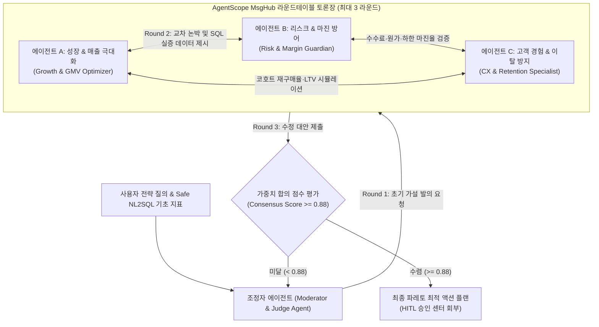

# SyncInsight 라운드테이블 에이전트 토론 (Multi-Agent Roundtable Debate)

## 1. 다관점 합의 메커니즘 (Roundtable Consensus)

단일 LLM의 단발성 분석 결과는 환각(Hallucination)이나 특정 프롬프트 편향(Confirmation Bias)에 취약하여 엔터프라이즈 핵심 의사결정(가격 인상/인하, 프로모션 예산 집행, 리소스 재배치 등)에 단독으로 사용하기 어렵습니다.

`SyncInsight`는 이를 해결하기 위해 **`AgentScope Java` (`io.agentscope:agentscope-harness:2.0.2`)의 `MsgHub` 멀티 에이전트 브로드캐스트 버스** 위에서 상반된 목적 함수를 가진 복수의 전문 분석 에이전트가 교차 검증하고 합의안을 도출하는 **라운드테이블 토론(Roundtable Debate) 엔진**을 운영합니다.



---

## 2. 페르소나별 목적 함수 및 평가 가중치 구성

각 토론 참여 에이전트는 동일한 원천 데이터(`SyncInsight` Safe NL2SQL 조회 결과 및 `SyncCrawl` 외부 시장 지식)를 공유하되, 서로 다른 평가 지표와 제약 조건을 부여받아 토론에 참여합니다.

| 에이전트 역할 (`personaCode`) | 핵심 목적 함수 (Objective) | 주요 참조 데이터 및 검증 제약조건 | 기본 합의 가중치 |
| :--- | :--- | :--- | :---: |
| **`GROWTH_OPTIMIZER`**<br>(성장 & 매출 에이전트) | 총거래액(GMV), 신규 유입 트래픽, 전환율(CVR) 극대화 | • 카테고리별 클릭률·장바구니 전환율 추이<br>• 경쟁사 프로모션 가격 지수 (`SyncCrawl`) | `0.35` |
| **`MARGIN_GUARDIAN`**<br>(리스크 & 마진 가디언) | 공헌이익률 방어, 역마진 사전 차단, 예산 한도 준수 | • SKU별 매입원가 및 최소 보장 마진율(`>= 15%`)<br>• 프로모션 쿠폰 예산 상한 및 재고 회전율 | `0.40` |
| **`CX_RETENTION_EXPERT`**<br>(고객경험 & 리텐션 에이전트) | 기존 VIP 고객 가격 박탈감 방지, 반품률 억제, LTV 향상 | • 최근 30일 구매자 코호트 재방문율<br>• 급격한 가격 변동 시 클레임·취소율 상관관계 | `0.25` |
| **`MODERATOR_JUDGE`**<br>(조정자 & 판정 에이전트) | 라운드별 쟁점 요약, 사실 근거(SQL) 검증, 최종 합의안 도출 | • 에이전트 주장에 실제 DB 쿼리 근거가 없는 경우 기각<br>• 파레토 최적(Pareto Optimal) 파라미터 수렴 판정 | 총괄 중재 |

---

## 3. 3단계 토론 수렴 알고리즘 및 수식

1. **1단계 — 초기 가설 발의 (Round 1: Hypothesis Proposal)**:
   - 각 에이전트가 자신의 목적 함수에 최적화된 실행 파라미터(예: `GROWTH_OPTIMIZER`는 `할인율 20%`, `MARGIN_GUARDIAN`은 `할인율 8%`)와 뒷받침하는 SQL 통계 지표를 발의합니다.
2. **2단계 — 교차 논박 및 반론 (Round 2: Cross-Examination)**:
   - `MsgHub`를 통해 타 에이전트의 제안을 수신한 뒤, 자신의 제약 조건에 위배되는 리스크(예: `"할인율 20% 적용 시 하위 14개 SKU에서 마진율이 9.2%로 하락하여 최소 마진 가드레일 15%를 위반함"`)를 정량 데이터로 반박하고 대안 조건을 제시합니다.
3. **3단계 — 가중치 합의 점수 산출 및 수렴 (Round 3: Weighted Consensus Scoring)**:
   - 조정자 에이전트가 각 대안의 기대 효과와 리스크 방어율을 종합하여 합의 점수 \(S_{\text{consensus}}\)를 산출합니다:
     \[
     S_{\text{consensus}} = \sum_{i \in \{A,B,C\}} w_i \cdot U_i(\theta) - \lambda \cdot \text{Penalty}_{\text{constraint}}(\theta)
     \]
   - 합의 점수가 설정 임계치(`0.88`) 이상에 도달하면 토론을 종료하고 최종 액션 카드(`Action Proposal`)를 발행합니다.

---

## 4. 라운드테이블 토론 REST API 및 스트리밍 페이로드

라운드테이블 토론은 `/api/v1/insight/debate/sessions` 엔드포인트를 통해 실행되며, 각 라운드의 발언과 합의 점수는 Server-Sent Events(SSE)로 프론트엔드 캔버스에 실시간 중계됩니다.

### 4.1 토론 세션 시작 요청 (`POST /api/v1/insight/debate/sessions`)

```json
{
  "topic": "가을 시즌 아우터 재고 소진 및 공헌이익 방어를 위한 최적 프로모션 설계",
  "targetDomain": "SYNC_SHOP",
  "maxRounds": 3,
  "consensusThreshold": 0.88,
  "constraints": {
    "minMarginRate": 0.15,
    "maxBudgetKrw": 25000000
  }
}
```

### 4.2 토론 완료 및 최종 합의 액션 응답 예시

```json
{
  "sessionId": "deb-20261118-042",
  "status": "CONSENSUS_REACHED",
  "completedRounds": 3,
  "consensusScore": 0.924,
  "transcriptSummary": [
    {
      "round": 1,
      "speaker": "GROWTH_OPTIMIZER",
      "claim": "전 품목 20% 일괄 타임세일 시 예상 주문량 +34.2% 증가",
      "evidenceSqlId": "sql-ev-101"
    },
    {
      "round": 2,
      "speaker": "MARGIN_GUARDIAN",
      "claim": "전 품목 20% 할인 시 저마진 SKU 18종이 최소 마진율(15%) 미달. 재고 체류일 45일 이상 품목에 한해 12% 할인 + VIP 3% 추가 쿠폰 조합으로 수정 제안",
      "evidenceSqlId": "sql-ev-104"
    },
    {
      "round": 3,
      "speaker": "MODERATOR_JUDGE",
      "claim": "체류 재고 타깃 12% 할인안으로 전체 공헌이익 +14.8% 개선 및 최소 마진율 17.4% 보존 합의 완료",
      "consensusScore": 0.924
    }
  ],
  "proposedAction": {
    "targetAgent": "SYNC_SHOP",
    "mcpTool": "shop_batch_price_update",
    "requiresHitlApproval": true,
    "arguments": {
      "action": "BATCH_UPDATE_PRICE",
      "categoryId": 104,
      "rate": 0.88,
      "minInventoryDays": 45
    }
  }
}
```
