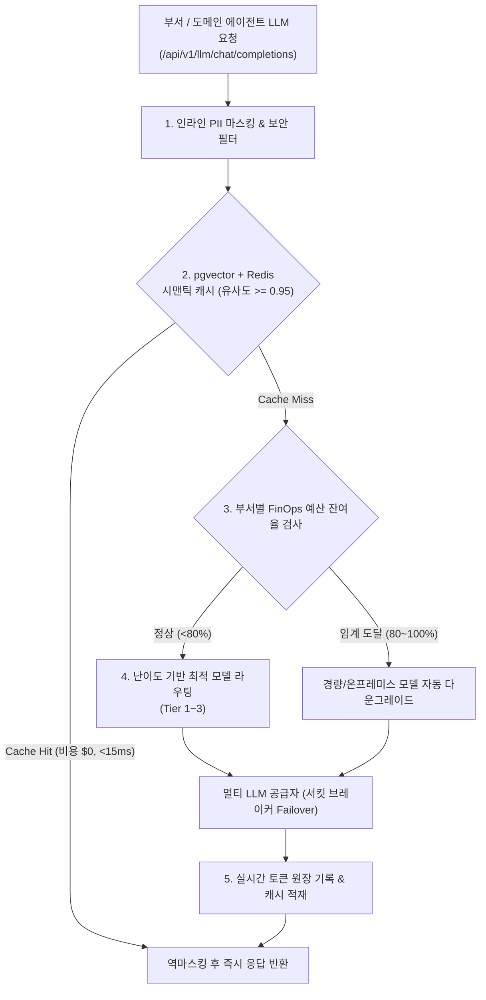

# SyncLLM 엔터프라이즈 도입 FAQ

전사 AI 모델 게이트웨이 및 FinOps 비용 통제 플랫폼인 `SyncLLM`을 도입할 때 인프라 아키텍트, 정보보안팀, 재무/구매 부서에서 자주 문의하는 핵심 질문과 기술 명세입니다.

---

## 1. 비용 절감 및 FinOps 예산 통제



### Q1. 시맨틱 캐시(Semantic Cache)를 도입하면 실제로 비용이 얼마나 절감되나요?
- **답변**: 엔터프라이즈 사내 업무 비서, 기술 문서 검색(RAG), 자동 회귀 테스트(`SyncETA`), 반복 코드 분석 등 정형화된 질의가 빈번한 환경에서는 **평균 35% ~ 55%의 LLM API 토큰 비용 절감**이 실측됩니다.
- `SyncLLM`의 시맨틱 캐시는 단순 문자열 일치가 아니라 **PostgreSQL 18.6 `pgvector` HNSW 인덱스와 Redis 인메모리 캐시**를 결합하여 임베딩 벡터 코사인 유사도(기본 임계치 \(\ge 0.95\), 도메인별 조정 가능)를 기준으로 판정하므로, 어미나 조사, 문장 어순이 조금씩 달라져도 검증된 캐시 응답을 즉시 반환합니다.

### Q2. 부서별 월간 예산 한도를 초과하면 업무용 AI 서비스가 즉시 중단되나요?
- **답변**: 기본 정책은 비즈니스 연속성을 보장하는 **단계별 소프트 가드레일(Graduated Soft-Limit)** 로 동작하며, 부서별 정책(`llm_budget_policy`)에 따라 정밀하게 설정할 수 있습니다.

| 예산 소진 구간 | 게이트웨이 자동 제어 동작 | 알림 및 거버넌스 조치 |
| :--- | :--- | :--- |
| **정상 구간 (`0% ~ 79%`)** | 요청된 모델 Tier 또는 지능형 라우터가 선택한 최적 모델 그대로 호출 | 실시간 토큰 원장(`llm_usage_ledger`) 기록 |
| **주의 구간 (`80% ~ 94%`)** | 일반 요약·분류 요청을 고성능 상용 모델에서 경량 모델(Tier 1)로 자동 전환 | 부서 관리자 및 PMO에게 Slack/이메일 예산 경고 발송 |
| **한도 도달 (`95% ~ 100%`)** | 외부 유료 상용 API 호출을 차단하고 **사내 온프레미스 vLLM 모델(한계비용 0원)로 100% 자동 폴백** | `hardLimitEnabled: true` 설정 시에만 `429 Too Many Requests` (RFC 7807) 반환 |

---

## 2. 보안 및 개인정보(PII) 비식별화 가드레일

### Q3. 외부 상용 LLM(OpenAI, Anthropic, Google) 호출 시 사내 고객 개인정보나 기밀 코드가 유출되지 않나요?
- **답변**: `SyncLLM`의 인라인 보안 파이프라인이 외부 네트워크로 패킷이 나가기 직전에 요청 페이로드를 가로채어 다음 2중 보호를 수행합니다:
  1. **양방향 가역 PII 토큰화(Reversible Tokenization)**: 주민등록번호, 외국인등록번호, 휴대폰 번호, 신용카드 번호, 계좌번호, 이메일, 사내 API 시크릿 키(`sk-...`, `Bearer ...`), JWT 토큰 등을 정규식 및 NER 필터로 실시간 감지하여 `<PII_PHONE_01>`, `<PII_ACCOUNT_01>` 형태의 일회용 플레이스홀더로 치환한 뒤 외부 LLM으로 전송합니다.
  2. **인메모리 역마스킹(Unmasking) 및 Zero-Retention 감사**: 외부 LLM으로부터 응답이 돌아오면 게이트웨이 메모리 내 격리된 세션 매핑 테이블을 통해 원본 값으로 복원하여 클라이언트에 전달하며, 외부 LLM 벤더의 학습 데이터나 로그에는 민감정보가 원천 노출되지 않습니다.
  3. **기밀 등급 강제 라우팅**: 프롬프트 내에 사내 대외비 키워드나 소스코드 블록이 포함된 경우 외부 상용 API 전송을 자동 거부하고 사내 폐쇄망 온프레미스 LLM으로만 강제 라우팅합니다.

---

## 3. 인프라 성능, 고가용성(HA) 및 폐쇄망 배포

### Q4. 게이트웨이 경유로 인한 네트워크 레이턴시(Latency) 오버헤드와 특정 LLM 벤더 장애 대응 방식은 어떠한가요?
- **답변**:
  - **시맨틱 캐시 적중(Hit) 시**: 외부 LLM 추론 시간(`1,200ms ~ 3,500ms`)을 완전히 생략하고 인메모리에서 즉시 응답하므로 **전체 응답 시간이 `5ms ~ 15ms` 이내**로 단축됩니다.
  - **캐시 미적중(Miss) 시**: 인라인 PII 마스킹과 라우팅 규칙 평가에 소요되는 게이트웨이 자체 오버헤드는 **`8ms ~ 12ms` 미만**이며, Java 25 Virtual Threads 기반 비동기 SSE 스트리밍(`text/event-stream`) 패스스루를 지원하여 첫 토큰 도달 시간(TTFT) 지연이 없습니다.
  - **무중단 서킷 브레이커 페일오버**: 특정 클라우드 LLM 공급자(예: OpenAI)에서 `5xx` 서버 오류, 타임아웃, 또는 `429 Rate Limit`이 연속 감지되면 서킷 브레이커가 `50ms` 이내에 차순위 공급자(예: Anthropic Claude 또는 Azure OpenAI / 사내 vLLM)로 트래픽을 자동 우회합니다.

```json
{
  "model": "sync-auto-tier2",
  "messages": [
    {
      "role": "user",
      "content": "홍길동 고객(010-1234-5678)의 주문 취소 환불 안내 메시지를 작성해줘."
    }
  ],
  "metadata": {
    "departmentCode": "CS_OPS",
    "agentCode": "SYNC_SHOP",
    "piiMaskingApplied": true,
    "maskedEntities": ["PERSON_NAME", "PHONE_NUMBER"],
    "routedProvider": "anthropic-claude-3-5-haiku",
    "failoverStandby": "onprem-vllm-llama3-70b"
  }
}
```

### Q5. 기존 OpenAI SDK나 LangChain/AgentScope 코드를 수정하지 않고 바로 SyncLLM으로 연결할 수 있나요?
- **답변**: 네, `SyncLLM`은 **OpenAI 호환 표준 REST API 규격(`/api/v1/llm/chat/completions`, `/api/v1/llm/embeddings`)** 과 `AgentScope Java` 표준 모델 클라이언트를 100% 지원합니다. 기존 애플리케이션에서는 `baseUrl`만 `SyncLLM` 게이트웨이 주소로 변경하고 부서별 가상 API 키(`X-SyncLLM-Key`)를 주입하면 코드 변경 없이 즉시 시맨틱 캐싱, PII 마스킹, FinOps 예산 통제를 적용받을 수 있습니다.

### Q6. 금융·국방·공공 등 완전 망분리(Air-Gapped) 온프레미스 환경에 단독 구축할 수 있나요?
- **답변**: 가능합니다. 외부 인터넷 연결이 전혀 없는 폐쇄망 환경에서도 `docker-compose-dev.yml` 또는 Kubernetes Helm 차트를 통해 설치할 수 있으며, 사내 GPU 클러스터에서 구동되는 **vLLM, Ollama, TGI(Text Generation Inference)** 추론 엔진들의 로드밸런서 겸 보안·감사 관제 게이트웨이로 완벽히 동작합니다.

---

## 4. 게이트웨이 핵심 운영 파라미터 및 API 명세 요약

| 설정 키 (`sys_config` / `application.yml`) | 기본값 | 설명 |
| :--- | :---: | :--- |
| `sync.llm.cache.similarity-threshold` | `0.95` | `PostgreSQL 18.6 pgvector` + Redis 시맨틱 캐시 적중 판정 코사인 유사도 임계치 |
| `sync.llm.cache.ttl-seconds` | `86400` | 시맨틱 캐시 응답 기본 유효 시간 (24시간, 도메인별 개별 설정 가능) |
| `sync.llm.pii.masking-enabled` | `true` | 인바운드 프롬프트 8대 개인·금융 민감정보(PII) 실시간 토큰화 및 역마스킹 활성화 |
| `sync.llm.circuit-breaker.failure-threshold` | `3` | 특정 LLM 벤더 연속 실패 시 차순위 공급자로 즉시 Failover하는 오류 횟수 임계치 |
| `sync.llm.finops.soft-limit-ratio` | `0.80` | 부서별 월간 예산 대비 경량 모델 자동 다운그레이드 및 경고 알림 발동 비율 |
| **표준 프록시 & MCP 엔드포인트** | `/api/v1/llm/*` | `POST /api/v1/llm/chat/completions`, `POST /api/v1/llm/embeddings`, `POST /api/v1/llm/mcp` |
