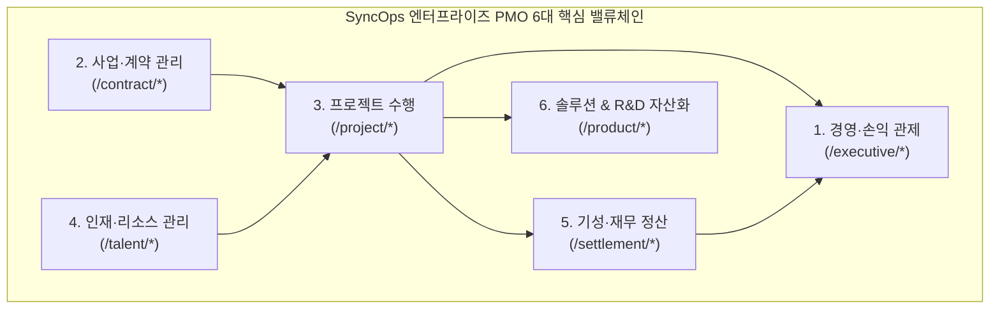
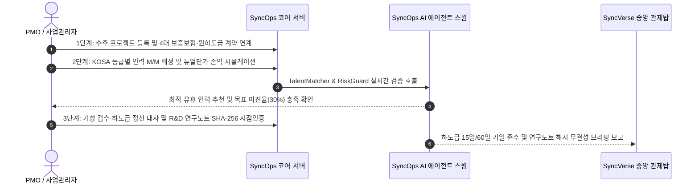

# SyncOps: 한국형 SI/솔루션 사업운영 & 손익·컴플라이언스 관제 플랫폼

> 📄 **제품 소개서 및 라이브 데모**: [SyncOps_Proposal.pdf (8p)](/downloads/proposals/SyncOps_Proposal.pdf){target="_blank" download="SyncOps_Proposal.pdf"} · [🖥️ SyncOps 라이브 데모 체험](https://sync.empasy.io/products/sync-ops#demo){target="_blank" rel="noopener"} · [🌐 제품 공식 페이지](https://empasy.io/ko/solutions/sync-ops.html){target="_blank" rel="noopener"} · [전체 제안서 모음](/proposals/)

> **Tier 3 Enterprise SI PMO & Profit/Compliance Agent Platform**  
> 서비스 도메인: `https://ops.empasy.io` · 표준 API Prefix: `/api/v1/ops`

**SyncOps**는 수주형 SI(시스템 통합) 및 SW 솔루션 기업의 핵심 경영 지표인 **발주처 계약단가 대 실투입원가 듀얼 손익**, **KOSA 소프트웨어 기술자 등급 및 월별 M/M 가동률 매트릭스**, **입찰·계약·선급금·하자 4대 이행보증보험 만기 추적**, **하도급법 15일/60일 지급기일 감시**, **조특법 R&D 세액공제용 SHA-256 시점인증 전자연구노트**를 단일 플랫폼에서 자율 관리하는 엔터프라이즈 사업운영(PSA/PMO) 에이전트입니다.

---

## 1. 핵심 도입 배경 및 해결 과제

기존 엑셀 수기 관리나 일반 제조업 중심 ERP에서는 수주형 IT 서비스 기업 특유의 **듀얼단가(발주처 청구단가 vs 정규직·프리랜서·반외주 실원가) 괴리**, **복잡한 컨소시엄 지분 정산**, **하도급법 법정 기일 준수**를 실시간으로 추적하기 어렵습니다.

| 비교 항목 | 기존 엑셀 및 파편화된 ERP 운영 | SyncOps 한국형 SI 사업운영 플랫폼 |
| :--- | :--- | :--- |
| **프로젝트 손익 산출** | 발주처 계약단가와 실제 투입 인력 원가가 분리 관리되지 않아 프로젝트 종료 후에야 적자 인지 | **계약단가 대 실투입원가 듀얼단가 엔진**으로 주간 타임시트 승인 즉시 실시간 공헌이익·영업이익률 자동 산출 |
| **인력 배정 및 가동률** | 스프레드시트 수기 관리로 인력 중복 배정(>1.0 M/M) 및 유휴(Bench) 인력 파악 지연 | **KOSA 기술등급 자동 산정 및 월별 M/M 가동률 히트맵 매트릭스**와 `pgvector` 기반 최적 대체 인력 AI 추천 |
| **보증보험 및 하도급법** | 입찰·계약·선급금·하자 보증보험 갱신일 및 하도급 15일/60일 지급기일 수동 관리로 법적 페널티 위험 | **4대 보증보험 만기 D-Day 알림** 및 **하도급 대금 법정 지급기일·지연이자(연 15.5%) 자동 계산기**로 법무 리스크 사전 차단 |
| **R&D 연구노트 증빙** | 국책 과제 및 기업부설연구소 세액공제용 연구노트를 수기 작성하여 사후 감사 대응 취약 | **SHA-256 해시 시점인증 전자연구노트** 및 Git 커밋 해시 자동 매핑으로 조특법 제10조 R&D 세액공제 요건 충족 |
| **담당자 퇴사·인수인계** | PM·영업 담당자 퇴사 시 고객사 키맨(Key-man) 연락처 및 구두 협의 이력 유실 | **원클릭 인수인계 센터** 및 AI 인수인계 요약 브리핑(`HandoverBriefing`)으로 고객사 업무 연속성 100% 보장 |

---

## 2. 6대 핵심 밸류체인 도메인

### 2.1 경영·손익 관제 (`/executive/dashboard`, `/executive/profit-matrix`, `/executive/ai-control`)
- **듀얼단가 실시간 손익 관제**: 발주처 기준 계약 청구단가(`billing_unit_price`)와 내부 급여·4대보험·퇴직충당금·외주비 기준 실투입원가(`cost_unit_price`)를 이원화하여 프로젝트별 실시간 매출원가(COGS)와 영업이익률을 시뮬레이션합니다.
- **5차원 다차원 손익 피벗 매트릭스**: 고객사, 프로젝트, 수행 부서, 고용 형태(정규직/프리랜서/하도급), 기간별로 손익을 드릴다운 분석합니다.
- **AI 인력 매칭·위험 관제**: 예산 번다운 초과 및 적자 전환 위험 프로젝트를 조기 탐지하고 해결 가이드를 제시합니다.

### 2.2 사업·계약 관리 (`/contract/list`, `/contract/clients`, `/contract/vendors`, `/contract/compliance-alerts`)
- **원·하도급 통합 계약 및 차수별 변경계약(Addendum)**: 단독수주 및 공동수급(공동이행·분담이행) 지분율, 과업변경(CR) 연계 변경계약 이력을 체계적으로 관리합니다.
- **4대 이행보증보험 통합 추적**: 서울보증보험(SGI)·소프트웨어공제조합의 입찰(`BID`), 계약이행(`PERFORMANCE`), 선급금(`ADVANCE`), 하자보수(`DEFECT`) 보증증권 만기일과 보험료 직접경비를 추적합니다.
- **고객사·협력사 키맨 CRM 및 원클릭 인수인계**: 발주처·협력사 담당자 연락처, 협의 이력, 대외 공문 수발신 직인 PDF를 관리하며 인사이동 시 단일 트랜잭션으로 후임자에게 일괄 승계합니다.

### 2.3 프로젝트 수행 및 손익 시뮬레이션 (`/project/list`, `/project/profit-simulator`, `/project/timesheet-approval`)
- **주간 타임시트 및 공수 승인**: 주간 실제 투입 공수(M/M)를 고객사 SI 원가(`CLIENT_SI`)와 코어 R&D 자산화(`CORE_RD`)로 구분 집계합니다.
- **과업 변경(CR) 통제**: 고객사 추가 요구사항에 따른 추가 공수 및 증액 청구 규모를 산정하고 변경계약과 연동합니다.

### 2.4 인재·리소스 관리 (`/talent/employee`, `/talent/kosa-grade`, `/talent/assignment-gantt`, `/talent/bench-monitor`)
- **KOSA 소프트웨어 기술자 등급 산정**: 학력, 국가기술자격, KOSA 인정 경력일수를 기반으로 특급(`SPECIAL`)·고급(`ADVANCED`)·중급(`INTERMEDIATE`)·초급(`BEGINNER`) 등급을 자동 판정합니다.
- **월별 M/M 가동률 간트차트 & 벤치 모니터링**: 인력별 프로젝트 투입률을 시각화하여 100%(`1.0 M/M`) 초과 배정을 방지하고 유휴(Bench) 인력 및 철수 예정자를 실시간 모니터링합니다.
- **투입인력 교체 승인 거버넌스**: 인력 교체 시 동급·상위 KOSA 등급 충족 여부를 자동 검증하고 발주처 승인 공문을 관리합니다.

### 2.5 기성·재무 정산 (`/settlement/milestone`, `/settlement/ar-aging`)
- **하도급법 제6조·제13조 지급기일 자동 감시**: 원도급 기성금 수령 후 **15일 이내**, 목적물 검수 후 **60일 이내** 법정 지급기한을 자동 계산하여 위반·임박(D-7) 경보를 발령하고, 지연 시 법정 지연이자(연 15.5%)를 자동 산출합니다.
- **전자세금계산서 및 미수금(AR Aging) 정산**: 선금 안분 차감, 프리랜서 3.3% 원천징수 공제, 미수금 경과일수를 관리합니다.

### 2.6 솔루션 & R&D 자산화 (`/product/releases`, `/product/rnd-notes`)
- **조특법 제10조 R&D 세액공제용 전자연구노트**: KOITA(한국산업기술진흥협회) 연구전담요원의 연구 수행 내역, Git 커밋 해시, 작성자·확인자 전자서명 및 **SHA-256 시점인증(TSA) 해시**를 결합하여 위변조 불가능한 전자연구노트를 보존합니다.
- **SI 커스텀 기능 코어 백포트 허브**: SI 프로젝트에서 개발된 우수 기능을 자사 솔루션(`SyncBoot`, `SyncCMS` 등) 코어로 자산화(Backport)하는 리뷰 파이프라인과 고객사별 배포 형상(Installed Base)을 관리합니다.

---

## 3. 3단계 표준 사업운영 프로세스

---

## 4. 공식 기술 문서 목차

- **[시스템 아키텍처 및 DB 스키마](./architecture)**: AgentScope Java 4대 내부 에이전트 스웜, 듀얼단가 손익 엔진, PostgreSQL 17 도메인 스키마(`ops_*`) 상세 명세
- **[MCP 도구 및 REST API 레퍼런스](./mcp-tools)**: `ops_analyze_project_profitability`, `ops_check_allocation_overload`, `ops_audit_subcontract_payment`, `ops_verify_rnd_note_hash` 도구 규격 및 `/api/v1/ops/...` API 가이드
