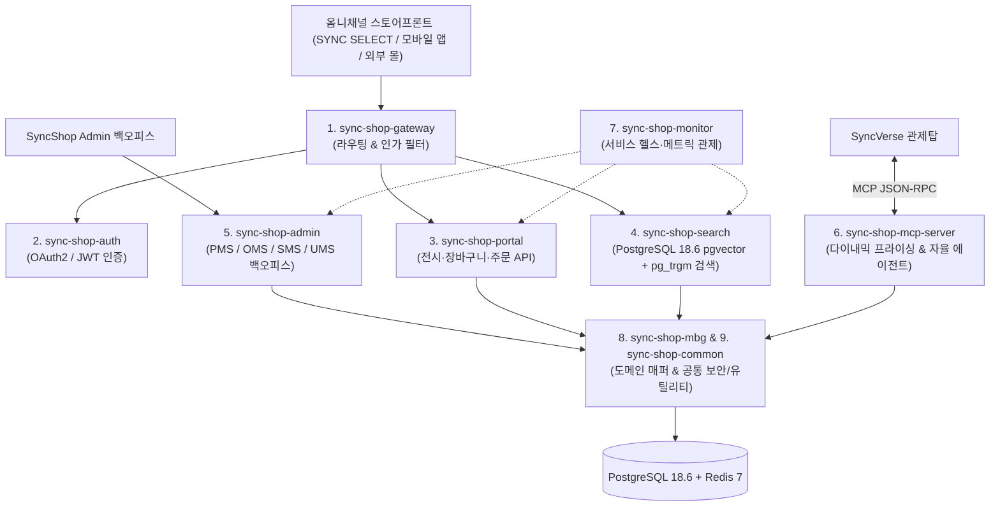

# SyncShop 엔터프라이즈 도입 FAQ

8개 독립 마이크로서비스 기반의 자율 상거래 플랫폼인 `SyncShop`을 도입 및 운영할 때 이커머스 사업부, 물류/ERP 운영팀, IT 아키텍트가 가장 많이 문의하는 기술 질문과 답변입니다.

---

## 1. 8개 마이크로서비스(MSA) 아키텍처 및 기간계 연동



### Q1. 왜 단일 모놀리스가 아닌 8개의 독립 마이크로서비스 구조로 구성되어 있나요?
- **답변**: 이커머스 워크로드는 평시 백오피스 상품·정산 관리(`sync-shop-admin`)와 대규모 프로모션·타임세일 시 폭증하는 대고객 조회·주문 트래픽(`sync-shop-portal`, `sync-shop-search`, `sync-shop-gateway`)의 특성이 완전히 다릅니다.
- `SyncShop`은 8개 독립 모듈(`gateway`, `auth`, `admin`, `portal`, `search`, `monitor`, `mbg`, `mcp-server`, `common`)을 물리적으로 분리하여, 대고객 트래픽 폭증 시 `portal`과 `search` 컨테이너만 즉시 스케일아웃(Scale-Out)하고 백오피스와 AI 에이전트(`mcp-server`)의 안정성을 체계적으로 격리합니다.

### Q2. 기존 사내 ERP(SAP, 더존 등), WMS(물류창고관리) 및 PG 결제망과 어떻게 연동하나요?
- **답변**: `SyncShop`은 모든 상거래 도메인이 `/api/v1/shop/*` 표준 Canonical REST API와 이벤트 웹훅(Webhook)으로 열려 있는 Headless Commerce 아키텍처입니다.

| 연동 영역 | 표준 연동 인터페이스 | 동기화 주기 및 트랜잭션 보장 방식 |
| :--- | :--- | :--- |
| **ERP (전사적자원관리)** | `POST /api/v1/shop/pms/products/sync`<br>`GET /api/v1/shop/oms/settlements` | 품목 마스터·매입원가·매출전표 실시간 웹훅 또는 일배치 양방향 대사 |
| **WMS / 3PL 물류** | `manage_orders` MCP 도구 (`action: SHIP`)<br>`POST /api/v1/shop/oms/orders/delivery-callback` | 출고 지시서 자동 전송, 송장 번호 역전송 및 배송 상태 전이 자동화 |
| **PG (결제 게이트웨이)** | 승인/취소 웹훅 및 멱등성 키(`idempotency_key`) 검증 | 망취소 및 부분 환불 시 `oms_order_return` 상태와 PG 원장 1:1 정합성 검증 |

---

## 2. 다이내믹 프라이싱 마진 보호 및 스냅샷 롤백

### Q3. AI 에이전트가 다이내믹 프라이싱(`shop_batch_price_update`)으로 가격을 일괄 조정할 때 역마진이 발생할 위험은 없나요?
- **답변**: 가격 조정 시 내부 **3단계 상거래 에이전트 스웜(`Pricing Optimizer` -> `Margin Safeguard` -> `Executor`)** 과 다중 안전장치가 작동하여 역마진을 사전에 차단하도록 돕습니다:
  1. **최소 보장 마진율 가드레일**: 상품 마스터(`pms_product`)의 매입 원가(`cost_price`)와 카테고리별 최소 마진율 기준(예: `15%`)을 대조하여, 단 1개 품목이라도 하한선 미만으로 산출되면 배치 트랜잭션 전체를 즉시 거부(Fail-Fast)합니다.
  2. **HITL 사전 결재 게이트**: 일정 할인율(예: `10%` 초과) 또는 대규모 카테고리 일괄 가격 변경은 `SyncVerse` HITL 승인 대기열로 자동 회부되어 커머스 책임자의 승인을 거쳐야만 반영됩니다.
  3. **변경 전 가격 스냅샷 및 1-Click 즉시 복원**: 가격 변경 직전 모든 대상 SKU의 기존 판매가 스냅샷(`SNP-YYYYMM-NNN`)이 DB에 자동 보존되며, 필요 시 `action: "ROLLBACK_PRICE"` 호출 한 번으로 `1초` 이내에 직전 가격으로 100% 원복됩니다.

```json
{
  "jsonrpc": "2.0",
  "id": "shop-pricing-rollback-01",
  "method": "tools/call",
  "params": {
    "name": "shop_batch_price_update",
    "arguments": {
      "action": "ROLLBACK_PRICE",
      "snapshotId": "SNP-202609-089",
      "reason": "타임세일 프로모션 조기 종료에 따른 정상가 즉시 복원"
    }
  }
}
```

---

## 3. 대규모 트래픽 재고 동시성 제어 및 폐쇄망 배포

### Q4. 타임세일(Flash Sale)이나 대규모 기획전 시 동시 접속으로 인한 재고 초과 판매(Overselling)를 어떻게 방지하나요?
- **답변**: **Redis 원자적 분산 락과 PostgreSQL 18.6 SKU 재고 잠금(`pms_sku_stock.lock_stock`)을 결합한 2단계 재고 점유 아키텍처**를 사용합니다.
  1. **1단계 (주문서 진입 시 선점)**: 고객이 결제 요청을 시작하는 순간 Redis 원자적 연산과 DB `lock_stock` 증가 쿼리(`WHERE stock - lock_stock >= :quantity`)로 가용 재고를 즉시 예약합니다.
  2. **2단계 (결제 확정 및 타임아웃 자동 해제)**: PG 결제 승인 완료 시 실제 `stock`과 `lock_stock`을 동시 차감하며, 지정된 결제 제한 시간(기본 `15분`) 내에 결제가 완료되지 않으면 지연 큐 워커가 선점 재고(`lock_stock`)를 자동 해제하여 가용 재고로 환원합니다.

### Q5. 별도의 검색엔진(Elasticsearch) 없이도 빠른 상품 검색과 AI 시맨틱 추천이 가능한가요?
- **답변**: 네, `sync-shop-search` 마이크로서비스는 **PostgreSQL 18.6의 `pgvector` HNSW 벡터 인덱스와 `pg_trgm` 전문 검색 인덱스**를 결합하여 운영합니다. 이를 통해 `"가을 출근룩 가벼운 자켓"` 같은 자연어 의도 기반 시맨틱 상품 검색과 브랜드·SKU 코드 정확 일치 검색을 단일 PostgreSQL 18.6 클러스터에서 초저지연으로 제공하며, 이기종 검색엔진 색인 동기화 지연이나 클러스터 이중 관리 비용을 제거합니다.

### Q6. 온프레미스 또는 프라이빗 클라우드(VPC) 환경에 독립 구축할 수 있나요?
- **답변**: 가능합니다. 8개 마이크로서비스, 백오피스(`admin/`), 플래그십 스토어프론트(`web/`), 그리고 6-File DB SSOT 스크립트(`sync-shop/db/00_extensions.sql` ~ `05_sample_dev.sql`)가 표준 컨테이너(`docker-compose-dev.yml` 및 K8s 매니페스트)로 패키징되어 제공되므로 외부 SaaS 종속 없이 기업 자체 인프라에 즉시 구축할 수 있습니다.

---

## 4. 8개 독립 마이크로서비스 모듈 및 포트 구성표

| 순번 | 모듈 ArtifactId (`Server/`) | 기본 포트 | 핵심 책임 및 기술 역할 |
| :---: | :--- | :---: | :--- |
| **1** | `sync-shop-gateway` | `8201` | Spring Cloud Gateway 기반 단일 진입점 라우팅 및 JWT 인가 필터 |
| **2** | `sync-shop-auth` | `8401` | OAuth2 / JWT 토큰 발급 및 관리자·소비자 통합 인증 서버 |
| **3** | `sync-shop-admin` | `8080` (`18082`) | PMS(상품), OMS(주문), SMS(프로모션), UMS(회원) 백오피스 REST API (`/api/v1/shop/*`) |
| **4** | `sync-shop-portal` | `8085` | 플래그십 스토어프론트(`SYNC SELECT`) 전시·장바구니·주문 결제 대고객 API |
| **5** | `sync-shop-search` | `8081` | `PostgreSQL 18.6 pgvector` + `pg_trgm` 기반 하이브리드 상품 검색 및 시맨틱 추천 |
| **6** | `sync-shop-monitor` | `8101` | Spring Boot Admin 기반 마이크로서비스 헬스체크, JVM 메트릭 및 로그 관제 |
| **7** | `sync-shop-mcp-server` | `8086` | `AgentScope Java` 기반 자율 프라이싱 스웜 및 MCP 도구(`/api/v1/shop/mcp/*`) 서버 |
| **8** | `sync-shop-mbg` | 라이브러리 | 도메인 엔티티 및 MyBatis 매퍼 계층 (`pms_*`, `oms_*`, `sms_*`, `ums_*`) |
| **9** | `sync-shop-common` | 라이브러리 | 전사 공통 응답 래퍼, RFC 7807 예외 처리, Redis 캐시 및 보안 유틸리티 |
