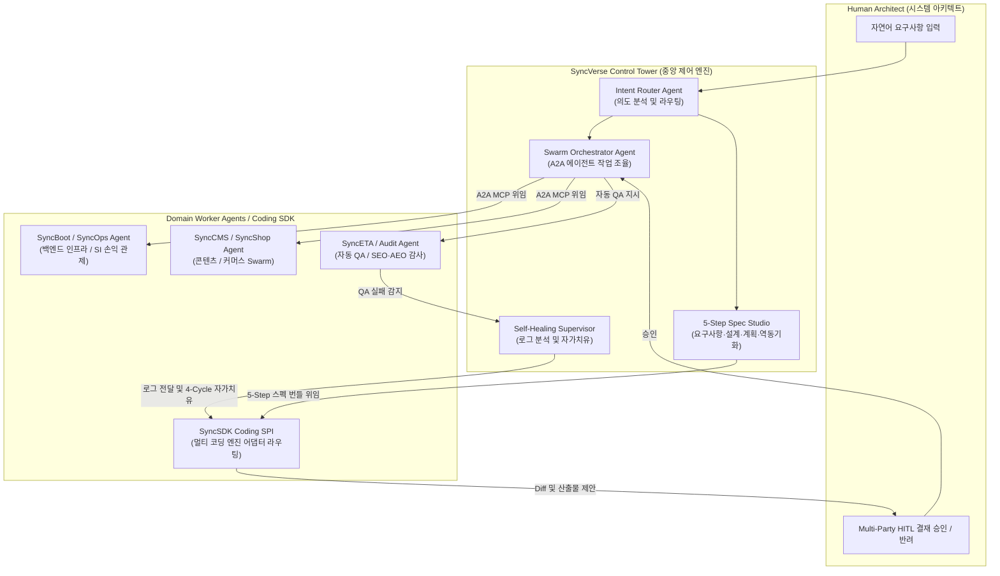
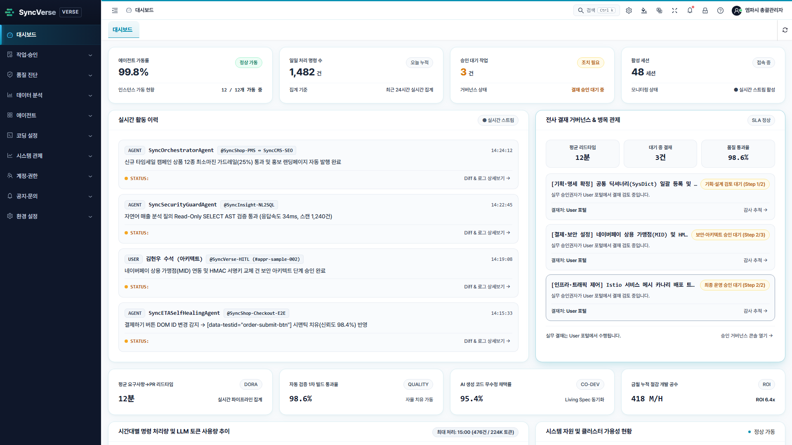
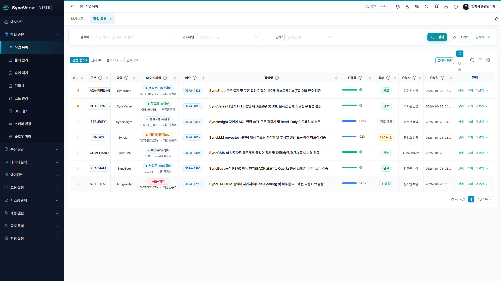
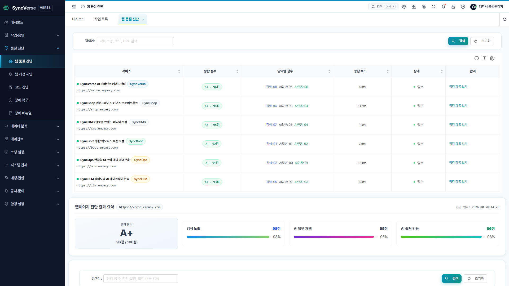
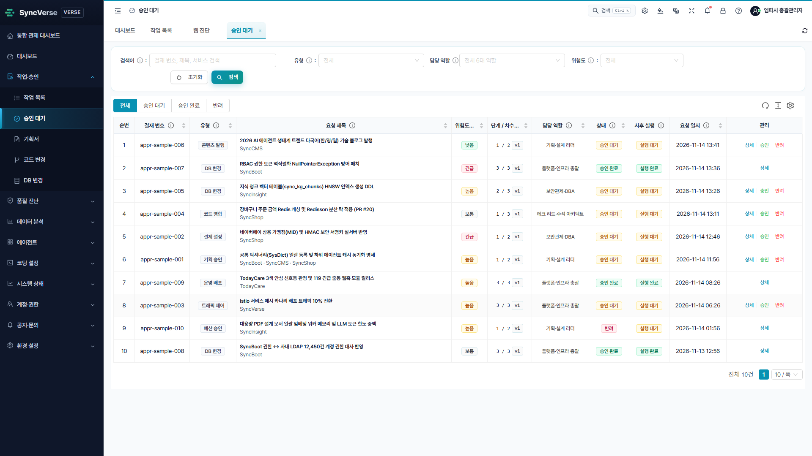

# SyncVerse: 멀티 에이전트 중앙 관제 및 오케스트레이션 플랫폼

> **비개발자 · 도입 검토 안내**: 쉬운 제품 소개는 [SyncVerse 제품 홈페이지(verse.empasy.io)](https://verse.empasy.io/){target="_blank" rel="noopener"}에서, 설치 없는 화면 체험은 [통합 데모 포털](https://sync.empasy.io/products/sync-verse#demo){target="_blank" rel="noopener"}에서 이용하실 수 있으며, 소개서·제안서 PDF는 [제안서 자료실](/proposals/)에서 내려받으실 수 있습니다.

**SyncVerse**는 개별적으로 동작하는 분산 도메인 솔루션을 표준 인터페이스로 연결해 요구사항 정리, 작업 배분, 품질 검증 조회, 단계별 결재 승인을 통합 관리하는 **중앙 오케스트레이션 플랫폼(Control Tower)**입니다.

SyncVerse 중앙 오케스트레이터는 하위 도메인 모듈(`SyncWatch`, `SyncAPIM`, `SyncBoot`, `SyncCMS`, `SyncShop`, `SyncOps`, `SyncLLM`, `SyncInsight`, `SyncETA`, `SyncCrawl`)과 표준 **[MCP](/glossary/#mcp)** 및 **[A2A](/glossary/#a2a)** 프로토콜로 통신합니다. 또한 [`SyncWatch`](/syncwatch/)로부터 수신한 `VerseAuditPack`(SCA 의존성·SAST 코드·DAST 점검 규칙 팩)을 기반으로 저장소 취약점을 점검하고 패치 PR 초안을 생성합니다.

---

## 1. 4대 핵심 구성 요소

SyncVerse는 소프트웨어 개발·운영 생명주기(AI DLC)를 지원하기 위해 네 가지 핵심 엔진을 제공합니다.

| 핵심 엔진 | 역할 및 기능 | 주요 기술 메커니즘 |
| :--- | :--- | :--- |
| **01. 자연어 의도 분류 및 A2A 위임** | 입력된 요청이 운영 데이터 작업인지 소스 변경 작업인지 판별하고 하위 도메인 모듈에 위임 | `A2ASwarmDelegationStrategyHandler`, 도메인 컨텍스트 Tri-Hybrid RAG 주입 |
| **02. 5-Step Spec Studio** | 인수 조건(AC) 정제 -> 상세 기술 명세 -> 구현 계획 -> 브랜치 작업 위임 -> 4대 표준 산출물 역동기화 | Decision Queue, Living Spec, 요구사항 커버리지 매트릭스 |
| **03. 멀티 코딩 엔진 SPI 라우팅 (`SyncSDK`)** | 소스코드 수정 시 사내 정책으로 등록된 활성 코딩 어댑터를 선택해 격리 브랜치에서 패치 생성 | `CodingAgentRoutingProxy` (`ICodingAgentClient` 플러그인 어댑터 구조) |
| **04. 자동 배포 연계 & 자가치유 복구** | 4-Cycle 빌드 오류 분석·보정 및 배포 실패 시 스냅샷 기반 보상 롤백 | `sync-module-deploy`, [Multi-Party HITL](/glossary/#hitl) 결재선, 스냅샷 보상 롤백 |

---

## 2. 6-Step AI DLC 라이프사이클

SyncVerse는 요구사항 접수부터 승인·배포까지 6단계 파이프라인의 상태를 추적합니다.

1. **요구사항 분석 및 스펙 정제 (Spec Studio Step 1~3)**: 요구사항 프롬프트를 분석해 인수 조건(AC), 기술 명세, 구현 계획 및 요구사항 커버리지 매트릭스를 생성합니다.
2. **격리 브랜치 코드 작성 (Spec Studio Step 4)**: `SyncSDK` 어댑터를 통해 격리된 작업 브랜치에서 소스코드 및 6-File DB SSOT(`db/00_extensions.sql` ~ `05_sample_dev.sql`) DDL 변경안을 작성합니다.
3. **자동 회귀 검증 (Automated QA)**: 자동 빌드와 Playwright/`SyncETA` E2E 회귀 테스트를 수행합니다.
4. **빌드·테스트 오류 보정 (4-Cycle Self-Healing Loop)**: 컴파일 또는 테스트 실패 시 분산 로그를 수집해 원인 분석 및 패치 재시도를 수행합니다.
5. **다자간 아키텍트 승인 (Multi-Party HITL Approval)**: 시스템 아키텍트가 코드 Diff와 영향도 분석 리포트를 검토하고 다단계 결재 승인 또는 반려를 결정합니다.
6. **배포 및 산출물 역동기화 (Spec Studio Step 5)**: 승인된 변경사항을 배포 파이프라인으로 전달하고 4대 표준 산출물(요구사항정의서, 화면설계서, DB설계서, 테스트결과서)을 갱신합니다.

---

## 3. 운영 구조 비교 (개별 수동 운영 vs SyncVerse 중앙 관제)

| 구분 항목 | 개별 수동 개발·운영 방식 | SyncVerse 중앙 관제 아키텍처 |
| :--- | :--- | :--- |
| **요구사항 명세 추적** | 기획서·이슈·코드가 분리되어 변경 이력 불일치 발생 | 5-Step Spec Studio 기반 명세·구현·산출물 역동기화 |
| **코드 변경 워크플로우** | 개발자별 상이한 도구 및 수동 브랜치·검증 절차 | `SyncSDK` 표준 SPI를 통한 격리 브랜치 생성 및 일관된 검증 게이트 적용 |
| **장애 원인 분석 및 재검증** | 에러 발생 시 서버 로그 수동 수집 및 재현 | 클러스터 로그 수집과 4-Cycle 빌드·테스트 재검증 자동 연계 |
| **LLM 비용 통제** | 팀별 개별 API 키 사용으로 비용 추적 및 제한 곤란 | `SyncLLM` 단일 게이트웨이, [시맨틱 캐시](/glossary/#semantic-cache), [FinOps](/glossary/#finops) 예산 한도 적용 |
| **도구·모듈 거버넌스** | 개별 도구가 파편화되어 감사 및 접근 통제 불가 | 표준 [MCP](/glossary/#mcp) 레지스트리 및 [RBAC](/glossary/#rbac) 기반 일원화 관리 |
| **배포 안전장치** | 장애 발생 시 수동 롤백 및 야간 대응 부담 | Multi-Party HITL 사전 승인 게이트 및 스냅샷 보상 롤백 |

---

## 4. 엔터프라이즈 보안 및 신뢰성 원칙

SyncVerse는 기업의 핵심 비즈니스 자산을 보호하기 위해 다음과 같은 거버넌스 규칙을 준수합니다.

- **프라이빗 AI 보안 환경**: 사내망을 벗어나면 안 되는 민감 데이터를 위해 온프레미스(On-Premise) 및 프라이빗 클라우드(VPC) 환경 지원
- **Multi-Party HITL 안전 게이트**: DDL 변경, 권한 수정, 상용 배포 등 중요 작업은 다자간 결재선 승인을 거치도록 정책화
- **실제 서비스 직접 연동 (Zero-Mock)**: 하드코딩된 더미 로직 없이 실제 PostgreSQL 18.6 데이터베이스 및 백엔드 서비스와 100% 직접 연동
- **전사 감사 증적(Audit Trail) & KMS**: 작업 지시자, 승인 이력, 에이전트 도구 호출 내역을 전수 기록하고 AES-256 마스터 키 1-클릭 회전을 지원

---

## 실제 구동 화면 및 핵심 워크플로우

### 1. 통합 커맨드 센터 및 에이전트 토폴로지 관제
자연어 비즈니스 명령을 입력받아 하위 도메인 에이전트(`SyncBoot`, `SyncCMS`, `SyncShop`, `SyncOps`, `SyncAPIM`, `SyncWatch` 등)로 의도를 라우팅하고 실시간 A2A 협업 상태를 관제합니다.

### 2. 전사 에이전트 자율 작업 및 품질 검증 파이프라인 관제
도메인 에이전트에 위임된 자율 작업 목록, AI 아키타입(역질문·Spec합의, 무코드·스냅샷, 시각회귀·자가치유 등), 품질 검증 파이프라인 진행률 및 상태를 단일 화면에서 추적합니다.

### 3. 웹 품질 및 저장소 보안 통합 감사
헤드리스 브라우저 렌더링과 보안 점검 룰을 결합하여 웹 품질 점수(SEO/AEO/GEO) 및 저장소 보안 취약점을 상시 진단합니다.

### 4. 다자간 승인 결재 및 스냅샷 롤백 센터
고위험 DDL 변경, 소스코드 패치 PR, 상용 배포 작업에 대해 변경 전후 Diff와 영향도를 검토하고 다자간 결재 승인 또는 1-Click 스냅샷 롤백을 수행합니다.

