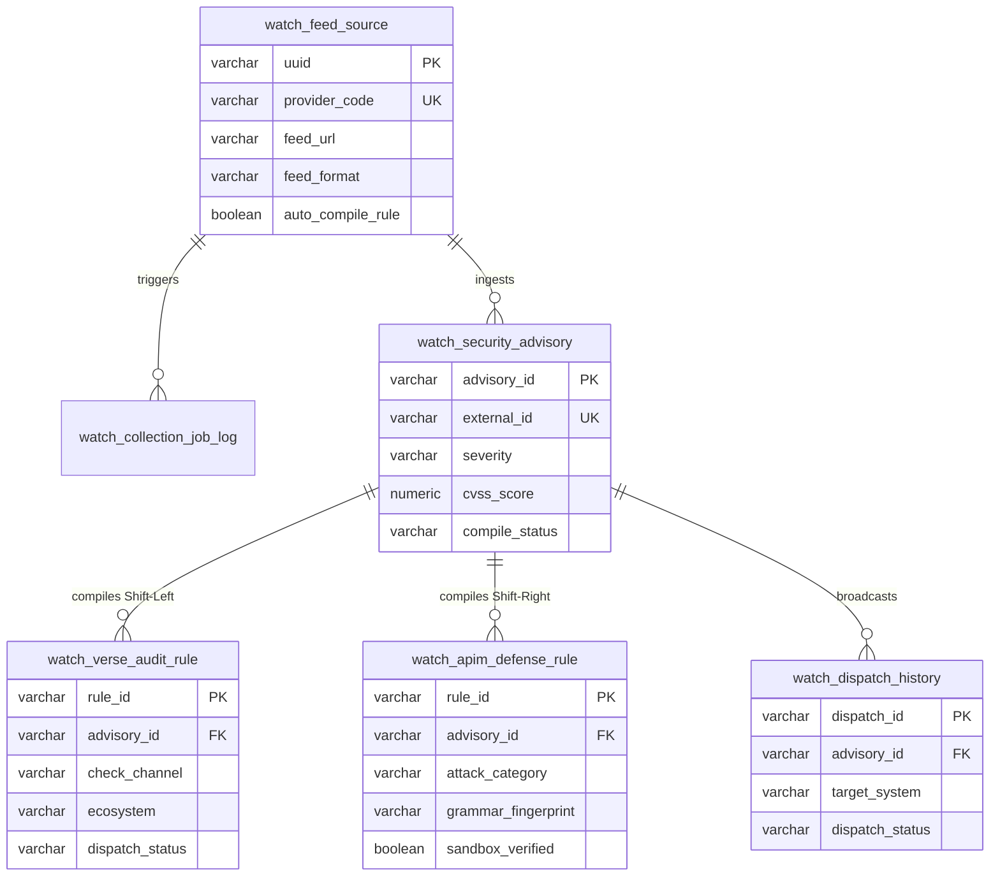

# SyncWatch DB 스키마 및 표준 REST/MCP API 명세

`SyncWatch`는 전사 6-File DB SSOT 데이터베이스 표준(`sync-watch/db/00_extensions.sql` ~ `05_sample_dev.sql`), **PostgreSQL 18.6 (`pgvector/pgvector:pg18`)**, 그리고 `/api/v1/watch/*` 단일 URL 매핑 원칙을 준수하여 **8대 글로벌 위협 피드(OSV.dev, GitHub GHSA, NVD CVE, CISA KEV, Nuclei, OWASP CRS, MITRE ATT&CK, KISA)** 수집부터 듀얼 룰 컴파일·배포까지의 전 주기를 영속화합니다.

---

## 1. 엔티티 관계도 (ER Diagram) 및 6대 도메인 테이블 (`watch_*`)



### 1.1 도메인 테이블 상세 명세 (`sync-watch/db/02_schema_domain.sql`)

| 순번 | 테이블명 | 역할 및 주요 컬럼 |
| :---: | :--- | :--- |
| **1** | **`watch_feed_source`** | **8대 글로벌 위협 피드 출처 마스터**<br>• PK: `uuid` / UK: `provider_code` (`OSV_DEV_FEED`, `GITHUB_GHSA`, `NVD_CVE_FEED`, `CISA_KEV_CATALOG`, `NUCLEI_TEMPLATES`, `OWASP_CRS_FEED`, `MITRE_ATTACK_STIX`, `KISA_BOHO_NOTICE`)<br>• 주요 컬럼: `provider_name`, `site_url`, `feed_url`, `feed_format` (`REST_JSON`, `YAML_NUCLEI`, `CRS_CONF`, `STIX_TAXII`, `RSS_XML`), `source_channel`, `auth_type`, `sync_interval_min`, `auto_compile_rule`, `auto_broadcast`, `enabled`, `last_sync_time`, `last_sync_status`, `last_sync_count`, `total_ingested_count` |
| **2** | **`watch_security_advisory`** | **정규화된 보안 이슈 원장**<br>• PK: `advisory_id`<br>• 주요 컬럼: `source_channel`, `feed_provider`, `external_id` (CVE/GHSA/KISA 번호), `cwe_id`, `mitre_code`, `title`, `severity` (`CRITICAL`, `HIGH`, `MEDIUM`, `LOW`), `cvss_score`, `exploit_status`, `affected_ecosystem`, `affected_packages`, `vulnerable_version_range`, `patched_version`, `summary_text`, `raw_payload_json` (`jsonb`), `matched_asset_count`, `matched_repo_count`, `compile_status` |
| **3** | **`watch_verse_audit_rule`** | **SyncVerse 공급용 보안 점검 룰 (`VerseAuditPack`)**<br>• PK: `rule_id` / FK: `advisory_id`<br>• 주요 컬럼: `external_id`, `rule_title`, `severity`, `check_channel` (`SCA_DEPENDENCY`, `SAST_CODE`, `DAST_PENTEST`), `ecosystem`, `package_name`, `vulnerable_version_range`, `patched_version`, `sast_pattern_regex`, `dast_probe_method`, `dast_probe_path`, `dast_probe_payload`, `remediation_guide_md`, `target_agent_code`, `verified`, `dispatch_status` |
| **4** | **`watch_apim_defense_rule`** | **SyncAPIM 공급용 공격 패턴 룰 (`ApimDefensePack`)**<br>• PK: `rule_id` / FK: `advisory_id`<br>• 주요 컬럼: `external_id`, `rule_name`, `attack_category` (`SQLI`, `XSS`, `SSRF`, `RCE`, `PATH_TRAVERSAL`), `mitre_tactic`, `severity`, `target_locations` (`HEADER,URI,QUERY,BODY`), `target_method`, `target_path`, `detection_regex`, `defense_expression`, `grammar_fingerprint`, `positive_samples_json`, `negative_samples_json`, `sandbox_verified`, `tp_rate`, `fp_rate`, `dispatch_status` |
| **5** | **`watch_dispatch_history`** | **전사 배포 및 적용 피드백 원장**<br>• PK: `dispatch_id` / FK: `advisory_id`<br>• 주요 컬럼: `target_system` (`SYNC_VERSE`, `SYNC_APIM`), `rule_id`, `target_endpoint_url`, `dispatch_mode` (`PUSH_BROADCAST`, `PULL_SYNC`), `dispatch_status`, `response_summary`, `dispatched_by`, `dispatched_time`, `feedback_time` |
| **6** | **`watch_collection_job_log`** | **수집 배치 및 진단 문서 업로드 실행 로그**<br>• PK: `job_id`<br>• 주요 컬럼: `provider_code`, `job_type` (`FEED_SYNC`, `DOC_UPLOAD`, `RULE_COMPILE`), `fetched_count`, `new_advisory_count`, `compiled_verse_rules`, `compiled_apim_rules`, `duration_ms`, `status`, `log_detail`, `executed_time` |

### 1.2 PostgreSQL 18.6 핵심 DDL 예시

```sql
-- sync-watch/db/02_schema_domain.sql
CREATE TABLE watch_apim_defense_rule (
    rule_id VARCHAR(64) PRIMARY KEY,
    advisory_id VARCHAR(64) NOT NULL REFERENCES watch_security_advisory(advisory_id),
    external_id VARCHAR(64) NOT NULL,
    rule_name VARCHAR(255) NOT NULL,
    attack_category VARCHAR(32) NOT NULL,
    mitre_tactic VARCHAR(32) NOT NULL DEFAULT 'T1190',
    severity VARCHAR(16) NOT NULL,
    target_locations VARCHAR(64) NOT NULL DEFAULT 'URI,QUERY,BODY',
    target_method VARCHAR(16) NOT NULL DEFAULT 'ANY',
    target_path VARCHAR(255) NOT NULL DEFAULT '/api/v1/*',
    detection_regex TEXT NOT NULL,
    defense_expression TEXT NOT NULL,
    grammar_fingerprint VARCHAR(128) NOT NULL,
    positive_samples_json JSONB NOT NULL,
    negative_samples_json JSONB NOT NULL,
    sandbox_verified BOOLEAN NOT NULL DEFAULT FALSE,
    tp_rate NUMERIC(5,2) NOT NULL DEFAULT 0.00,
    fp_rate NUMERIC(5,2) NOT NULL DEFAULT 0.00,
    dispatch_status VARCHAR(24) NOT NULL DEFAULT 'DRAFT',
    created_time TIMESTAMPTZ NOT NULL DEFAULT CURRENT_TIMESTAMP
);

CREATE INDEX idx_watch_apim_rule_category ON watch_apim_defense_rule (attack_category, severity);
CREATE INDEX idx_watch_apim_rule_fingerprint ON watch_apim_defense_rule USING gin (grammar_fingerprint gin_trgm_ops);
```

---

## 2. 표준 REST API 명세 (`/api/v1/watch/*`)

| 도메인 분류 | HTTP Method & Canonical URL | 설명 |
| :--- | :--- | :--- |
| **관측 대시보드** | `GET /api/v1/watch/overview` | 8대 수집 피드 가동 현황, 심각도별 보안 어드바이저리 통계, 듀얼 룰 컴파일·배포 지표 조회 |
| **피드 출처 관리** | `GET /api/v1/watch/feeds/list`<br>`GET /api/v1/watch/feeds/active`<br>`POST /api/v1/watch/feeds/add`<br>`PUT /api/v1/watch/feeds/edit`<br>`POST /api/v1/watch/feeds/test`<br>`POST /api/v1/watch/feeds/sync` | 8대 글로벌 보안 피드 출처 목록 조회·등록, 5단계 SSRF 가드 기반 연결 진단 및 즉시 동기화 실행 |
| **보안 어드바이저리** | `GET /api/v1/watch/advisories/list`<br>`GET /api/v1/watch/advisories/detail`<br>`POST /api/v1/watch/advisories/register`<br>`POST /api/v1/watch/advisories/upload`<br>`POST /api/v1/watch/advisories/compile`<br>`POST /api/v1/watch/advisories/match-sbom` | 정규화된 보안 이슈 원장 검색, 보안 진단 문서·번들 업로드 파싱, 듀얼 룰 컴파일 및 전사 SBOM 의존성 교차 매칭 |
| **듀얼 룰 & 샌드박스** | `GET /api/v1/watch/verse-rules/list`<br>`PUT /api/v1/watch/verse-rules/edit`<br>`GET /api/v1/watch/apim-rules/list`<br>`PUT /api/v1/watch/apim-rules/edit`<br>`POST /api/v1/watch/apim-rules/verify-sandbox` | `VerseAuditPack` 점검 룰 및 `ApimDefensePack` 방어 룰 조회·편집, Positive/Negative 샘플 기반 샌드박스 검증 |
| **보안 팩 & 전사 배포** | `GET /api/v1/watch/packs/verse`<br>`GET /api/v1/watch/packs/apim`<br>`POST /api/v1/watch/dispatch/broadcast`<br>`POST /api/v1/watch/dispatch/feedback`<br>`GET /api/v1/watch/dispatches/list`<br>`GET /api/v1/watch/dispatches/jobs` | `SyncVerse` 및 `SyncAPIM`용 보안 팩 조회(Pull), 실시간 브로드캐스트 배포(Push), 적용 피드백 수신 및 작업 로그 조회 |
| **MCP 서버 & 메뉴 인가** | `GET /api/v1/watch/mcp/tools`<br>`POST /api/v1/watch/mcp`<br>`GET /api/v1/watch/sys/permission/getUserPermissionByToken` | JSON-RPC 2.0 MCP 도구 목록·실행 및 현재 인증 사용자의 역할(`role_admin`, `role_secops`) 동적 메뉴 트리 반환 |

### 2.1 샌드박스 검증 요청 및 응답 예시 (`POST /api/v1/watch/apim-rules/verify-sandbox`)

```json
{
  "code": 200,
  "success": true,
  "result": {
    "ruleId": "arule-sqli-union-001",
    "sandboxVerified": true,
    "tpRate": 100.0,
    "fpRate": 0.0,
    "avgEvaluationTimeMs": 0.08,
    "maxEvaluationTimeMs": 0.21,
    "dispatchStatus": "READY"
  }
}
```

---

## 3. MCP (Model Context Protocol) 노출 도구 명세 (`/api/v1/watch/mcp`)

`SyncWatch`는 타 에이전트(`SyncVerse`, `SyncAPIM`, `SyncInsight`)가 A2A 프로토콜로 위협 인텔리전스를 즉시 조회하거나 룰 컴파일·배포를 트리거할 수 있도록 표준 MCP 도구를 노출합니다.

| MCP 도구명 | 주요 파라미터 | 기능 설명 |
| :--- | :--- | :--- |
| **`watch_sync_security_feeds`** | `providerCode` (선택) | 8대 글로벌 위협 피드(OSV.dev, GitHub GHSA, NVD CVE, CISA KEV, Nuclei, OWASP CRS, MITRE ATT&CK, KISA) 동기화 및 정규화 실행 |
| **`watch_compile_dual_rules`** | `advisoryId` | 단일 보안 이슈로부터 `SyncVerse` 점검 룰(`VerseAuditPack`) 및 `SyncAPIM` 공격 패턴(`ApimDefensePack`)을 동시 컴파일하고 샌드박스 검증 실행 |
| **`watch_dispatch_to_verse_and_apim`** | `advisoryId`, `targetSystem` | 검증 완료된 보안 점검 룰 및 WAF 가상 패치 룰을 `SyncVerse`와 `SyncAPIM`으로 즉시 브로드캐스트 배포 |
| **`watch_match_enterprise_sbom`** | `ecosystem` (선택) | 전사 마이크로서비스 SBOM 패키지와 취약점 원장을 교차 매칭하여 영향 자산·리포지토리 산출 |
| **`delegate_intent`** | `intent`, `instruction` | A2A 자연어 보안 인텔리전스 수집·컴파일·전사 배포 위임 실행 |

### 3.1 JSON-RPC 2.0 MCP 호출 페이로드 예시

```json
{
  "jsonrpc": "2.0",
  "id": "watch-rpc-901",
  "method": "tools/call",
  "params": {
    "name": "watch_compile_dual_rules",
    "arguments": {
      "advisoryId": "adv-cve-2026-41892"
    }
  }
}
```
