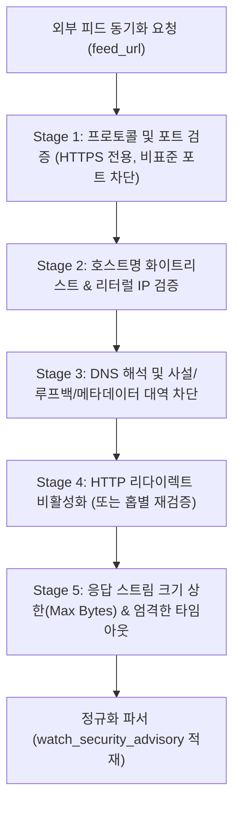

# SyncWatch 시스템 아키텍처 및 듀얼 룰 컴파일러

`SyncWatch`는 외부 위협 인텔리전스를 안전하게 반입하고, 오탐(False Positive) 없는 고신뢰 점검·방어 규칙으로 변환하기 위해 **다채널 정규화 수집기**, **5단계 SSRF 가드**, **`WatchRuleCompilerService` 듀얼 컴파일러**, 그리고 **자체 샌드박스 검증기**로 구성됩니다.

---

## 1. 6대 위협 수집 채널 및 7대 글로벌 피드 정규화

`SyncWatch`는 다양한 포맷(`REST_JSON`, `STIX_TAXII`, `YAML_NUCLEI`, `CRS_CONF`, `RSS_XML`, `DOCUMENT_UPLOAD`)의 보안 정보를 단일 표준 원장(`watch_security_advisory`)으로 정규화합니다.

| 수집 채널 (`source_channel`) | 대표 공급자 (`provider_code`) | 수집 포맷 | 주요 정규화 추출 항목 |
| :--- | :--- | :--- | :--- |
| **1. 글로벌 CVE 데이터베이스** | `NVD_CVE_FEED` (NIST NVD) | `REST_JSON` | CVE ID, CVSS v3.1 점수, CWE 코드, 영향 받는 CPE/패키지 버전 범위 |
| **2. 실전 악용 확인 취약점** | `CISA_KEV_CATALOG` (CISA KEV) | `REST_JSON` | 실제 해킹에 악용 중인 취약점(`ACTIVE_EXPLOIT`), 필수 조치 기한, 완화 지침 |
| **3. 오픈소스 생태계 권고** | `OSV_DEV_FEED`, `GITHUB_GHSA` | `REST_JSON` | `MAVEN`, `NPM`, `PYPI`, `GO` 패키지별 취약 버전 범위 및 패치 완료 버전 |
| **4. 모의해킹·취약점 스캐너 템플릿** | `NUCLEI_TEMPLATES` | `YAML_NUCLEI` | HTTP 요청 메소드·경로, 공격 페이로드 프로브, 매처(Matcher) 정규식 |
| **5. 웹 방화벽 핵심 룰셋** | `OWASP_CRS_FEED` | `CRS_CONF` | SQLi/XSS/RCE/LFI 탐지 정규식, 타깃 위치(`HEADER`, `URI`, `QUERY`, `BODY`), 구문 지문 |
| **6. 국내 보안 권고 및 진단 문서** | `KISA_BOHO_NOTICE`, 사내 진단서 업로드 | `RSS_XML` / `DOC` | KISA 보안 공지, 외부 모의해킹 결과 보고서(PDF/Markdown) 파싱 및 정규화 |

---

## 2. 5단계 SSRF 방어 가드 (5-Stage SSRF Defense Guard)

외부 피드 URL을 동기화하거나 웹훅으로 보안 권고를 수집할 때 내부망 침투(SSRF) 공격에 악용되지 않도록, `SyncWatch`의 모든 아웃바운드 수집 요청은 **5단계 SSRF 방어 가드**를 통과해야 합니다.

1. **Stage 1 — 스킴 및 포트 강제**: `https://` 스킴(기본 443 포트)만 허용하며 `file://`, `gopher://`, `ftp://`, `ldap://` 등 비표준 스킴을 즉시 차단합니다.
2. **Stage 2 — 등록 공급자 도메인 검증**: `watch_feed_source`에 등록·승인된 공급자 도메인 여부를 확인하고, URL 내 사용자 자격증명(`user:pass@host`) 삽입을 거부합니다.
3. **Stage 3 — DNS Rebinding 및 사설 대역 차단**: 소켓 연결 직전 DNS를 해석하여 루프백(`127.0.0.0/8`, `::1`), 사설망(`10.0.0.0/8`, `172.16.0.0/12`, `192.168.0.0/16`), 링크 로컬 및 클라우드 메타데이터(`169.254.169.254`) IP로 해석될 경우 즉시 연결을 거부합니다.
4. **Stage 4 — 리다이렉트(3xx) 체인 통제**: 무분별한 오픈 리다이렉트를 통한 내부망 우회를 막기 위해 자동 리다이렉트를 비활성화하거나 모든 이동 대상 URL에 대해 1~3단계를 재수행합니다.
5. **Stage 5 — 페이로드 폭탄 방어**: 응답 `Content-Type` 검증과 함께 최대 수신 바이트 상한(예: 10MB) 및 읽기 타임아웃을 강제하여 메모리 고갈(OOM)을 방지합니다.

---

## 3. `WatchRuleCompilerService` 듀얼 룰 컴파일 및 자체 샌드박스 검증

정규화된 보안 어드바이저리(`watch_security_advisory`)가 적재되면, `WatchRuleCompilerService`는 이를 분석하여 두 가지 실행 가능한 보안 룰로 동시 컴파일합니다.

### 3.1 듀얼 컴파일 산출물
* **Shift-Left 점검 룰 (`watch_verse_audit_rule` → `VerseAuditPack`)**:
  - **SCA 의존성 규칙 (`SCA_DEPENDENCY`)**: 생태계(`MAVEN`, `NPM` 등), 패키지 좌표(`package_name`), 취약 버전 범위(`vulnerable_version_range`), 안전한 패치 버전(`patched_version`)을 명세합니다.
  - **SAST 정적 코드 규칙 (`SAST_CODE`)**: 취약한 API 호출이나 안전하지 않은 역직렬화·쿼리 조합을 소스코드 AST/라인에서 찾아내는 정규식(`sast_pattern_regex`)과 수정 가이드(`remediation_guide_md`)를 포함합니다.
  - **DAST 모의해킹 프로브 (`DAST_PENTEST`)**: 격리된 스테이징 환경에서 취약점 재현 여부를 점검하는 HTTP 메소드(`dast_probe_method`), 경로(`dast_probe_path`), 페이로드(`dast_probe_payload`)를 생성합니다.
* **Shift-Right 방어 룰 (`watch_apim_defense_rule` → `ApimDefensePack`)**:
  - **구문 토큰 지문 (`grammar_fingerprint`)**: `SqlXssLexicalTokenizer`가 추출하는 SQLi/XSS 문법 토큰 시퀀스 지문(예: `s&1`, `sUE`, `;k`, `x_script`)을 매핑합니다.
  - **위치별 정밀 정규식 (`detection_regex` & `target_locations`)**: `HEADER`, `URI`, `QUERY`, `BODY` 중 검사가 필요한 타깃 위치와 엔드포인트 경로 패턴(`target_path`)을 지정합니다.
  - **Restricted SpEL 방어 표현식 (`defense_expression`)**: `SimpleEvaluationContext` 기반의 안전한 샌드박스 표현식으로 복합 조건(헤더 + 쿼리 + 구문 지문 조합)을 평가합니다.

### 3.2 자체 격리 샌드박스 검증 (Self-Sandbox Verification)
컴파일된 모든 `watch_apim_defense_rule`은 전사 배포 전 반드시 자체 샌드박스 검증기를 통과해야 합니다:
1. **Positive Samples 검증 (`positive_samples_json`)**: 실제 공격 벡터 샘플을 주입하여 100% 탐지(`tp_rate = 100.00`)되는지 확인합니다.
2. **Negative Samples 검증 (`negative_samples_json`)**: 정상적인 비즈니스 API 요청 샘플을 주입하여 오탐이 0건(`fp_rate = 0.00`)인지 확인합니다.
3. **ReDoS 타임아웃 검증**: 정규식 및 SpEL 평가 시간이 단건당 `0.5ms`를 초과하지 않는지 측정하며, 검증을 통과한 룰만 `sandbox_verified = true`, `dispatch_status = 'READY'` 상태로 승격됩니다.
