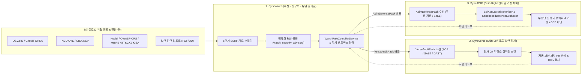
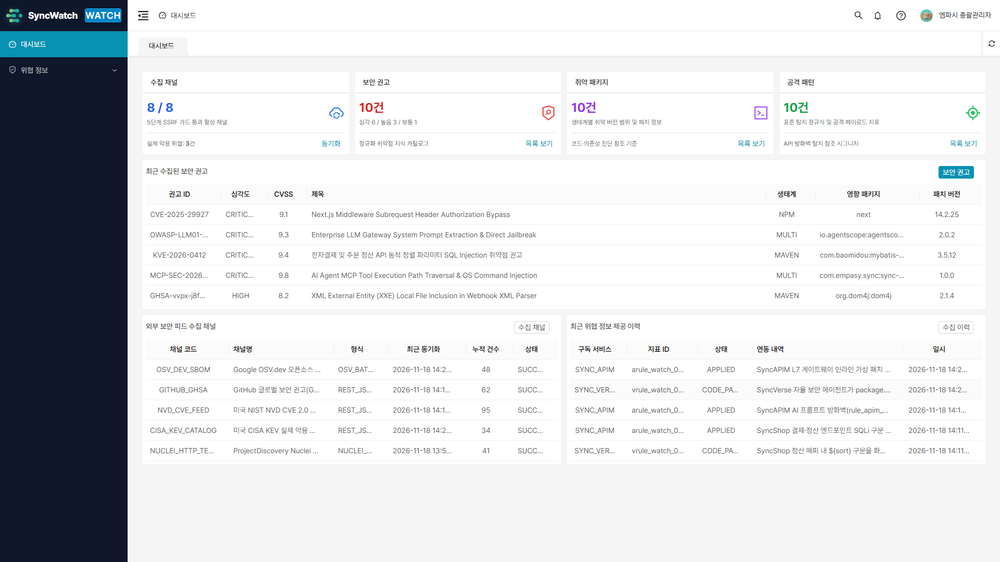
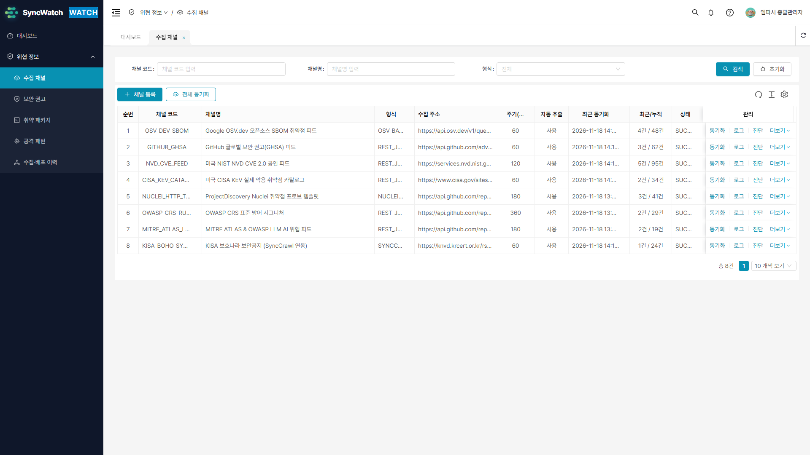
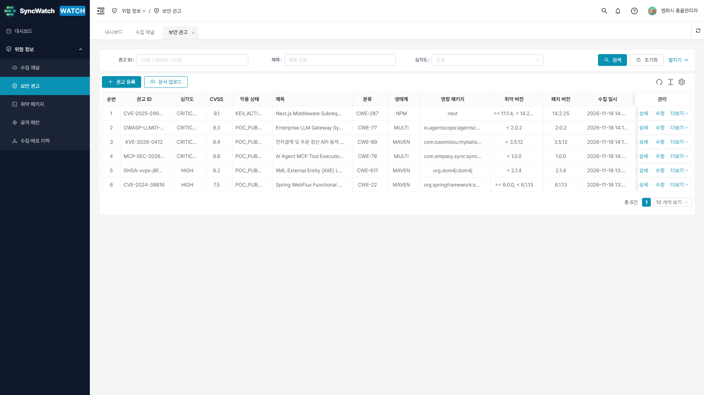
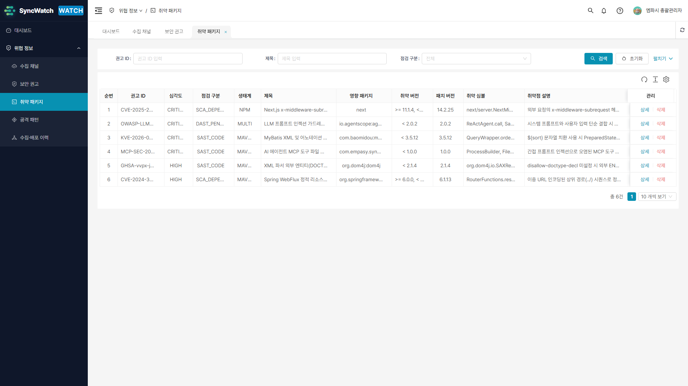
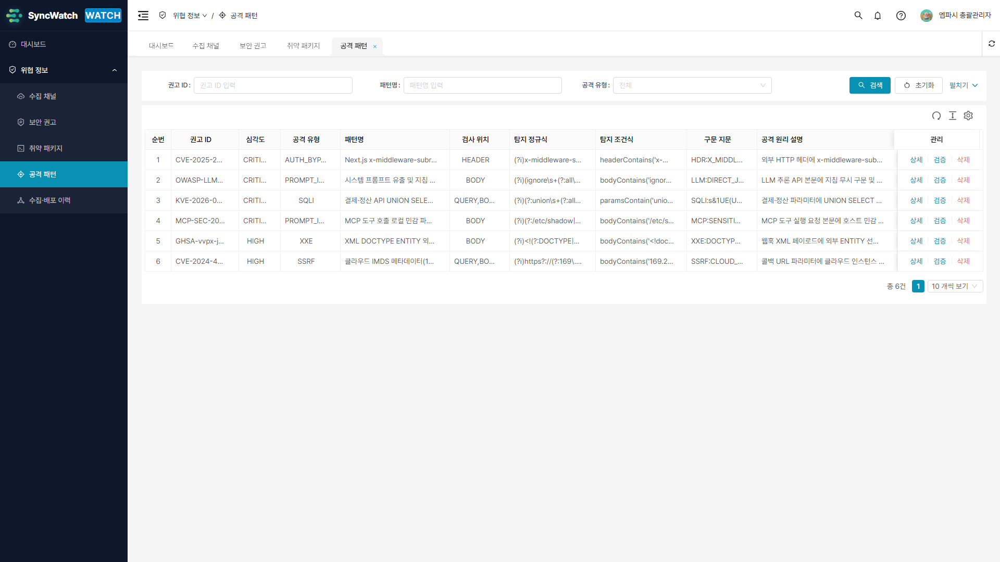
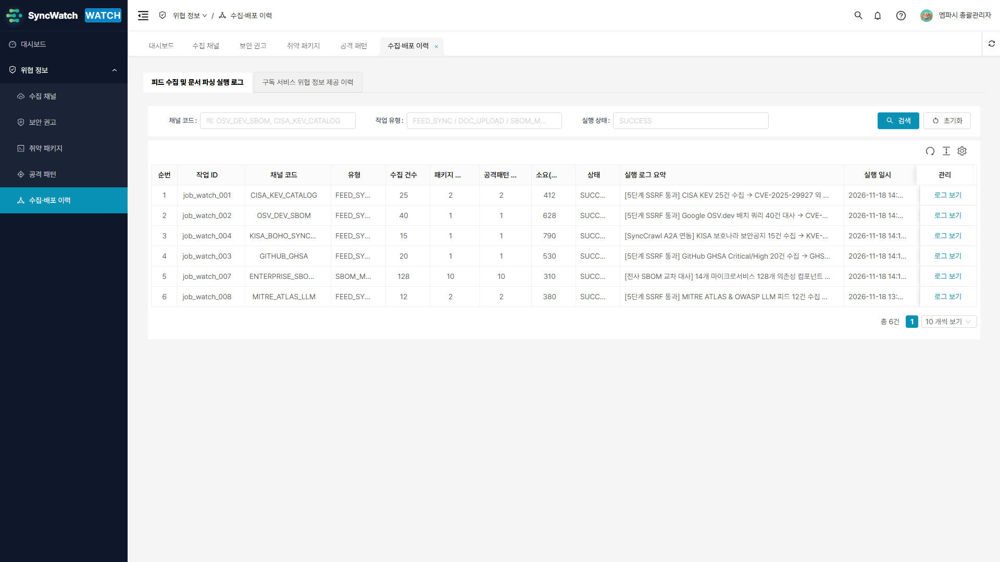

# SyncWatch 개요 (AI Security Threat Intelligence & Rule Compiler Agent)

> **비개발자 · 도입 검토 안내**: 쉬운 제품 소개는 [SyncWatch 제품 홈페이지(empasy.io)](https://empasy.io/ko/solutions/sync-watch.html){target="_blank" rel="noopener"}에서, 설치 없는 화면 체험은 [통합 데모 포털](https://demo.empasy.io/products/sync-watch/#demo){target="_blank" rel="noopener"}에서 이용하실 수 있으며, 소개서·제안서 PDF는 [제안서 자료실](/proposals/)에서 내려받으실 수 있습니다.

**SyncWatch (`SYNC_WATCH`, `com.empasy.sync.watch`)**는 **8대 글로벌 위협 피드(OSV.dev, GitHub GHSA, NVD CVE, CISA KEV, Nuclei, OWASP CRS, MITRE ATT&CK, KISA)**와 기업 내부 보안 진단 문서를 단일 허브로 수집·정규화하여, **SyncVerse**에는 코드·의존성·모의해킹 보안 점검 팩(**`VerseAuditPack`**)을, **SyncAPIM**에는 런타임 공격 패턴 방어 팩(**`ApimDefensePack`**)을 실시간 컴파일·배포하는 **전사 보안 관측소(Security Threat Observatory & Dual Rule Compiler)**입니다.

---

## 1. 핵심 제원 및 접속 정보

| 항목 | 표준 명세 |
| :--- | :--- |
| **에이전트 식별 코드** | `SYNC_WATCH` (`sync-watch`) |
| **Maven 좌표계** | `com.empasy.sync.watch:sync-watch-server` (Spring Boot 4.0.x, JDK 25) |
| **표준 API Prefix** | `/api/v1/watch/*` (권한 API: `/api/v1/watch/sys/permission/getUserPermissionByToken`) |
| **Admin 관리 콘솔** | 로컬: `http://localhost:3107` / 클라우드: `https://watch-admin.empasy.io` |
| **백엔드 API & 홈페이지** | 로컬: `http://localhost:18087/api/v1/watch` / 클라우드: `https://empasy.io/ko/solutions/sync-watch.html` |
| **데이터베이스** | PostgreSQL 18.6 (`sync_watch`, 6대 도메인 테이블 `watch_*`) |

---

## 2. 3각 자율 DevSecOps 보안 아키텍처 (Triad Autonomous DevSecOps)

SyncSeries는 신규 제로데이 취약점이나 보안 권고가 발표되었을 때, 보안 담당자의 수동 분석과 정규식 작성으로 인해 발생하는 방어 공백(Window of Exposure)을 제거하기 위해 **SyncWatch → SyncVerse → SyncAPIM**으로 이어지는 3각 자율 DevSecOps 루프를 운영합니다.

1. **SyncWatch (Threat Ingestion & Dual Rule Compilation)**:
   - 외부 위협 피드와 보안 진단 문서를 수집하여 CWE, MITRE ATT&CK, 생태계(`MAVEN`, `NPM`, `PYPI`, `DOCKER` 등) 기준으로 정규화합니다.
   - 하나의 보안 이슈 원장에서 개발 단계 점검용 `VerseAuditPack`과 운영 게이트웨이 방어용 `ApimDefensePack`을 동시에 컴파일하고, 격리 샌드박스에서 공격 샘플(Positive)과 정상 샘플(Negative)을 대조 검증합니다.
2. **SyncVerse (Shift-Left Code Security Audit & Auto-Patch PR)**:
   - 수신한 `VerseAuditPack`을 기반으로 전사 마이크로서비스 저장소의 의존성 버전(`SCA_DEPENDENCY`), 소스코드 취약 패턴(`SAST_CODE`), 샌드박스 엔드포인트 모의해킹(`DAST_PENTEST`)을 자동 수행하고 패치 Pull Request를 생성합니다.
3. **SyncAPIM (Shift-Right Runtime Defense & Pinpoint Virtual Patching)**:
   - 코드 패치가 운영에 배포되기 전이라도, 수신한 `ApimDefensePack`을 `SqlXssLexicalTokenizer`(구문 토큰 지문 분석기)와 `SandboxedDefenseEvaluator`(핀셋 가상 패치 평가기)에 무중단 핫스왑 적용하고 커널 eBPF로 공격원을 즉시 차단합니다.

---

## 실제 구동 화면 및 핵심 워크플로우

### 1. 글로벌 보안 위협 인텔리전스 수집 및 관측 대시보드
OSV.dev, GitHub GHSA, NVD CVE, CISA KEV, Nuclei, OWASP CRS, MITRE ATT&CK, KISA 등 8대 글로벌 위협 피드의 실시간 수집 현황과 심각도 분포를 통합 관제합니다.

### 2. 8대 공인 보안 피드 수집 채널 및 연결 진단
외부 보안 피드 수집 채널의 폴링 스케줄, 5단계 SSRF 방어 가드 연결 진단, 즉시 동기화 및 수집 배치 실행 상태를 관리합니다.

### 3. 정규화 보안 권고 원장 및 전사 SBOM 매칭 분석
다양한 포맷의 외부 보안 권고와 진단 문서를 단일 표준 스키마로 정규화하고 영향받는 패키지 생태계와 전사 SBOM 영향도를 분석합니다.

### 4. 생태계별 취약 패키지 및 코드 보안 점검 기준
개발 관제탑에 공급되는 의존성 버전 범위(SCA), 정적 코드 패턴(SAST), 동적 런타임 프로브(DAST) 점검 기준과 취약 심볼 명세를 관리합니다.

### 5. 런타임 공격 패턴 및 샌드박스 정/오탐 검증
API 보안 게이트웨이에 공급되는 HTTP 검사 위치, 탐지 정규식, 방어 조건식 및 샌드박스 무오탐 검증(TP 100%, FP 0%) 결과를 관리합니다.

### 6. 피드 수집·파싱 실행 로그 및 전사 배포 이력
수집·컴파일·샌드박스 검증 배치 실행 로그와 구독 서비스 대상 위협 정보 브로드캐스트 제공 이력을 투명하게 추적합니다.

---

## 3. 문서 구성 안내

* **[아키텍처 및 듀얼 룰 컴파일러](./architecture)**: 8대 글로벌 위협 피드 수집 채널, 5단계 SSRF 방어 가드, `WatchRuleCompilerService` 듀얼 룰 컴파일 및 자체 샌드박스 검증 메커니즘을 설명합니다.
* **[SyncVerse & SyncAPIM 연동 프로토콜](./devsecops-protocol)**: `VerseAuditPack` 및 `ApimDefensePack` 데이터 계약과 실시간 브로드캐스트·피드백 프로토콜을 다룹니다.
* **[DB 스키마 및 REST/MCP API 명세](./api-and-schema)**: 6대 `watch_*` 테이블 DDL 규격과 `/api/v1/watch/*` REST API 및 MCP 도구를 안내합니다.
